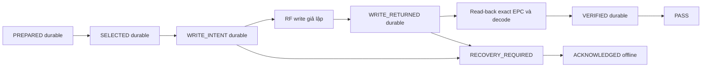

# Kiến trúc Pha 1

Ngày 2026-10-31, branch `feature/fx9600-phase1-safety`. Chỉ triển khai và kiểm tra
cục bộ. **Ghi RFID production bị khóa; chưa được deploy hoặc nghiệm thu phần cứng.**
Baseline phát hiện: [technical audit](../technical-audit-autostart-health.md).

## Nhận diện tag và SDK

`PhysicalTagIdentity` là policy thuần Java cho các observation EPC/full serialized
TID. Hai TID khác nhau dù cùng EPC đều bị từ chối; cùng TID nhưng EPC không ổn định,
không có tag, thiếu TID/serial hoặc discovery chưa xác minh cũng bị từ chối.
Các cờ `fullSerializedTid`/`discoveryVerified` là bằng chứng do adapter đáng tin cậy
cung cấp, **không phải parser chứng minh TID MR6P đầy đủ**. Hiện chỉ test fake cấp
các cờ đó. Không suy completeness từ độ dài chuỗi HEX hoặc một lần đọc theo EPC.
TID không chống được clone; vẫn cần enclosure/antenna và ground truth vật lý.

Gateway mặc định `supportsVerifiedIdentityAccess=false`. `RfidGateway` production
không override giá trị này; cả select/write/read đều ném
`HARDWARE_VERIFICATION_REQUIRED`, trước mọi inventory/access. Các lệnh RF write
theo EPC cũ đã được loại khỏi adapter. Không có config/env để bật đường TID.
Gateway giả lập được bật chỉ trong test; contract yêu cầu write và read dùng cùng
physical identity xuyên suốt lúc EPC đổi. Chưa có adapter phần cứng đáp ứng contract.
Workflow vẫn chặn old EPC khác 20 HEX (80 bit); không ghi PC hoặc đổi memory layout.

Reflection public API của **JAR cục bộ**, không gọi SDK/native:

| API hiện có | Điều chưa chứng minh |
|---|---|
| `writeWait(String, WriteAccessParams, AntennaInfo)`; `readWait(String, ReadAccessParams, AntennaInfo)` | Chọn bằng String EPC; không có overload `bTIDPrefilter` trong JAR này. Chưa chứng minh prefilter TID được synchronous access tôn trọng. |
| `writeEvent(WriteAccessParams, AccessFilter, AntennaInfo)`; `readEvent(ReadAccessParams, AccessFilter, AntennaInfo)` | Có surface cho hướng khảo sát bất đồng bộ, chưa có bằng chứng filtering đủ serial, correlation, completion, timeout/cancel và cleanup trên FW 3.32.37. |
| `PreFilters`/`AccessFilter.TagPatternA/TagPatternB` | Tồn tại API không chứng minh khám phá hết hai tag trùng EPC hoặc lựa chọn ổn định sau đổi EPC. |

[Zebra Android TagAccess](https://techdocs.zebra.com/dcs/rfid/android/2-0-5-292/apis/com/zebra/rfid/api3/tagaccess)
và [AccessFilter](https://techdocs.zebra.com/dcs/rfid/android/2-0-5-292/apis/com/zebra/rfid/api3/accessfilter)
chỉ là tài liệu đối chiếu về API khác package/version, **không phải contract Embedded
`com.mot.rfid.api3` của FX9600**. Cần JavaDoc đúng JAR và SAT trước implementation tiếp.

## Journal và thứ tự durable

`transaction.journal` mặc định `rfid-transactions.journal`, tương đối theo working
directory ổn định. Không dùng `/tmp`. Thư mục phải private, persistent, cùng filesystem
cho journal/checkpoint. Không tự tạo thư mục cha hoặc sửa quyền thiết bị.

| File | Vai trò |
|---|---|
| `.journal` | Header version `FXJNL01`, append-only records: length, payload, SHA-256; payload chứa previous hash và sequence. Giới hạn một record 16 KiB. |
| `.journal.head` | Checkpoint 72 byte: sequence + hash cuối + checksum; phát hiện mất nguyên record/prefix hoàn chỉnh. |
| `.journal.head.pending` | File tạo bằng CREATE_NEW, force trước atomic rename sang head. Tồn tại lúc startup = gate, giữ nguyên để điều tra. |
| `.journal.fault` | Latch lỗi I/O cố ghi/force bằng kênh độc lập. Không tự xóa hoặc cho ACK trực tiếp. |
| `recovery.marker` cũ | Giữ nguyên nội dung; nhập vào journal dưới dạng legacy recovery với hash/metadata nhận diện. |

Mỗi record chứa transaction UUID, boot UUID của lần mở journal, barcode nguyên bản,
old EPC, expected EPC, TID nếu đã xác định, stage, write/verify outcome, error code,
`tagMayHaveChanged`, thời gian epoch-ms và acknowledgement/reference. Boot ID có thể
đổi ở record ACK sau restart; txId giữ nguyên. Thứ tự dựa sequence, không dựa đồng hồ
wall time. GRN chưa có mapping ngoài barcode; không tuyên bố xác minh chứng từ bên ngoài.



Mỗi append: ghi frame → `FileChannel.force(true)` → ghi/force head.pending →
atomic rename thay head → force directory trên Linux → công bố record trong RAM.
Không fallback sang rename không atomic. Chỉ sau read-back khớp bytes/decode và
VERIFIED cùng checkpoint durable mới phát PASS. Mọi exception sau WRITE_INTENT đều
conservative: giữ changed=true kể cả adapter ném lỗi tự khai changed=false.
WRITE_RETURNED chỉ nghĩa lời gọi write đã trả về; chưa đủ để PASS.

Một lỗi append/fsync/checkpoint khóa ngay process; cố tạo `.fault`. Nếu cả kênh latch
cũng lỗi, checkpoint cũ/pending record vẫn giữ evidence. Không chứng nhận storage
khi đồng thời mất cả bộ evidence hoặc filesystem vi phạm force/rename. Không thể
phát hiện privileged rollback/xóa đồng bộ cả journal và checkpoint bằng checksum.

Startup quét toàn journal với allocation giới hạn theo record, kiểm tra checksum,
hash chain, sequence/transitions rồi so head. File rỗng đã tồn tại, truncated tail,
truncated đúng boundary, thiếu/corrupt head, pending head hoặc fault latch đều khóa.
Không truncate, bỏ qua tail, tự dựng head hay replay. Journal bị mất nhưng còn
sidecar, không lấy được file lock/quyền mở file: startup từ chối, không chạy ghi.
Nếu journal mở được nhưng hỏng, API vẫn phục vụ `recoveryRequired=true`, safe=false.

Không rotation/retention tự động trong Pha 1; file tăng dần, startup scan O(số record),
RAM O(một record). Disk full gây gate. Cần ngân sách flash/dung lượng trước deploy.
Thư mục phải có ACL hạn chế hoặc quyền Linux 0700/umask 077 do commissioning đặt;
Java không tự provision ACL. Log công khai không in barcode/EPC/raw SDK detail;
API read-only hiện vẫn giữ các trường barcode/EPC để tương thích, cần LAN policy.

## Recovery và acknowledgement

Unresolved record khi startup luôn chặn scan/trigger. Scan mới, tick 5 giây, hết hạn
barcode, reconnect và reboot không resolve record. Giao dịch đang chạy hợp lệ có
safe=false; khi kết thúc bất định hoặc restart mới trở thành recoveryRequired.
Không có tự replay write. `FAILED_SAFE` chỉ trước durable write intent; không suy
ra an toàn từ tên exception. `.fault`/journal hỏng **không được ACK bằng CLI này**.

Legacy marker được fingerprint bằng nội dung + metadata; ACK lưu fingerprint,
marker được giữ nguyên. Marker không đổi đã ACK không tạo incident mới; marker
khác tạo recovery mới. Không chạy binary cũ song song hoặc rollback trước Pha 1:
binary cũ không biết journal/checkpoint, không tôn trọng lock/gate mới.

Workflow manual quarantine, chưa xác minh bằng sensor/RF:

1. Dừng trạm/supervisor; xác nhận không còn process điều khiển cùng reader. Việc JVM
   chết không chứng minh RF/session server-side đã dừng; operator phải xác minh riêng.
2. Cách ly toàn bộ tag nghi vấn; đọc/đối soát độc lập theo quy trình đã phê duyệt,
   gắn incident/reference với txId, TID/EPC nếu biết. Xác nhận box trống và không tag
   nghi vấn được đưa lại vào sản xuất. ACK không kết luận write trước thành công.
3. Chỉ khi journal/checkpoint khỏe, dùng lệnh offline sau (ví dụ, **không chạy trên
   reader trong nhiệm vụ này**):

```sh
java -cp "fx9600-writing-box.jar:Symbol.RFID.API3.jar" org.fus.Main \
  --ack-recovery station.properties TRANSACTION_UUID \
  QUARANTINED_BOX_EMPTY operator/INCIDENT-123 OFFLINE
```

CLI lấy lock độc quyền trên đúng journal; từ chối stale txId, transaction đã resolve,
disposition sai, reference không hợp lệ, journal hỏng hoặc process giữ lock.
ACK là record append+checkpoint durable, giữ nguyên outcome/error/changed cũ. CLI
không mở scanner, HTTP hay SDK; không tự ghi/read tag. Không xác thực danh tính
operator điện tử: quyền OS và evidence ngoài là trust boundary, còn cần SAT.

Journal hỏng/fault/pending checkpoint: dừng và giữ nguyên toàn bộ bộ file, sao lưu
offline có kiểm soát, cách ly tag, điều tra/đối soát bằng công cụ được review riêng.
Không sửa header, xóa sidecar hoặc tạo journal mới để vượt gate. Chưa có tool repair
tự động được nghiệm thu; trường hợp này BLOCKED cho vận hành.

## Concurrency, shutdown và API

Một worker; reservation có AtomicBoolean chạy tối đa một lần. Disconnect/shutdown
đổi generation; scan khi writing bị từ chối; kiểm tra generation trước write và
trước durable success. Abort reservation tạo record gate nếu journal còn ghi được.
Main dừng GPI/session polling khi worker đang chạy, đợi worker trước thay gateway
hoặc disconnect/Dispose. Deadline halt trực tiếp, không chờ status/log lock. Shutdown
giữ process lock đến khi JVM thực sự thoát; không giải phóng cho worker đang treo.
Connect/GPI/dispose/CDC close ngoài transaction vẫn có thể treo: chưa giải quyết Pha 2.

API mở sau safety snapshot ban đầu. Các trường additive: `recoveryRequired`,
`safeToTrigger`, `transactionId`, `safetyReason`. ID để trống lúc reserve rồi cập nhật
ngay sau PREPARED; với journal hỏng, ID chỉ là record cuối đọc được, không dùng để
vượt kiểm tra healthy của ACK. Safety lease tối đa 250 ms và không quá validity còn
lại của barcode; HTTP snapshot tự từ chối safe khi lease hết dù GPI/tick treo.
Lease không phải benchmark hay xác minh health vật lý. Production luôn safe=false
vì adapter chưa verified. Không có HTTP control/ack. ESP32 chưa đổi UI/schema trong Pha 1.
