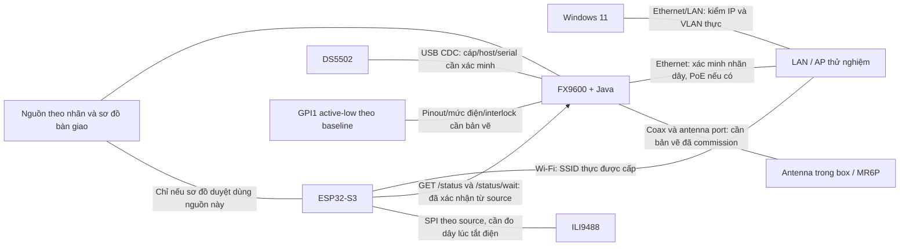

# FX9600 Writing Box — Hướng dẫn kiểm thử tại thiết bị

Ngày soạn: **2026-10-31, Asia/Saigon (UTC+07:00)**. Tài liệu thao tác cho kỹ thuật viên Windows/SSH. **Chưa chạy test phần cứng; mọi ô kết quả ban đầu là NOT RUN.**

## Mục lục

1. [Mục đích và phân loại quyền thực hiện](#s1)
2. [Danh sách thiết bị và sơ đồ kết nối](#s2)
3. [Thông tin cần điền trước khi test](#s3)
4. [Chuẩn bị Windows / Network / SSH](#s4)
5. [FX9600 hardware preflight](#s5)
6. [Scanner DS5502 tests](#s6)
7. [ESP32 build / firmware / UI tests](#s7)
8. [Plug & Play / AutoStart tests](#s8)
9. [Realtime health tests](#s9)
10. [Latency measurement](#s10)
11. [RFID read-only verification](#s11)
12. [RFID write SAT — gated, chưa được phép thực hiện](#s12)
13. [Troubleshooting theo triệu chứng](#s13)
14. [Rollback và stop conditions](#s14)
15. [Evidence collection](#s15)
16. [Checklist bàn giao và kết luận SAT](#s16)

<a id="s1"></a>
## 1. Mục đích và phân loại quyền thực hiện

Mục tiêu: xác định đúng thiết bị, quan sát trạng thái thật, thử lỗi an toàn trên bench đã được duyệt, đo độ trễ bằng bằng chứng có đồng hồ chung và bàn giao kết quả có thể review. Đây là hướng dẫn **chuẩn bị và thực hiện SAT có điều kiện**, không cấp quyền deploy hay ghi RFID.

| Nhãn | Được làm gì | Điều kiện bắt buộc |
|---|---|---|
| READ-ONLY | Đọc nhãn, tài liệu, sysfs, metadata, process, GET API đang chạy | Quyền quan sát đúng thiết bị/mạng; không mở owner SDK/CDC khác |
| LOCAL | Build/đọc artifact, phân tích CSV trên laptop | Tool đã được cấp; output riêng; không nối điều khiển thiết bị |
| BENCH APPROVAL REQUIRED | Quét mã, rút/cắm cáp, đổi mạng thử nghiệm, upload/reboot/stop/crash có điều kiện | Phiếu phê duyệt nêu test ID, serial, hành động, thời gian, người giám sát, rollback; độc quyền bench |
| BLOCKED | Chỉ thu thông tin để gỡ blocker | `HARDWARE/VENDOR CONFIRMATION REQUIRED`; chưa được thực hiện hành động gây lỗi/đổi trạng thái |

**Thứ tự:** PRE → NET → FX → SCN identity → ESP artifact/UI → health/latency được duyệt → AUTO khi gỡ blocker → RF read-only khi có công cụ đã review. Phần ghi RFID luôn là mission riêng.

Các case BENCH vẫn BLOCKED nếu thiếu một điều kiện trước khi thử. Chưa có quyền thì ghi NOT RUN; biết thiếu điều kiện cụ thể thì ghi BLOCKED và chỉ rõ bằng chứng cần bổ sung. Không dùng PASS của Phase 1–4 làm kết quả thiết bị hiện trường.

**Điểm cần hiểu trước khi bắt đầu:**

- Production `RfidGateway.selectUnique/write/read` đều chặn `HARDWARE_VERIFICATION_REQUIRED`; không có cờ cấu hình mở đường TID. `safeToTrigger=false` là kết quả đúng của baseline này.
- Scanner plain CDC có thể `CONNECTED`, `readiness=UNKNOWN`, `safeToOperate=false`, `reason=CDC_LIVENESS_UNVERIFIED` dù vừa quét được. `usbPresence=UNKNOWN` không có nghĩa scanner bị rút.
- API `state=WAIT_TRIGGER` không có nghĩa TFT phải hiện READY. READY toàn trạm chưa thể đạt với gateway/CDC baseline.
- Journal/fence có thể chặn Java **trước khi mở HTTP**. Khi đó TFT có thể chỉ hiện STATION UNREACHABLE; chẩn đoán bằng supervisor/state, không yêu cầu API báo recovery khi API chưa chạy.
- Local tar là **release candidate**, không phải installer Zebra. `--check-startup` có thể tạo journal/binding/lock: **không thuộc READ-ONLY**. Không dùng nó trong preflight này.

Nguồn ưu tiên: source tại checkout → contract [Phase 3](../phase3/health-contract.md) → readiness/SAT [Phase 4](../phase4/sat-test-plan.md). [Audit ban đầu](../technical-audit-autostart-health.md) mô tả phiên bản cũ, không dùng nguyên các lệnh start/stty/ACK hoặc trạng thái cũ của audit cho baseline hiện tại. Đã đọc toàn bộ Phase 1–4 khi soạn.

Mỗi case bên dưới có mục đích, điều kiện, bước số, lệnh hoặc thao tác vật lý rõ ràng, kỳ vọng, bất thường/xử lý, evidence, kết luận và STOP/rollback. **Trước và sau mỗi case**, tạo record ở mục 15, ghi `started_at`/`ended_at`, ảnh TFT và JSON nếu API còn tới được; case không có API/TFT ghi `N/A — lý do`, không để trống. Khi mất mạng, lỗi GET chính là evidence, không chế JSON thay thế.

<a id="s2"></a>
## 2. Danh sách thiết bị và sơ đồ kết nối

### PRE-01 — Đối chiếu bộ thiết bị (READ-ONLY)

**Mục đích:** tránh thử sai model, nguồn, cổng, board hay lô tag. **Điều kiện:** bộ bàn giao, phiếu serial/SKU, sơ đồ điện và tài liệu đúng revision; chỉ nhìn/đọc, không tháo dây đang có điện.

| Đã có | Thiết bị/model cần đối chiếu | SL cần chuẩn bị | Cáp/phụ kiện | Mục đích |
|---|---|---:|---|---|
| [ ] | Zebra FX9600, SKU/serial thực | 1 | Ethernet; nguồn theo nhãn/SKU hoặc PoE theo phương án bàn giao | Reader và Java station |
| [ ] | Zebra DS5502, SKU/serial/FW thực | 1 | Cáp USB đúng mã phụ kiện, cổng host được bàn giao | Barcode CDC |
| [ ] | ESP32-S3, module/board revision thực | 1 | USB data đúng cổng, nguồn board đúng tài liệu | Client trạng thái |
| [ ] | TFT ILI9488, revision thực | 1 | Dây SPI, GND, VCC/BL theo sơ đồ đã duyệt | Hiển thị |
| [ ] | Antenna/coax/box bàn giao | Theo BOM; ghi số thực | Connector và port thực; interlock/GPI theo bản vẽ | RF cách ly |
| [ ] | MR6P đúng SKU/lô | Tối thiểu 2 tag thử và mẫu ngoài box | Khay/hộp cách ly, mã fixture | Ground truth 0/1/2 tag; duplicate cần mẫu đã provision sẵn |
| [ ] | Laptop Windows 11 | 1 | PowerShell, VS Code, SSH client; Python/PIO đã duyệt nếu build | Quan sát/lưu bằng chứng |
| [ ] | LAN/AP Wi-Fi thử nghiệm | 1 bộ | Ethernet đã đánh dấu; Wi-Fi phù hợp firmware màn hình | API FX → ESP; DHCP/reservation có quản lý |
| [ ] | Nguồn/cáp dự phòng đúng định mức | Theo BOM | Ổ cấp điện bench có người phụ trách | Nguồn ổn định; không dùng brownout tự chế |
| [ ] | Camera điện thoại | 1 | Giá cố định, đủ dung lượng; tốc độ khung hình xác nhận | Quay cáp/TFT/clock cùng khung |
| [ ] | Camera nhanh/logic analyzer/common clock nếu có | 1 bộ | Marker/calibration đã review | Đo subsecond; không tự thêm GPIO |
| [ ] | Bộ mã vạch fixture đã in và kiểm độc lập | 1 bộ | Nhãn payload và expected bytes | Quét hợp lệ/không hợp lệ, không ghi tag |

**Thao tác:**

1. Chụp ảnh tổng thể khi chưa đổi kết nối. Đặt thẻ giấy ghi run ID cạnh thiết bị, không che nhãn.
2. Chụp nhãn FX: model/SKU/serial/MAC, số port antenna; chụp nhãn nguồn đầu vào và adapter hoặc hồ sơ PoE. Ghi đúng trị số V/A/W trên nhãn; không lấy trị số từ trí nhớ.
3. Chụp DS5502, nhãn cáp/đầu USB. Lấy firmware từ configuration report đã bàn giao hoặc vendor report đúng serial; `bcdDevice` sau này không thay firmware report.
4. Chụp tên module ESP32-S3, board revision, ký hiệu flash/PSRAM; đối chiếu BOM/datasheet module. Profile `esp32-s3-devkitc-1` không chứng minh board thật có 4 MB/PSRAM.
5. Chụp mặt sau TFT/nhãn ILI9488 và dây tới GPIO; đánh dấu port antenna, nhãn antenna/coax, box/interlock. Không mở hộp điện đang cấp nguồn hoặc tháo coax khi RF có thể hoạt động.
6. Ghi số tag vật lý, mã lô, vị trí từng tag vào inventory. Hai tag cùng EPC phải là mẫu sẵn có với full serialized TID được chứng minh độc lập; không ghi để tạo mẫu.
7. Điền bảng trên và `device-inventory.csv` theo mục 15. Nếu không đọc được nhãn, chụp rõ phần thiếu và xin bản BOM/datasheet từ người bàn giao có mã part/revision khớp; giữ case liên quan BLOCKED.

**Kỳ vọng:** ảnh/phiếu nối được từng serial với từng dây/port/nguồn. **Bất thường/xử lý:** model khác, không rõ nguồn/flash/pin → dán nhãn “chưa xác minh”, lưu ảnh, yêu cầu chủ phần cứng trả đúng sơ đồ/định mức và ký bảng; không cắm thử.

**Evidence:** ảnh nhãn, BOM/revision, inventory; lệnh không cần ở case này. **PASS:** đủ đối chiếu mọi thành phần dùng trong ca thử; **FAIL:** nhãn thực mâu thuẫn bộ bàn giao; **BLOCKED:** thiếu nhãn/tài liệu cần để nối an toàn. **STOP/rollback:** nguồn nóng/mùi/chập/dây hở → ngừng tiếp xúc, gọi người phụ trách điện cô lập nguồn theo quy trình bench; không tự tháo dây. Trạng thái an toàn phải được họ xác nhận và ghi record.

### Sơ đồ: contract phần mềm đã xác nhận; dây thực tế phải đối chiếu PRE-01



Không coi mũi tên là pinout hoặc cho phép cấp nguồn chung. GND/logic TFT theo thiết kế 3,3 V; VCC và backlight phải theo module thực, không lấy dòng BL trực tiếp từ GPIO. FX GPI không nối thẳng ESP GPIO theo suy đoán.

<a id="s3"></a>
## 3. Thông tin cần điền trước khi test

Điền một lần từ phiếu commissioning/quản trị mạng và evidence PRE-01. Ô thiếu là blocker của đúng bước phụ thuộc; không điền IP/user/path mẫu thành giá trị thật.

| Biến/ô hồ sơ | Lấy ở đâu / điều kiện chấp nhận |
|---|---|
| `Repo`, `EvidenceRoot`, `RunId`, operator/reviewer, authorization ref | Checkout local; thư mục evidence riêng được cấp, không chứa state production |
| `ReaderIp`, MAC/serial, prefix/VLAN/gateway | DHCP lease/reservation của quản trị mạng khớp MAC nhãn FX; hoặc phiếu static IP đã ký |
| `WebUrl` | URL/scheme/cổng quản trị trong hồ sơ hoặc do quản trị viên xác nhận; không mặc định HTTP/HTTPS/cổng |
| `SshUser`, `SshPort`, host key fingerprint | Tài khoản/port được cấp, fingerprint qua kênh quản trị độc lập; không ghi password |
| `StatusUrl` | URL thực kết thúc chính xác `/status`, khớp `status.bind/status.port` và route LAN; không chép URL example |
| `APP_DIR`, `STATE_DIR`, `CONFIG_FILE`, `JOURNAL_FILE`, `MARKER_FILE` | Absolute canonical paths từ commissioning; journal/marker cùng state root, ngoài release |
| `SCANNER_DEVICE`, `SCANNER_NODE`, VID/PID/serial, USB parent | Config được duyệt + kết quả sysfs SCN-01; node thật không chọn ACM đầu tiên |
| Java executable/native paths + release SHA | Danh mục deployment đúng thiết bị, supported SDK matrix/license |
| FW FX/DS/ESP và baseline/candidate SHA | Label/Web read-only/report phát hành đã duyệt; ghi mismatch, không tự nâng cấp |
| `PythonExe`, `PosixSh`, `BuildDir`, `CoreDir`, `LibDir` | Tool laptop có thật; output thư mục mới, riêng ca thử |
| `EspPort`, production firmware manifest/rollback image | OS identity USB của board thực; không đặt COM giả |
| RF region/power/antenna/GPI pinout, interlock idle | Hồ sơ commissioning + ảnh read-only, không đổi cấu hình |
| `BootObserveSeconds`, `ReconnectObserveSeconds`, `CrashObserveSeconds` | Cửa sổ quan sát được QA/platform ký từ timeout thực; hết cửa sổ là kết quả lỗi/blocked, không tự reset |
| Clock ID/FPS/resolution/uncertainty; load/RSSI/topology | Calibration và video/raw trace trước LAT; không suy từ thời gian PowerShell |

**Windows PowerShell — mở tại repository, nhập giá trị thực; chỉ tạo evidence local:**

```powershell
Set-Location -LiteralPath 'D:\Dev\RFID\Codes\fx9600_writing_box'
$Repo = (Get-Location).Path
$RunId = 'SAT-' + (Get-Date).ToString('yyyyMMdd-HHmmss') + '-' + [guid]::NewGuid().ToString('N').Substring(0,8)
$EvidenceRoot = Read-Host 'Duong dan tuyet doi thu muc cha evidence duoc cap'
if (-not [IO.Path]::IsPathRooted($EvidenceRoot)) { throw 'Can duong dan tuyet doi' }
$Evidence = Join-Path $EvidenceRoot $RunId
New-Item -ItemType Directory -Path $Evidence -ErrorAction Stop | Out-Null
$ReaderIp = Read-Host 'IP FX da doi chieu MAC/serial'
$WebUrl = Read-Host 'URL Web Console da xac nhan'
$SshUser = Read-Host 'SSH user duoc cap'
$SshPort = [int](Read-Host 'SSH port duoc cap')
$StatusUrl = Read-Host 'Status API URL thuc, ket thuc /status'
if ($SshPort -lt 1 -or $SshPort -gt 65535) { throw 'SSH port invalid' }
if (-not $StatusUrl.EndsWith('/status')) { throw 'URL phai ket thuc /status' }
$PythonExe = Read-Host 'Duong dan python.exe that da cai PlatformIO 6.1.18'
$PosixSh = Read-Host 'Duong dan POSIX sh.exe da duoc cap'
$BuildDir = Join-Path $Evidence 'pio-build'
$CoreDir = Join-Path $Evidence 'pio-core'
$LibDir = Join-Path $Evidence 'pio-libs'
$EspPort = '' # Chi dien sau ESP-03; khong tu dong chon cong
$ClockZone = [TimeZoneInfo]::FindSystemTimeZoneById('SE Asia Standard Time')
function Get-SatTime {
    [TimeZoneInfo]::ConvertTime([DateTimeOffset]::UtcNow, $ClockZone).ToString('yyyy-MM-ddTHH:mm:ss.fffzzz')
}
Get-SatTime
```

Không chạy lại khối này trong cửa sổ khác rồi trộn run ID. PowerShell mới phải nhập lại các biến từ hồ sơ run. Không dùng `Start-Transcript` cho phiên đăng nhập/secret.

**FX9600 SSH POSIX shell — chỉ sau NET-02, nhập path từ hồ sơ, không dùng path suy đoán:**

```sh
printf 'APP_DIR: '; IFS= read -r APP_DIR
printf 'STATE_DIR: '; IFS= read -r STATE_DIR
printf 'CONFIG_FILE: '; IFS= read -r CONFIG_FILE
printf 'JOURNAL_FILE: '; IFS= read -r JOURNAL_FILE
printf 'MARKER_FILE: '; IFS= read -r MARKER_FILE
printf 'SCANNER_DEVICE: '; IFS= read -r SCANNER_DEVICE
printf 'JAVA_BIN (absolute executable): '; IFS= read -r JAVA_BIN
for sat_path in "$APP_DIR" "$STATE_DIR" "$CONFIG_FILE" "$JOURNAL_FILE" "$MARKER_FILE" "$SCANNER_DEVICE" "$JAVA_BIN"; do
    case "$sat_path" in /*) printf 'ABSOLUTE: %s\n' "$sat_path" ;; *) printf 'STOP: path must be absolute\n' ;; esac
done
```

Có dòng STOP thì dừng, sửa **hồ sơ nhập biến**, không sửa config thiết bị. Ghi canonical path ở FX-02. Không truyền mật khẩu trong biến tài liệu/argv/log. Không đọc `env`, `printenv`, `/proc/*/environ`, `ps e` hoặc dump config thật.

### Thủ tục O — Quan sát dùng chung cho từng case

**Windows PowerShell — định nghĩa một lần, chỉ GET API, ghi file mới:**

```powershell
function Save-SatStatus([string]$TestId, [string]$Phase) {
    $tag = (Get-Date).ToString('yyyyMMddTHHmmssfff') + '-' + [guid]::NewGuid().ToString('N').Substring(0,8)
    $base = Join-Path $Evidence ($TestId + '-' + $Phase + '-' + $tag)
    $start = Get-SatTime
    try {
        $response = Invoke-WebRequest -UseBasicParsing -Uri $StatusUrl -Method Get -TimeoutSec 5 -ErrorAction Stop
        $json = $response.Content | ConvertFrom-Json -ErrorAction Stop
        [IO.File]::WriteAllText($base + '.json', $response.Content, (New-Object Text.UTF8Encoding($false)))
        @("start=$start", ('end=' + (Get-SatTime)), ('http=' + [int]$response.StatusCode),
          ('contentType=' + $response.Headers['Content-Type']), ('cache=' + $response.Headers['Cache-Control'])) |
            Set-Content -LiteralPath ($base + '.txt') -Encoding UTF8
        $json | Select-Object schemaVersion,bootId,revision,sampleSequence,state,scanner,reader,recoveryRequired,safeToTrigger,safetyReason
    } catch {
        @("start=$start", ('end=' + (Get-SatTime)), ('errorType=' + $_.Exception.GetType().FullName)) |
            Set-Content -LiteralPath ($base + '-error.txt') -Encoding UTF8
        Write-Warning 'GET that bai: luu error record, doi chieu NET/FX; khong suy trang thai reader tu timeout'
    }
}
Save-SatStatus 'PRE-01' 'baseline'
```

Với mọi case thay `TestId` bằng ID thật, gọi trước/sau và khi có chuyển trạng thái. Quay TFT/cáp trước khi gây sự kiện, đọc to ID/lượt. JSON chứa barcode/EPC: lưu ở kho hạn chế. Lấy thời gian bằng `Get-SatTime`; thời gian bắt đầu/kết thúc HTTP chỉ phục vụ chronology, **không là Java event timestamp hoặc thời gian TFT redraw**. Khi cần shell output, dùng chức năng lưu session của SSH terminal hoặc copy output vào file evidence; ngừng capture khi đăng nhập/nhập secret.

<a id="s4"></a>
## 4. Chuẩn bị Windows / Network / SSH

### NET-01 — Laptop, IP và route (READ-ONLY)

**Mục đích:** xác nhận đúng mạng và đúng FX trước mọi truy cập. **Điều kiện:** PRE-01, quản trị mạng cấp IP/MAC/VLAN, laptop không dùng bridge/VPN ngoài sơ đồ test.

**Thao tác:**

1. Mở Start → Windows PowerShell, chạy phần khai báo Windows ở mục 3. Trong VS Code có thể dùng Terminal → New Terminal, chọn PowerShell và `Set-Location` như trên.
2. Chạy khối dưới; chụp adapter đang UP, IP/prefix/default gateway và route tới reader.
3. Nhờ quản trị mạng xuất lease/reservation có IP, MAC khớp nhãn FX, VLAN và thời gian. Nếu static IP, lấy phiếu static có cùng thông tin; không scan cả subnet để đoán.
4. So laptop prefix/VLAN với thiết kế. Cùng prefix chưa chứng minh cùng VLAN; ghi switch/AP/port từ quản trị mạng. Có route qua gateway chỉ chấp nhận nếu đúng sơ đồ đã duyệt.
5. Đọc `TcpTestSucceeded`; ping không trả lời nhưng TCP đúng port có thể vẫn hợp lệ. So neighbor MAC nếu cùng L2; nếu qua router, MAC neighbor có thể là gateway, không dùng làm serial FX.

```powershell
$PSVersionTable.PSVersion
Get-Command ssh,Test-NetConnection,Invoke-WebRequest,Get-FileHash -ErrorAction SilentlyContinue
Get-NetAdapter | Select-Object Name,Status,LinkSpeed,MacAddress
Get-NetIPConfiguration
Test-Connection -ComputerName $ReaderIp -Count 2 -ErrorAction Continue
Test-NetConnection -ComputerName $ReaderIp -InformationLevel Detailed
Get-NetNeighbor -IPAddress $ReaderIp -ErrorAction SilentlyContinue
$web = [uri]$WebUrl
$api = [uri]$StatusUrl
Test-NetConnection -ComputerName $web.DnsSafeHost -Port $web.Port
Test-NetConnection -ComputerName $api.DnsSafeHost -Port $api.Port
```

**Kỳ vọng:** route theo hồ sơ, IP khớp lease/serial, port web/API theo ứng dụng đang chạy. API chưa provision không làm FAIL phần route; ghi BLOCKED API riêng. **Bất thường/xử lý:** thiếu `ssh` → ghi tên/phiên bản Windows, gửi người quản trị laptop yêu cầu SSH client được duyệt; không cài tự động. TCP fail → lưu output, yêu cầu quản trị mạng đối chiếu ACL/VLAN/lease/port cụ thể; không đổi IP/firewall để thử mò.

**Evidence:** output và lease đã che dữ liệu ngoài ca thử, sơ đồ route, ảnh nhãn. **PASS:** đúng đích và route/port được phép có evidence; **FAIL:** đích sai/route mâu thuẫn; **BLOCKED:** thiếu lease/quyền/tool. **STOP/rollback:** fingerprint/đích chưa chắc chắn thì không đăng nhập; không có cấu hình mạng nào cần hoàn tác vì chỉ đọc.

### NET-02 — Web Console và SSH đúng thiết bị (READ-ONLY)

**Mục đích:** lấy phiên bản thực và shell quan sát. **Điều kiện:** NET-01, URL/user/port/fingerprint được cấp; role chỉ đọc nếu có.

**Thao tác:**

1. Mở URL đã xác nhận bằng lệnh dưới, nhập credential trực tiếp trên trang; không ghi password vào evidence.
2. Chụp trang sau đăng nhập thấy model/serial/version nếu trang hiện có; chụp toàn vùng navigation để ghi tên menu thật. Baseline tài liệu FW **3.32.37** chưa xác minh ở thiết bị này.
3. Chưa có bằng chứng menu đúng 3.32.37: **HARDWARE/VENDOR CONFIRMATION REQUIRED**. Dừng trước việc chọn control. Gửi ảnh landing/navigation cho quản trị FX/Zebra; yêu cầu họ đánh dấu chính xác đường dẫn màn hình read-only cho firmware, GPI, antenna, user applications/AutoStart và tên trường. Lưu trả lời kèm revision/FW. Sau đó chỉ mở các trang đó, chụp giá trị, không bấm Save/Apply/Start/Stop/Install/Reboot.
4. Thử TCP SSH rồi dùng lệnh dưới. So fingerprint hiện lần đầu với bản được cấp; mismatch thì thoát, không bỏ host key check hoặc xóa known_hosts để vào.
5. Sau khi đăng nhập, chạy `id` và `uname -a`, đối chiếu đúng host/role. Nếu SSH disabled/quyền không được cấp, ghi BLOCKED cho shell, tiếp tục các ảnh Web read-only được phép; không bật SSH.

```powershell
Start-Process -FilePath $WebUrl
Test-NetConnection -ComputerName $ReaderIp -Port $SshPort
ssh -p $SshPort ($SshUser + '@' + $ReaderIp)
```

**FX SSH shell:**

```sh
id
uname -a
```

**Kỳ vọng:** serial/FW trên trang khớp inventory, shell đúng user được cấp. **Bất thường/xử lý:** Web khác FW hoặc không thấy menu → lưu ảnh nguyên navigation/title/version, yêu cầu vendor trả menu map đúng FW; không tự dùng hướng dẫn firmware khác. SSH refused → lưu thời gian/port/error type, nhờ quản trị xác nhận policy SSH và port trên hồ sơ.

**Evidence:** ảnh navigation/version, fingerprint đối chiếu và output không secret. **PASS:** đích, role và version được xác nhận; **FAIL:** sai thiết bị/host key; **BLOCKED:** menu/SSH chưa được xác nhận. **STOP/rollback:** thoát SSH bằng `exit` khi sai đích/quyền; đóng trang, không đổi gì trên reader.

<a id="s5"></a>
## 5. FX9600 hardware preflight

### FX-01 — OS, Java, SDK/native và tài nguyên (READ-ONLY)

**Mục đích:** thu compatibility facts mà không tạo SDK session. **Điều kiện:** NET-02; các biến SSH mục 3 từ hồ sơ; Java executable đã xác định, không dùng binary lạ.

**Thao tác:**

1. Chạy discovery utilities dưới. Với `UNAVAILABLE`, ghi nguyên tên; không cài tool, không thay bằng lệnh mutation.
2. Đọc OS/runtime/memory/mount. Nếu `/etc/os-release` thiếu, dùng `uname` và firmware screen, ghi thiếu file.
3. Hash đúng JAR trong app đang bàn giao; lấy native paths từ manifest/vendor danh mục, không tìm rồi thực thi mọi `.so`. Nhập từng path đã xác nhận và hash.
4. Lấy release notes/support matrix/JavaDoc/EULA khớp **SHA JAR + native + FW/CPU** từ chủ SDK. Yêu cầu ghi rõ release ID, ABI, Java version, native dependencies, quyền phân phối và đủ RAM hai JVM. Không chạy `ldd` trên binary không tin cậy hoặc gọi constructor SDK để “test read-only”.
5. So kết quả với baseline tài liệu Java `1.8.0_102`, FW `3.32.37`; khác thì ghi thực tế và dừng phần phụ thuộc support matrix.

```sh
for utility in sh sha256sum grep readlink stat stty fuser od awk ps df; do
    command -v "$utility" || printf 'UNAVAILABLE: %s\n' "$utility"
done
uname -a
if [ -r /etc/os-release ]; then cat /etc/os-release; else printf 'NO /etc/os-release\n'; fi
"$JAVA_BIN" -version
cat /proc/meminfo
cat /proc/mounts
df -k
ls -l "$APP_DIR/fx9600-writing-box.jar" "$APP_DIR/Symbol.RFID.API3.jar"
if command -v sha256sum >/dev/null 2>&1; then
    sha256sum "$APP_DIR/fx9600-writing-box.jar" "$APP_DIR/Symbol.RFID.API3.jar"
fi
printf 'Native library path from approved manifest: '; IFS= read -r NATIVE_FILE
if [ -f "$NATIVE_FILE" ] && command -v sha256sum >/dev/null 2>&1; then
    ls -l "$NATIVE_FILE"
    sha256sum "$NATIVE_FILE"
else
    printf 'BLOCKED: native path/tool not verified\n'
fi
```

JAR repo reference SHA256: `b1929f3686357e3a61ecf8a817446c10c89906994dd7648bbe11fa4eb7623fe4`, 608931 bytes. Đây là reference cần so, không chứng minh JAR/native trên target đúng release; Maven `1.0.1` không là SDK version.

**Kỳ vọng:** output đủ CPU/kernel/Java/mount/hash; không thêm reader session/process station. **Bất thường/xử lý:** Java sai major/native không rõ → giữ B2 BLOCKED, gửi hash và output cho Zebra/platform để nhận support statement đúng version. Không copy `.so` hoặc nâng Java.

**Evidence:** log OS/Java, hash/list native, support matrix/EULA references. **PASS:** thu facts khớp hồ sơ; compatibility chỉ PASS khi matrix đúng tổ hợp; **FAIL:** hash/version trái release tin cậy; **BLOCKED:** thiếu native/matrix/tool. **STOP/rollback:** binary không tin cậy thì không thực thi; không startup probe, không có state cần hoàn tác.

### FX-02 — Process, storage, owner và session fence (READ-ONLY)

**Mục đích:** phát hiện owner/recovery trước khi chạm thiết bị. **Điều kiện:** đã biết canonical config/state/journal/marker từ commissioning; quyền đọc metadata. `sdk-session.pending` có thể tồn tại bình thường khi child đang giữ SDK; tồn tại sau child chết mới là dấu hiệu session bất định.

**Thao tác:**

1. Resolve paths và so với hồ sơ. State phải ngoài version directory, private/persistent, journal/marker absolute cùng parent. Không sửa path nếu khác; ghi blocker binding.
2. Chạy metadata-only snapshot dưới để đối chiếu PID/PPID/UID/Name. Không chạy `ps` mặc định (có thể in argv), không đọc cmdline/environment. Để phân biệt supervisor/child station với JVM khác, yêu cầu admin cung cấp process-tree report đã redacted cho đúng PID, ghi role và quan hệ parent; không tự dump argv toàn hệ thống.
3. Đọc `supervisor.status`, `restart.count` và metadata fence/latch; không mở/parse journal bằng Main. `.head.pending`, `.fault`, `hung.latch`, `restart.exhausted` hoặc orphan/session chưa rõ → dừng test tác động.
4. So process user/parent với contract manager. Hai JVM (supervisor + child) là bình thường; hai child station là lỗi. `CHILD_RUNNING`/lock file tồn tại không chứng minh lock đang được giữ hoặc RF READY.
5. Nếu `/proc/locks` đọc được, lưu ảnh/output để platform map device:inode của lock với PID; nếu tool map chưa có thì singleton proof BLOCKED. Không thử lấy lock bằng `flock`/Main để chứng minh vì có thể tạo/đổi file.
6. Ghi free space/mount/private permissions; FileLock/force/atomic rename/fsync/brownout **chưa được chứng minh bởi `ls`/`test -w`**. Yêu cầu platform đưa kết quả fixture durability trên đúng filesystem; không tạo file thử vào state.

```sh
if command -v readlink >/dev/null 2>&1; then
    readlink -f "$APP_DIR"
    readlink -f "$STATE_DIR"
    readlink -f "$CONFIG_FILE"
    readlink -f "$SCANNER_DEVICE"
fi
id
ls -ld "$APP_DIR" "$STATE_DIR"
ls -l "$CONFIG_FILE" "$JOURNAL_FILE" "$JOURNAL_FILE.head" "$JOURNAL_FILE.head.pending" "$JOURNAL_FILE.fault" "$MARKER_FILE" 2>/dev/null
for sat_name in supervisor.lock station-owner.lock control.lock state.binding state.binding.pending sdk-session.pending hung.latch restart.count restart.count.pending restart.exhausted supervisor.status supervisor.status.pending stop.request; do
    if [ -e "$STATE_DIR/$sat_name" ]; then ls -l "$STATE_DIR/$sat_name"; else printf 'ABSENT: %s\n' "$sat_name"; fi
done
for sat_name in supervisor.status restart.count; do
    if [ -r "$STATE_DIR/$sat_name" ]; then printf '%s:\n' "$sat_name"; cat "$STATE_DIR/$sat_name"; fi
done
if [ -r /proc/locks ]; then cat /proc/locks; else printf 'UNAVAILABLE: /proc/locks\n'; fi
for sat_dir in /proc/[0-9]*; do
    [ -r "$sat_dir/comm" ] || continue
    IFS= read -r sat_comm < "$sat_dir/comm"
    case "$sat_comm" in
        java*)
            printf 'PROCESS %s\n' "$sat_dir"
            if command -v grep >/dev/null 2>&1; then grep -E '^(Name|Pid|PPid|Uid):' "$sat_dir/status"; fi
            ;;
    esac
done
```

**Kỳ vọng:** đúng root, user, một supervisor/child; không claimant mới trong lúc đọc. **Bất thường/xử lý:** permission denied → lưu path/tên lỗi, yêu cầu admin cung cấp metadata bằng role được cấp; không `chmod`, `sudo` hoặc đổi root. Orphan/fence không rõ → giữ box cách ly, dùng mục 14; không xóa file để chạy lại.

**Evidence:** snapshots trước/sau, path map, metadata, state status/budget, ảnh mount/free space. Snapshot/hash live không là backup nhất quán; backup thật cần quiescence được chứng minh. **PASS:** observational map đủ và đúng hồ sơ; **FAIL:** hai owner/user/path sai; **BLOCKED:** không map được locks/session/storage hoặc thấy recovery. **STOP/rollback:** không ghi state; session bất định chuyển R2 mục 14, không auto ACK/restart.

### FX-03 — Web, RFID access, GPI/antenna và cấu hình ứng dụng (READ-ONLY)

**Mục đích:** đọc setting và bằng chứng control-plane mà không chỉnh RF/GPI hoặc gọi access. **Điều kiện:** menu map đúng FW từ NET-02; API đã được cài/chạy hợp lệ từ trước nếu có, không dùng runbook để start.

**Thao tác:**

1. Mở đúng các trang read-only đã được quản trị/vendor đánh dấu: firmware, GPI, antenna/RF và user application. Ghi nguyên navigation/title/field label vào record rồi chụp toàn màn hình từng trang. Nếu chưa có map, chỉ chụp landing/navigation và ghi `HARDWARE/VENDOR CONFIRMATION REQUIRED` cho trang chưa rõ.
2. Đọc GPI1 enabled/state/polarity nếu trang thực có, region/power/antenna port/cable/interlock theo phiếu; không chạm nút GPI hoặc ấn nút physical trigger.
3. Nếu có quyền đọc config và `awk`, chạy allowlist dưới, chỉ xuất key không secret; đối chiếu config với bảng biến mục 3. Không dump cả file. Properties có escape/continuation thì output này chỉ để xem, nhờ platform cấp normalized non-secret report; không tự parse sửa.
4. Trên Windows gọi O ba lần cách nhau khoảng 1 giây, so API v2, `health.reader`/`health.application` ages và reason. Reader READY với `SDK_GPI_COMPLETED` còn mới chỉ là SDK control-plane. Antenna/RF/TID chưa được xác minh bằng điều đó.

**FX SSH shell — nếu `awk` tồn tại:**

```sh
if command -v awk >/dev/null 2>&1; then
    awk -F= '/^(scanner[.]device|reader[.]host|reader[.]port|reader[.]timeout[.]ms|status[.]bind|status[.]port|station[.]state[.]directory|transaction[.]journal|recovery[.]marker|reconnect[.]ms|operation[.]timeout[.]ms|process[.]progress[.]timeout[.]ms|supervisor[.]restart[.]limit|supervisor[.]restart[.]base[.]ms|supervisor[.]restart[.]cap[.]ms|supervisor[.]stop[.]timeout[.]ms|barcode[.]validity[.]seconds|gpi[.]debounce[.]ms)=/ {print}' "$CONFIG_FILE"
else
    printf 'BLOCKED: request approved non-secret config report\n'
fi
```

**Windows PowerShell:**

```powershell
1..3 | ForEach-Object { Save-SatStatus 'FX-03' ('observe-' + $_); Start-Sleep -Seconds 1 }
```

**Kỳ vọng:** schemaVersion 2, freshnessLimitMs 1000, `safeToTrigger=false`; settings khớp bản commission; scanner có thể CONNECTED/UNKNOWN. **Bất thường/xử lý:** reader DISCONNECTED/GPI1_DISABLED → chụp config GPI read-only, log `READER_ERROR type=...`, gửi platform xác nhận enable/pinout trong mission commissioning riêng; không tự bật. HTTP không có → FX-02 status/fence trước, không đổi API port.

**Evidence:** ảnh page/field thực, config allowlist report, JSON health. **PASS:** settings và quan sát đúng contract; **FAIL:** schema cũ hoặc setting trái hồ sơ; **BLOCKED:** menu/ứng dụng/role chưa có. **STOP/rollback:** không thay setting/nhấn trigger; phát hiện RF/session hoạt động ngoài hồ sơ thì R2.

<a id="s6"></a>
## 6. Scanner DS5502 tests

Các ca rút/cắm/quét cần bench được duyệt, box trống, trigger không bị ấn/kẹt và đúng baseline khóa write đã xác minh bằng release hash. Không lấy beep của scanner làm bằng chứng Java nhận mã. Không gửi SSI/SNAPI/RTA/ESC, không cấu hình host mode/suffix/termios trong runbook này.

### SCN-01 — USB identity, node và host mode (READ-ONLY; cắm mới cần BENCH)

**Mục đích:** nối serial vật lý → USB parent → CDC node → config path. **Điều kiện:** PRE/FX đã đọc, scanner đang cắm theo sơ đồ; quyền sysfs. Nếu chưa cắm, chụp hiện trạng và chỉ cắm đúng cổng/cáp trong phiếu bench sau khi được duyệt.

**Thao tác:**

1. Lưu ảnh nhãn DS5502/cáp/cổng FX và O baseline. Liệt kê device/sysfs dưới, không mở tty.
2. Nhập node từ kết quả đã đối chiếu `SCANNER_DEVICE`, không dùng wildcard làm input reader. Script đi lên từng parent đến khi thấy `idVendor/idProduct`, không đoán số cấp parent.
3. Ghi VID/PID/serial/manufacturer/product/bcdDevice; so serial với label/report. Ghi interface class/subclass/protocol ở đúng USB parent. Report CDC chỉ là descriptor, không chứng minh decode-engine liveness hoặc Linux driver hoàn toàn tương thích.
4. Nếu có `/dev/serial/by-id`, resolve từng symlink và đối chiếu đúng serial/node; không sửa symlink/config. Không có serial/by-id thì identity ổn định sau reconnect còn BLOCKED.
5. Host mode: lấy configuration report đúng DS5502 serial/FW, đối chiếu PRG đúng revision và descriptors. Không có report/PRG → `HARDWARE/VENDOR CONFIRMATION REQUIRED`, xin vendor xuất host-interface/suffix report không thay config; không quét programming barcode.

**FX SSH shell:**

```sh
ls -l /dev/ttyACM* /dev/serial/by-id /sys/class/tty/ttyACM* 2>/dev/null
printf 'Exact CDC node already matched to scanner: '; IFS= read -r SCANNER_NODE
if [ -c "$SCANNER_NODE" ] && command -v readlink >/dev/null 2>&1; then
    readlink -f "$SCANNER_DEVICE"
    sat_tty=${SCANNER_NODE##*/}
    USB_PARENT=$(readlink -f "/sys/class/tty/$sat_tty/device")
    while [ -n "$USB_PARENT" ] && [ "$USB_PARENT" != / ] && [ ! -r "$USB_PARENT/idVendor" ]; do
        USB_PARENT=${USB_PARENT%/*}
    done
    if [ -r "$USB_PARENT/idVendor" ] && [ -r "$USB_PARENT/idProduct" ]; then
        printf 'USB_PARENT=%s\n' "$USB_PARENT"
        for sat_attr in idVendor idProduct serial bcdDevice manufacturer product; do
            printf '%s=' "$sat_attr"
            if [ -r "$USB_PARENT/$sat_attr" ]; then cat "$USB_PARENT/$sat_attr"; else printf 'UNAVAILABLE\n'; fi
        done
        for sat_if in "$USB_PARENT"/*/bInterfaceClass "$USB_PARENT"/*/bInterfaceSubClass "$USB_PARENT"/*/bInterfaceProtocol; do
            [ -r "$sat_if" ] || continue
            printf '%s=' "$sat_if"; cat "$sat_if"
        done
    else
        printf 'BLOCKED: no verified USB parent\n'
    fi
else
    printf 'BLOCKED: node is not character device or readlink unavailable\n'
fi
```

**Kỳ vọng:** một node/config path được map đúng thiết bị; API identity là OS path/fileKey, **không phải USB serial**. **Bất thường/xử lý:** không ACM nhưng USB xuất hiện → lưu descriptors và kernel/FW, xin vendor xác nhận host mode/driver ARM; không cài driver hoặc đổi mode. Serial khác → không quét tiếp, cách ly scanner sai.

**Evidence:** ảnh, sysfs output trước/sau, symlink map, firmware/host-mode report. **PASS:** map identity và report khớp; **FAIL:** sai serial/node; **BLOCKED:** descriptor/report thiếu. **STOP/rollback:** chỉ đọc không cần rollback; nếu có cắm mới, trở lại kết nối đã duyệt và xác nhận O, không rút bất kỳ cáp khác.

### SCN-02 — Raw bytes và delimiter LF/CRLF (BENCH APPROVAL REQUIRED; hiện phụ thuộc lifecycle)

**Mục đích:** chứng minh payload 18 ASCII và delimiter tại input, không tranh CDC. **Điều kiện:** SCN-01; **app/supervisor đã dừng theo lifecycle được vendor xác nhận**, RF/session quiescent, không auto restart; port độc quyền được chứng minh bởi admin. Nếu AUTO-01 còn BLOCKED thì không mở tty, chỉ lấy configuration report và ghi case BLOCKED.

**Thao tác:**

1. Lưu O cuối và record stop/quiescence từ quy trình đã duyệt. `fuser` không trả PID dưới role hạn chế chưa đủ chứng minh không owner.
2. Chạy `fuser` nếu có và đọc `stty -a` chỉ khi độc quyền được xác nhận. Lưu flags; cần cấu hình raw hiện hành được reviewer platform xác nhận (không echo/canonical/CR↔LF translation làm sai bytes). Nếu không raw, dừng capture, yêu cầu mission provisioning riêng; không sửa bằng stty ở đây.
3. Dùng `od -N 19` với **node chính xác**, quét đúng nhãn fixture 18 ASCII một lần. Lệnh dừng đủ 19 byte và in phần cuối; không dùng od liên tục rồi Ctrl+C để kết luận suffix vì có thể chưa flush buffer. Trước khi mở tty, phải xác nhận `od` target hỗ trợ `-N` qua help/documentation utility đúng firmware; thiếu hỗ trợ thì BLOCKED, xin platform bounded byte-capture tool đã review. Không chạy app song song. Không dùng `cat /dev/ttyACM*`.
4. Đếm 19 byte: SAMPLE fixture `9K1135600660004039` = `39 4b 31 31 33 35 36 30 30 36 36 30 30 30 34 30 33 39`, byte19 phải là `0a`. Nếu byte19=`0d`, suffix không đúng LF: FAIL, chưa đủ 20 byte để phân biệt CR-only/CRLF; đối chiếu suffix report hoặc bounded capture20 được duyệt riêng khi report xác nhận CRLF. CRLF giữ CR trong payload gây INVALID_BARCODE; CR-only chưa kết thúc frame. Không quét thêm nhãn chỉ để lấp số byte thiếu.
5. Lưu ảnh/raw hex và flags trước/sau. Đóng `od`, chứng minh không còn CDC capture, trả quyền owner bằng lifecycle đã duyệt; O xác nhận đúng scanner, không mở thêm reader bằng tay.

**FX SSH shell — CHỈ SAU gate độc quyền:**

```sh
if command -v fuser >/dev/null 2>&1; then fuser "$SCANNER_NODE"; else printf 'No fuser; require admin owner evidence\n'; fi
stty -F "$SCANNER_NODE" -a
od -An -tx1 -v -N 19 "$SCANNER_NODE"
```

Nếu BusyBox không hỗ trợ `stty -F`, ghi stderr/version của utility; không thử biến thể mở tty khi chưa review. `od` có thể block nếu thiếu byte: hết cửa sổ capture đã duyệt thì Ctrl+C, ghi timeout/incomplete và **không kết luận delimiter từ output chưa đủ**; không dùng killall. Bounded capture đã kiểm local bằng input tổng hợp LF/CRLF, không thay việc xác minh utility/termios trên FX.

**Kỳ vọng:** exact 18 bytes + LF, không prefix/suffix khác; không thay termios. **Bất thường/xử lý:** CRLF/prefix/bytes sai → giữ capture và provisioning report, yêu cầu scanner owner duyệt cấu hình suffix/raw riêng rồi chạy lại case mới; không trim trong code hoặc sửa flags để giấu lỗi.

**Evidence:** stop/quiescence/exclusive proof, flags, hex, fixture payload. **PASS:** exact bytes và transport không dịch; **FAIL:** bytes khác contract; **BLOCKED:** không chứng minh raw/độc quyền/lifecycle. **STOP/rollback:** thấy owner khác hoặc termios thay đổi → Ctrl+C, giữ station dừng/gated theo R2, không tự khởi động lại.

### SCN-03 — Quét mã hợp lệ 18 ký tự, không trigger (BENCH APPROVAL REQUIRED)

**Mục đích:** kiểm đường scanner → Java → API → TFT. **Điều kiện:** đúng baseline hash, reader/app health fresh, scanner port mở, không recovery, LF đã chứng minh; nhãn fixture được kiểm bằng máy đọc độc lập; box trống và không nhấn GPI.

**Thao tác:**

1. Lưu O trước; quay TFT và nhãn. Dùng **SAMPLE payload, không phải hardware evidence** `9K1135600660004039`; expected EPC tính độc lập `394B1135600660004039`. Nếu cơ sở dùng fixture khác, ghi exact payload/expected EPC trước khi quét.
2. Đưa nhãn vào vùng đọc DS5502, quét một lần; không ấn nút ghi. Gọi O ngay sau quét, rồi trong validity đã cấu hình.
3. Đọc `state=WAIT_TRIGGER`, barcode/epc khớp exact, `safeToTrigger=false`, safetyReason hardware gate; `health.lastDecodeAgeMs` mới sau scan, scanner vẫn CONNECTED/readiness UNKNOWN.
4. Trên TFT kiểm dòng barcode đủ 18 ký tự, dấu tiếng Việt rõ, R READY/S CONNECTED khi các bằng chứng khác fresh, giữa màn hình CONNECTED. Chờ hết `barcode.validity.seconds` thực và gọi O: IDLE/barcode rỗng; không yêu cầu UI hiện chữ IDLE.

**Lệnh:** O với `SCN-03` trước/sau/expired; không có lệnh gửi scanner/ghi tag. **Kỳ vọng:** như bước 3–4, không WRITING/PASS. **Bất thường/xử lý:** beep nhưng không API → chụp O `lastDecodeAgeMs`, identity và SCN-01; nếu decode mới nhưng không WAIT_TRIGGER, ghi reader/recovery conditions (scan bị bỏ khi reader chưa sẵn), không kết luận scanner hỏng.

**Evidence:** nhãn/fixture ground truth, JSON, video, thời gian quét/expire, firmware/hash. **PASS:** exact payload/encoding và expiry, không false READY; **FAIL:** sai bytes/EPC hoặc READY toàn trạm baseline; **BLOCKED:** reader/CDC/recovery không đủ điều kiện. **STOP/rollback:** không scan tiếp nếu WRITING/recovery xuất hiện ngoài dự kiến; R2. Sau bình thường, chờ barcode hết hạn trước case khác.

### SCN-04 — Barcode không hợp lệ (BENCH APPROVAL REQUIRED)

**Mục đích:** từ chối sai định dạng mà không ghi. **Điều kiện:** SCN-03 đủ gate; nhãn negative đã in, không phải programming barcode.

**Thao tác:**

1. Ghi expected trước quét: SAMPLE `9K113560066000403` (17 ký tự), `9k1135600660004039` (chữ thường), `9K113560066000403X` (nondigit phần sau). Chọn từng nhãn, mỗi lượt một record.
2. O trước, quay video, quét một nhãn. O ngay sau quét trong 5 giây result visibility; không nhấn GPI.
3. Đọc API FAIL, `error` có `code=INVALID_BARCODE stage=SCAN tagMayHaveChanged=false`, không có PASS. TFT hiện FAIL nếu health vẫn fresh và không có lỗi ưu tiên cao.
4. Chờ hơn 5 giây và O: result về IDLE khi control loop tick; rồi mới thử nhãn tiếp.

**Lệnh:** O `SCN-04` với phase tên nhãn/lượt; không gửi command scanner. **Kỳ vọng:** từ chối cả ba negative. **Bất thường/xử lý:** không FAIL nhưng decode age đổi → xem health/gates có làm scan bị bỏ; nếu điều kiện đủ mà vẫn nhận WAIT_TRIGGER thì giữ JSON và dừng regression. CRLF case chỉ quan sát nếu đã tồn tại/có fixture được duyệt, không đổi suffix chỉ để gây lỗi.

**Evidence:** payload đếm ký tự độc lập, JSON error/return-IDLE, video. **PASS:** từng negative bị từ chối như trên; **FAIL:** nhận payload sai hoặc ghi; **BLOCKED:** chưa có fixture/health/gates phù hợp. **STOP/rollback:** PASS/WRITING ngoài dự kiến → R2; bình thường chờ expiry/result hết trước lượt khác.

### SCN-05 — Rút/cắm scanner và tự reconnect (BENCH APPROVAL REQUIRED)

**Mục đích:** phát hiện mất CDC, bỏ barcode cũ, không false READY. **Điều kiện:** bench riêng, đúng dây USB đã đánh dấu, SCN-01/03, camera và cửa sổ reconnect đã ký; không giao dịch đang chạy.

**Thao tác:**

1. O trước; ghi VID/PID/serial/node hiện tại, quay đồng thời đầu USB và TFT. Nếu cần kiểm invalidation, quét mã SCN-03 trước nhưng không trigger.
2. Đọc to test/lượt, rút **chỉ USB scanner**, ghi physical edge `t0` bằng camera/common clock. O trong lúc rút; chạy lại SCN-01 phần liệt kê không mở node.
3. Ghi `t_api`, `t_display` khi scanner DISCONNECTED/S DISCONNECTED; TFT SCANNER OFFLINE nếu app/reader fresh, UNKNOWN hoặc STATION UNREACHABLE nếu app/API cũng mất freshness. Không giả định luôn thấy transient RECOVERING.
4. Cắm lại đúng dây/cổng. Chạy SCN-01, so serial/VID/PID và resolve config path; O tới hết cửa sổ reconnect. `reconnect.ms` mẫu 3000 là khoảng retry, không cam kết tổng reconnect ≤3 s.
5. Sau port mở, scanner CONNECTED/liveness UNKNOWN, barcode cũ đã bị xóa, không tự trigger. Quét **một mã mới** theo SCN-03 để chứng minh fd mới nhận dữ liệu; không reuse kết quả cũ.
6. Lặp ≥30 lượt phù hợp để phục vụ CDC SAT; mỗi thất bại giữ record, không bỏ lượt. Partial frame cần generator/fixture raw đã review; chưa có thì ghi subcase BLOCKED, không gõ bytes vào tty.

**Lệnh:** O `SCN-05` từng phase; SCN-01 trước/sau. **Kỳ vọng:** không reader thứ hai, không barcode/fd cũ, không scanner READY. **Bất thường/xử lý:** cleanup pending/failed, node có nhưng không reopen → giữ reason/identity, dừng lặp và chuyển SCN-06/FX-02; không mở thêm fd hoặc restart để né close treo.

**Evidence:** video edge/UI, JSON, sysfs serial/node, từng lượt và thời gian. **PASS:** toàn hành vi đúng; KPI thời gian chỉ đánh giá LAT-02 đủ mẫu/clock; **FAIL:** stale frame/wrong identity/false READY; **BLOCKED:** không detector/cleanup/lifecycle an toàn. **STOP/rollback:** cắm lại dây đúng vị trí, O xác nhận baseline; không hồi phục thì giữ bench ngừng, R2.

### SCN-06 — Device path đổi số hoặc tái dùng (BENCH APPROVAL REQUIRED)

**Mục đích:** phân biệt reconnect đúng identity với mở nhầm ACM. **Điều kiện:** SCN-05, stable path đã commission và fixture USB topology được platform duyệt. Không cắm thiết bị lạ chỉ để ép renumber.

**Thao tác:**

1. Lưu config path → resolved node → USB serial của SCN-01 và O trước.
2. Trong lượt SCN-05, quan sát OS có đổi node hay không. Nếu không xảy ra tự nhiên và chưa có fixture renumber được duyệt, ghi BLOCKED subcase; gửi node map trước/sau cho platform, yêu cầu sơ đồ fixture/USB thứ tự hotplug không đụng thiết bị khác và identity assertion.
3. Nếu node thật đổi, chạy SCN-01 với node mới đã map cùng serial, resolve lại **config path cũ**, không sửa config. Stable symlink đúng có thể reconnect sau cleanup; config hardcode node cũ có thể giữ offline. Đây là giới hạn phải báo, không tự rewrite path.
4. Nếu node cũ tái dùng, ghi USB serial thực. Đối chiếu API identity/reason, không quét từ scanner khác. Baseline chỉ kiểm OS fileKey/path, chưa attest USB serial: không tuyên bố nó chống mọi reuse/TOCTOU. Yêu cầu review commissioning identity trước khi chấp nhận vận hành.
5. Phục hồi topology đúng phiếu bench, chạy lại SCN-01 và O. Không rename `/dev`, không tạo symlink tạm để ép PASS.

**Lệnh:** O `SCN-06`, các lệnh SCN-01. **Kỳ vọng:** chỉ nguồn đúng serial được nhận theo cấu hình đã review; không mở owner khác khi cleanup chưa xong. **Bất thường/xử lý:** node mới không được config resolve → ghi limitation/FAIL mục tiêu tự reconnect, xin mission stable identity riêng; giữ hash/config cũ làm evidence.

**Evidence:** bảng path/node/fileKey/serial mỗi giai đoạn, topology/video/JSON. **PASS:** fixture chứng minh đúng identity và reconnect; **FAIL:** nhận sai thiết bị/frame; **BLOCKED:** không xảy ra renumber hoặc chưa có identity fixture. **STOP/rollback:** sai serial thì dừng quét, phục hồi wiring đã duyệt; không tự đổi config và không claim toàn bộ identity safety từ OS node.

### SCN-07 — Boot thiếu scanner, cắm sau khi Java chạy (BENCH; BLOCKED theo AUTO-01)

**Mục đích:** scanner thiếu không chặn status và tự nhận khi cắm sau. **Điều kiện:** toàn bộ gate cold boot AUTO-02 được ký, FX không có transaction, lifecycle/rollback đã xác minh; phê duyệt nêu rút USB trước boot.

**Thao tác:**

1. Nếu AUTO-01 chưa đóng, chỉ thu ảnh manager/navigation, script metadata và scanner identity; ghi BLOCKED, không stop/boot.
2. Khi đủ gate, người phụ trách lifecycle dừng/quiesce theo phiếu đã duyệt; rút scanner trước khi cấp nguồn lại ở AUTO-02. Quay USB/TFT/nguồn, ghi `t0` boot.
3. Quan sát FX-02 và O: nếu safety preflight khỏe, HTTP có thể lên dù scanner thiếu; scanner DISCONNECTED, safe=false. TFT SCANNER OFFLINE khi app/reader fresh hoặc STATION UNREACHABLE trước khi API lên.
4. Sau khi xác nhận Java đang chạy và không recovery, cắm đúng scanner; ghi `t_insert`, SCN-01, O và `t_connected`. Chạy SCN-03 mới, không nhấn nút.

**Lệnh:** chỉ O/FX-02/SCN-01 read-only; hành động nguồn/lifecycle phải dùng phiếu cụ thể đã được duyệt ở AUTO-02, không có lệnh reboot tự suy đoán. **Kỳ vọng:** tự nhận đúng serial không SSH launch, không reuse barcode. **Bất thường/xử lý:** HTTP không lên → lưu terminal status/exit/fence, phân biệt preflight gate với thiếu scanner; không xóa state để thử boot lại.

**Evidence:** phê duyệt, boot video, PID/bootId, O/sysfs trước/sau. **PASS:** đạt đầy đủ; **FAIL:** thiếu scanner gây block startup dù preflight khỏe hoặc sai identity; **BLOCKED:** lifecycle/package/backup chưa đủ. **STOP/rollback:** cắm scanner lại chỉ khi an toàn, trạm có fence/latch thì R2, không tiếp boot loop.

### SCN-08 — USB còn nhưng scanner ngừng đáp ứng (BLOCKED)

**Mục đích:** kiểm giới hạn liveness một cách trung thực. **Điều kiện để thử lỗi:** vendor cung cấp đúng DS5502 SKU/FW/host protocol, phương pháp fault không ghi config bền vững, request/response/framing/checksum/correlation/timeout và rollback đã review; bench riêng.

**Thao tác hiện được làm:**

1. Giữ nguyên scanner; O trước/sau một khoảng idle đã ghi giờ, SCN-01 xác nhận node/serial còn. Không quét để “gia hạn health”.
2. Ghi scanner CONNECTED/readiness UNKNOWN/safeToOperate=false và lastDecodeAge tăng. Idle không là lỗi scanner.
3. Gửi Zebra/scanner owner bộ SKU/FW/VID/PID/host-mode report cùng yêu cầu: command read-only nào chứng minh engine responsive, cách phân biệt decode với reply và cách đưa engine vào/ra fault an toàn. Lưu tài liệu opcode/sample/support statement đúng release; không gửi opcode thử.
4. Khi chưa có transport implementation và fault fixture đã review, ghi subcase engine-hang BLOCKED dù bước quan sát idle PASS. Không lấy hỗ trợ RTA model khác làm contract DS5502.

**Lệnh:** O `SCN-08`, SCN-01; không command engine. **Kỳ vọng:** không nâng READY hoặc suy DISCONNECTED vì không quét. **Bất thường/xử lý:** READY từ idle/decode trên baseline → giữ hash/JSON/video, dừng nghiệm thu. **Evidence:** idle duration, descriptors, request vendor/reply. **PASS:** chỉ phần liveness chưa xác minh được hiển thị đúng; **FAIL:** false READY/idle fault; **BLOCKED:** fault-engine SAT khi thiếu contract. **STOP/rollback:** không đổi mode, không gửi SSI/SNAPI/RTA; nếu fault thật xuất hiện, ngừng quét và giữ trạng thái cho scanner owner xử lý theo quy trình đã ký.

<a id="s7"></a>
## 7. ESP32 build / firmware / UI tests

### ESP-01 — Board, flash/PSRAM, TFT và GPIO (READ-ONLY)

**Mục đích:** tránh nạp/wire nhầm board. **Điều kiện:** PRE-01, BOM/datasheet; kiểm continuity chỉ lúc nguồn đã được người phụ trách cô lập theo quy trình.

**Thao tác:**

1. Đối chiếu ảnh tên module/board với BOM và datasheet đúng mã, ghi dung lượng flash/PSRAM được xác nhận. Không suy từ tên environment “supermini” hoặc devkit profile.
2. Đọc `tft_setup.h` và `platformio.ini` bằng lệnh Windows dưới; điền bảng dây thực từ bản vẽ/ảnh. Nếu cần đo, dừng ở bước đọc cho tới có phiếu bench tắt nguồn/đo điện.
3. So CS=10, RST=8, DC=9, MOSI=11, SCLK=12, MISO=-1 (không dùng), HSPI, SPI 20 MHz, TFT 320×480 với source; firmware rotation=1 nên UI landscape 480×320. GND/VCC/BL theo module, không tự đổi pin cho giống baseline.
4. Nếu nhãn không đủ xác nhận flash/PSRAM/driver, yêu cầu embedded owner cấp BOM hoặc report nhận dạng đọc chip đã review (ghi tool/version/command không erase). Chưa có command được bàn giao thì BLOCKED, không chạy esptool tự đoán.

```powershell
Get-Content -Encoding UTF8 (Join-Path $Repo 'screen_writing_box/platformio.ini')
Get-Content -Encoding UTF8 (Join-Path $Repo 'screen_writing_box/include/tft_setup.h')
```

**Kỳ vọng:** dây/module thực khớp cấu hình hoặc mismatch được ghi trước build/upload. **Bất thường/xử lý:** sai CS/RST/nguồn → chụp hai đầu dây và ghi số GPIO thực; chỉ kỹ thuật phần cứng sửa trong mission wiring riêng. **Evidence:** ảnh dây, BOM/datasheet revision, bảng pin và cấu hình. **PASS:** đối chiếu đủ; **FAIL:** wiring/model trái hồ sơ; **BLOCKED:** không rõ module/định mức. **STOP/rollback:** không đo/cắm khi có điện chưa được duyệt, áp dụng R2 khi bất thường điện.

### ESP-02 — Build-check, operational build và checksum (LOCAL)

**Mục đích:** tái hiện compile và phân biệt artifact placeholder với image dùng bench. **Điều kiện:** Python thật có PlatformIO 6.1.18 đã được cấp, không WindowsApps alias; output build-check cũ đã được người giữ artifact bảo quản. Script hiện có ghi lại `target/f4`, nên không chạy nếu sẽ ghi đè artifact quan trọng chưa có bản lưu. Không cài tool hoặc tạo config thật trong nhiệm vụ soạn tài liệu này.

**Thao tác:**

1. Trên laptop xác nhận tool/version/help dưới; thiếu tool → lưu lỗi và nhờ quản trị chuẩn bị môi trường theo [build report Phase 4](../phase4/firmware-build-report.md), không cài global để né blocker.
2. Đọc script để thấy chỉ env `esp32-s3-build-check` và output `target/f4/esp32-s3-build-check`. Sau khi bảo quản artifact cũ, chạy script hiện có; lưu log/exit, hash outputs. Nó dùng `config.example.h` với placeholder và **không được upload**.
3. Đối chiếu expected pinned platform `espressif32@6.10.0`, TFT_eSPI 2.5.43, ArduinoJson 6.21.5; ghi RAM/flash từ log. Reference Phase 4: static RAM 47616/327680, app 1177793/1310720 bytes; chỉ là build cũ, không buộc build mới có SHA giống hoặc suy runtime free heap.
4. Firmware operational: embedded owner phải chuẩn bị `screen_writing_box/include/config.h` riêng đã duyệt (SSID/password/URL thật), không copy đè file sẵn có; không dump nội dung/secret. Reviewer tại laptop đọc đúng ba macro, xác nhận URL chính xác kết thúc `/status`, Wi-Fi test đúng mạng, credentials quản lý riêng. Manifest chỉ ghi “config reviewed”, URL đã che nếu cần, không ghi password/hash password.
5. Khi có approval build operational, dùng env `esp32-s3-supermini`, output/core/libs riêng dưới Evidence như khối có gate dưới; không upload. Hash firmware/ELF/bootloader/partitions và giữ compile log, source/config review ref, partition layout/flash phù hợp board. Image runtime và build-check phải ở thư mục khác tên.

**Windows PowerShell — build-check hiện có:**

```powershell
& $PythonExe --version
& $PythonExe -m platformio --version
& $PythonExe -m platformio run --help
Get-Content -Encoding UTF8 (Join-Path $Repo 'scripts/build-screen.ps1')
powershell -NoProfile -ExecutionPolicy Bypass -File (Join-Path $Repo 'scripts/build-screen.ps1') -Python $PythonExe
if ($LASTEXITCODE -ne 0) { throw 'Build-check failed' }
Get-ChildItem -LiteralPath (Join-Path $Repo 'target/f4/esp32-s3-build-check') -File |
    Where-Object { $_.Extension -in '.bin','.elf' } | Get-FileHash -Algorithm SHA256
```

**Windows PowerShell — CHỈ khi config operational/board/tool đã review, build local:**

```powershell
if (-not (Test-Path -LiteralPath (Join-Path $Repo 'screen_writing_box/include/config.h'))) { throw 'Operational config missing' }
$pioNames = @('PLATFORMIO_CORE_DIR','PLATFORMIO_BUILD_DIR','PLATFORMIO_LIBDEPS_DIR')
$pioPrevious = @{}
foreach ($name in $pioNames) { $pioPrevious[$name] = [Environment]::GetEnvironmentVariable($name, 'Process') }
try {
    $env:PLATFORMIO_CORE_DIR = $CoreDir
    $env:PLATFORMIO_BUILD_DIR = $BuildDir
    $env:PLATFORMIO_LIBDEPS_DIR = $LibDir
    & $PythonExe -m platformio run -d (Join-Path $Repo 'screen_writing_box') -e esp32-s3-supermini
    if ($LASTEXITCODE -ne 0) { throw 'Operational build failed' }
    $OperationalOutput = Join-Path $BuildDir 'esp32-s3-supermini'
    $OperationalImages = @(Get-ChildItem -LiteralPath $OperationalOutput -File |
        Where-Object { $_.Extension -in '.bin','.elf' } | ForEach-Object FullName)
    $OperationalImages += Join-Path $CoreDir 'packages/framework-arduinoespressif32/tools/partitions/boot_app0.bin'
    $OperationalImages | Get-FileHash -Algorithm SHA256 |
        Export-Csv -LiteralPath (Join-Path $Evidence 'ESP-02-operational-hashes.csv') -NoTypeInformation -Encoding UTF8
} finally {
    foreach ($name in $pioNames) { [Environment]::SetEnvironmentVariable($name, $pioPrevious[$name], 'Process') }
}
```

**Kỳ vọng:** BUILD PASS, log đúng environment/config provenance; không thiết bị nào thay đổi. **Bất thường/xử lý:** thiếu macro → chụp compiler error/include/env, không dùng `FX9600_BUILD_CHECK` cho operational. CreateProcess/path dài → dùng evidence/build root ngắn đã cấp và run ID mới, không sửa system PATH/registry. Tool download bị chặn → ghi BLOCKED, không đổi pin versions.

**Evidence:** tool help/version, log, SHA toàn bộ image/ELF/partition, config review ref. **PASS:** build/provenance đúng; **FAIL:** build lỗi/hash trái manifest; **BLOCKED:** thiếu tool/config/board facts. **STOP/rollback:** không upload từ case này, giữ outputs lỗi riêng; operational binary có credentials cần kho hạn chế. Không khẳng định runtime/TFT PASS từ compile.

### ESP-03 — Upload firmware operational (BENCH APPROVAL REQUIRED; thiếu manifest/rollback thì BLOCKED)

**Mục đích:** nạp đúng image lên đúng board chỉ trong mission được phê duyệt riêng. **Điều kiện:** ESP-01/02 đã đạt, phiếu riêng nêu board serial/USB identity, production environment, config ref, expected image/partition SHA và rollback bundle tương thích, boot/reset procedure đúng board; nguồn ổn định, không thiết bị production; tool CLI help đúng version. Không nạp `esp32-s3-build-check`, không erase flash.

**Thao tác có điều kiện:**

1. Đọc phiếu upload và manifest **đã được reviewer phê duyệt**, so firmware.bin/firmware.elf/bootloader.bin/partitions.bin và framework `boot_app0.bin` với hashes ESP-02, xác nhận không có build flag `FX9600_BUILD_CHECK`. Giữ source/config/platform/toolchain/input bundle cố định trong suốt phê duyệt→upload. Manifest ghi đủ mọi `FLASH_EXTRA_IMAGES` nếu board khác; ngoài exact profile đã review thì BLOCKED. Không xác nhận được installed firmware hiện tại bằng hash từ file trên laptop; phải có deployment record/read-back procedure được review. Thiếu rollback bundle thì BLOCKED.
2. Dùng device list dưới khi bench cho phép enumerate; so USB hardware ID/serial với ảnh board. Nếu không có unique serial, người giám sát phải cách ly chỉ board thử và ký physical port map. Nhập `EspPort` đúng kết quả; không chọn COM đầu tiên.
3. Đóng monitor/VS Code serial owner khác. Chỉ làm boot/download button sequence nếu datasheet board đã được ký chỉ rõ; chưa có sequence thì dừng trước upload, xin embedded owner điền thao tác theo board revision.
4. Chạy khối upload dưới với **cùng config/source/tool/output của ESP-02**, kiểm approved hashes **trước** lệnh hardware và dùng `-t nobuild -t upload` để không rebuild firmware khi upload. Đã đối chiếu nhánh `nobuild` trong espressif32 6.10.0 builder và core6.1.18 local; custom build hooks/profile khác phải review lại. Post-hash chỉ để audit, không thay preflight hash gate. Nếu log báo compile/build image ngoài dự kiến, ngừng nghiệm thu và giữ board dừng, không tuyên đã nạp bundle được duyệt. Không thêm `--erase`, địa chỉ flash hoặc bootloader command tự đoán.
5. Lưu log port/image/exit, manifest mới xác nhận; quan sát UI bằng ESP-05. Nếu lỗi giữa chừng, không reset lặp; chỉ restore bundle theo procedure riêng đã duyệt, nếu chưa có thì giữ board dừng.

**Windows PowerShell — enumerate/help, không mở monitor:**

```powershell
& $PythonExe -m platformio device list --serial --json-output
& $PythonExe -m platformio run --help
$EspPort = Read-Host 'Exact approved ESP32 port from identity map'
```

**Windows PowerShell — KHÔNG CHẠY khi thiếu approval upload riêng:**

```powershell
if ([string]::IsNullOrWhiteSpace($EspPort)) { throw 'Approved port missing' }
$ApprovedUploadManifest = Read-Host 'Absolute path CSV Path,Hash da duoc reviewer phe duyet; khong tu tao lai'
$approvedImages = @(Import-Csv -LiteralPath $ApprovedUploadManifest -ErrorAction Stop)
$requiredImages = @('firmware.bin','firmware.elf','bootloader.bin','partitions.bin') |
    ForEach-Object { Join-Path (Join-Path $BuildDir 'esp32-s3-supermini') $_ }
$requiredImages += Join-Path $CoreDir 'packages/framework-arduinoespressif32/tools/partitions/boot_app0.bin'
foreach ($imagePath in $requiredImages) {
    $approved = @($approvedImages | Where-Object { $_.Path -ceq $imagePath })
    if ($approved.Count -ne 1 -or $approved[0].Hash -notmatch '^[0-9A-Fa-f]{64}$') { throw ('Approved hash missing/ambiguous: ' + $imagePath) }
    if ((Get-FileHash -LiteralPath $imagePath -Algorithm SHA256).Hash -ne $approved[0].Hash) { throw ('Hash mismatch BEFORE upload: ' + $imagePath) }
}
$pioPrevious = @{}
foreach ($name in $pioNames) { $pioPrevious[$name] = [Environment]::GetEnvironmentVariable($name, 'Process') }
try {
    $env:PLATFORMIO_CORE_DIR = $CoreDir
    $env:PLATFORMIO_BUILD_DIR = $BuildDir
    $env:PLATFORMIO_LIBDEPS_DIR = $LibDir
    & $PythonExe -m platformio run -d (Join-Path $Repo 'screen_writing_box') -e esp32-s3-supermini -t nobuild -t upload --upload-port $EspPort
    if ($LASTEXITCODE -ne 0) { throw 'Upload failed; preserve log and use approved rollback' }
    $requiredImages | Get-FileHash -Algorithm SHA256
} finally {
    foreach ($name in $pioNames) { [Environment]::SetEnvironmentVariable($name, $pioPrevious[$name], 'Process') }
}
```

CLI `run -d/-e/-t/--upload-port` phải được kiểm qua help local đúng PlatformIO 6.1.18 trước khi cho phép. Gate là hồ sơ có chữ ký, không phải việc khối lệnh có chạy được.

**Kỳ vọng:** port đúng board, exit0, manifest/hash khớp, UI nhận API v2. **Bất thường/xử lý:** sync/flash/USB error → giữ nguyên log, xác nhận nguồn/cáp/board bằng ảnh, dùng rollback đã duyệt; không tăng flash size/chọn board khác để thử. **Evidence:** approval, identity map, log và hashes trước/sau, deployment record. **PASS:** nạp đúng bundle đã duyệt và UI đạt; **FAIL:** nhầm board/hash/lỗi flash; **BLOCKED:** thiếu bất kỳ prerequisite. **STOP/rollback:** theo bundle board-specific đã ký; không tự flash build-check thay thế.

### ESP-04 — Serial Monitor và giới hạn log (BENCH APPROVAL REQUIRED)

**Mục đích:** thu serial nếu firmware có output mà không nhầm với telemetry latency. **Điều kiện:** đúng port ESP-03, exclusive monitor; embedded owner xác nhận tác động DTR/RTS/open/reset trên board. Mở port có thể reset board, nên không phải READ-ONLY phần cứng.

**Thao tác:**

1. Lưu O/ảnh TFT, ghi port/board/approval. Đọc help monitor, xác nhận baud 115200 theo source.
2. Chạy monitor dưới trong PowerShell ở Evidence; filter `log2file` theo CLI help local, ghi lại đường dẫn log công cụ in ra. Không gửi phím/payload điều khiển tới board.
3. Quan sát 30 giây, chụp TFT và lưu log; Ctrl+C để thoát, chụp trạng thái sau. Baseline chỉ có `Serial.begin(115200)`, **không có Serial.print trace revision/render/heap**. Log trống không tự là lỗi; log boot không chứng minh image hash hay timing end-to-end.
4. Muốn heap/stack high-water/redraw markers phải xin diagnostic firmware/instrumentation mission riêng, review source và image SHA trước. Không tự thêm log/GPIO trong ca này.

```powershell
& $PythonExe -m platformio device monitor --help
Push-Location -LiteralPath $Evidence
try {
    & $PythonExe -m platformio device monitor --port $EspPort --baud 115200 --filter time --filter log2file
} finally { Pop-Location }
```

Options/filter tham chiếu [PlatformIO monitor](https://docs.platformio.org/en/latest/core/userguide/device/cmd_monitor.html); vị trí file log theo version thực, lưu path từ output (tài liệu upstream có mô tả vị trí khác nhau). Không giả định có dòng “firmware ready” trong source.

**Kỳ vọng:** monitor đúng port, không reset ngoài phiếu; UI không sai trạng thái. **Bất thường/xử lý:** reset/garbled → lưu baud/USB descriptor/boot log, đóng monitor và nhờ embedded owner xác nhận port/control-line contract; không thử DTR/RTS ngẫu nhiên. **Evidence:** log hoặc record “no application serial output”, ảnh trước/sau. **PASS:** thu đúng khả năng hiện có; **FAIL:** reset ngoài dự kiến/serial owner conflict; **BLOCKED:** control-line chưa rõ. **STOP/rollback:** Ctrl+C, đóng port; UI không trở lại thì giữ bench dừng, không reset để giấu lỗi.

### ESP-05 — UI và bảng trạng thái (BENCH; các fixture chưa có là BLOCKED)

**Mục đích:** hiển thị đúng ưu tiên, chữ/màu/freshness. **Điều kiện:** firmware operational đã cài hợp lệ, API v2 đúng hash, camera; không trigger RFID để tạo WRITING/PASS. Repo có host reducer/parser tests nhưng **không có fake HTTP server dành cho operator chọn mọi trạng thái**; `HealthLatencyCheck` không phải fixture server đứng chờ.

**Thao tác:**

1. O baseline và quay toàn TFT ở landscape. Kiểm đủ WiFi/Reader/Scanner, dòng R/S bằng chữ, tiêu đề, hướng dẫn tiếng Việt, barcode, App/txId nếu có. Chụp chữ dài để thấy clipping/fallback font.
2. Chọn từng dòng bảng dưới; chỉ kích hoạt case liên kết nếu đủ gate của chính case đó. Ghi mỗi trạng thái thành một iteration của ESP-05, kể cả BLOCKED.
3. Với trạng thái chưa tạo được an toàn, ghi yêu cầu fixture: backend LAN bench cách ly, schema2 hợp lệ đầy đủ, sequence tăng, ages/reasons/safe/recovery nhất quán, manifest/source SHA, scenario control và lệnh khởi động đã review. Chưa có bundle đó thì không sửa JSON production/firmware URL để thử.
4. So ảnh/JSON và ưu tiên: recovery/outcome bất định → unreachable → app stale → reader/scanner offline → recovering → WRITING/PASS/FAIL → device UNKNOWN → READY → CONNECTED. Lỗi ưu tiên cao có thể che trạng thái thấp; lưu cả hai, không ép screen bằng reset.

| Trạng thái cần kiểm | Cách tạo an toàn / gate | TFT đúng từ source | Dấu hiệu FAIL / giới hạn |
|---|---|---|---|
| WAITING FOR STARTUP | ESP reboot được duyệt HLT-09, quay frame đầu | Setup gọi `showCurrent(true,0)` trước Wi-Fi; có thể rất ngắn | Không thấy bằng mắt không đủ FAIL; cần video đầu boot. Wi-Fi mất ngay có thể chuyển unreachable |
| STATION UNREACHABLE | HLT-05/06/07, không đang write | Tiêu đề đỏ, R/S UNKNOWN, barcode xóa, App UNKNOWN; lý do mất Wi-Fi/không nhận trạng thái | Giữ READY/PASS cũ sau deadline |
| CONNECTED | SCN-03, app/reader fresh, scanner port mở | Tiêu đề vàng “CONNECTED”; “Đã kết nối, chưa đủ điều kiện READY”; S CONNECTED vàng | Toàn trạm READY chỉ vì CDC mở |
| READY | Chỉ fixture đã review có mọi health READY, safeToTrigger=true, không recovery | Tiêu đề xanh, “Chờ nhấn nút” | Baseline thực không tạo được: BLOCKED; không mở write gate |
| DISCONNECTED | SCN-05 hoặc HLT-02 đúng detector | Dòng R/S DISCONNECTED, badge đỏ; tiêu đề **SCANNER OFFLINE** hoặc **READER OFFLINE**, không có title DISCONNECTED | Ép title DISCONNECTED là sai tiêu chí; app stale có thể ưu tiên UNKNOWN |
| UNKNOWN | HLT-03/08 fixture; hết lease progress 1000ms | Tiêu đề vàng; “Trạng thái cũ / thiếu bằng chứng”; device UNKNOWN | HTTP200 gia hạn progress giả hoặc READY stale |
| RECOVERING | SCN-05 lúc reopen / fixture đã review | Dòng R/S RECOVERING, tiêu đề vàng nếu không có lỗi ưu tiên cao | Transient bị coalesce thì ghi không quan sát/BLOCKED subcase, không tạo lỗi RF |
| WRITING | Chỉ fake backend bundle đã review, không access tag | Tiêu đề WRITING khi evidence còn fresh | BLOCKED nếu chưa có bundle; mất evidence phải latch recovery |
| PASS | Chỉ fake backend reviewed; không ghi tag để thử UI | Tiêu đề PASS xanh, outcome đúng boot/tx fixture | PASS mô phỏng không là RFID PASS |
| FAIL | SCN-04 INVALID_BARCODE khi health fresh; fixture cho lỗi khác | Tiêu đề FAIL đỏ, error/safety text; về IDLE workflow sau 5s tick | PASS hoặc che recovery bằng FAIL |
| RECOVERY REQUIRED | HLT-11 fixture; không tạo journal hỏng trên reader | Đỏ; “Cần kiểm tra tag / kết quả chưa rõ”, ưu tiên cả khi mất mạng | Bị scan/reconnect/result khác tx xóa; startup gate thật có thể chỉ unreachable |

**Lệnh:** O `ESP-05` cho từng dòng, các lệnh read-only của case liên kết; không lệnh write/JSON inject hiện tại. **Kỳ vọng:** bảng đúng và không glyph lỗi/clipping/đè dòng. **Bất thường/xử lý:** UI không khớp → lưu frame/JSON/image hash và scenario, dừng nghiệm thu UI, xin embedded owner review parser/schema/priority theo đúng source.

**Evidence:** từng iteration tên trạng thái, ảnh/video/JSON, fixture bundle approval hoặc blocker. **PASS:** chỉ dòng đã thật sự quan sát đúng; **FAIL:** hiển thị sai/stale; **BLOCKED:** thiếu trigger/fixture an toàn. **STOP/rollback:** trở lại kết nối baseline, không ACK recovery trên TFT, không flash/reset để dọn cảnh báo.

<a id="s8"></a>
## 8. Plug & Play / AutoStart tests

**Hiện trạng: package/lifecycle FW 3.32.37 còn BLOCKED.** Các bước gây start/stop/boot/crash bên dưới là quy trình có điều kiện sau khi có contract và phiếu bench riêng. Không chạy script trong `deploy/` lên reader chỉ vì tên đã tồn tại. Không dùng `java -jar`: artifact hiện là class-path JAR, entry point `org.fus.Main`, dependency SDK ngoài.

### AUTO-01 — Đóng blocker package/lifecycle, đọc scripts và AutoStart (READ-ONLY)

**Mục đích:** xác định installer và lifecycle thật trước mọi thử boot/stop. **Điều kiện:** FX-01/02/03, vendor/platform có quyền đọc hồ sơ package và manager.

**Thao tác:**

1. Thu SDK builder/sample/release notes đúng FW/CPU/JAR; yêu cầu Zebra/platform xác nhận bằng văn bản: package format/architecture/layout, script name/case/mode, user/group, cwd/env, foreground/background, run-status tracking, stop callback/timeout, AutoStart qua boot/upgrade/uninstall. Lưu file/revision/SHA và câu trả lời có thiết bị/FW cụ thể.
2. Đối chiếu local tar chỉ là candidate với installer vendor. Format `.deb` trong Android UserApp docs không đủ chứng minh installer embedded 3.32.37. Không upload tar lên manager, không tự viết Debian control/systemd/cron.
3. Đọc script metadata bằng lệnh dưới; `sh -n` kiểm cú pháp **không chạy script**. Nếu POSIX sh/sha256sum chưa có thì ghi utility missing, không cài vào reader. Nếu script chưa được cài, lưu “ABSENT”, không copy lên.
4. So source: start exec `fx9600-writing-box` → `org.fus.Main --supervise`; stop dùng cùng canonical root/config, hỗ trợ state-only khi được provision. `FX9600_CONFIG` phải absolute; đường mặc định trong launcher **không là path đã xác minh tại site**. Không in environment/secret; lấy non-secret env report đã được admin duyệt.
5. Trên trang manager đã có menu map NET-02, chụp tên/version app, run status, AutoStart value và user nếu thực sự có trường; ghi tên menu/field thật vào record. Nếu map thiếu, chụp navigation/title/version và yêu cầu quản trị đánh dấu đúng vị trí cho FW; không tự tạo đường dẫn UI hoặc bật checkbox.
6. Đóng B1/B2/E3 chỉ khi có installer manifest, lifecycle approval, persistent state/backup/quiescence/rollback procedure, native/session cleanup evidence và user/RAM support. Ảnh checkbox AutoStart hoặc hash candidate không đóng những mục này.

**FX SSH shell — chỉ đọc scripts đã tồn tại:**

```sh
for sat_script in start_fx9600-writing-box.sh stop_fx9600-writing-box.sh fx9600-writing-box run.sh verify-release.sh; do
    if [ -f "$APP_DIR/$sat_script" ]; then
        ls -l "$APP_DIR/$sat_script"
        sh -n "$APP_DIR/$sat_script"
        printf 'syntax_exit=%s script=%s\n' "$?" "$sat_script"
        if command -v sha256sum >/dev/null 2>&1; then sha256sum "$APP_DIR/$sat_script"; fi
    else
        printf 'ABSENT: %s\n' "$sat_script"
    fi
done
if [ -r "$APP_DIR/release.properties" ]; then cat "$APP_DIR/release.properties"; fi
```

Chỉ đọc `release.properties` khi đúng metadata release tin cậy, không phải config bí mật đặt nhầm tên. Scripts release dự kiến 0755, data 0644, LF/no BOM; private config/state theo commissioning (thường file0600/dir0700), không `chmod` trong case này. Manifest yêu cầu `journal.schema=FXJNL01`, `runtime.schema=FXRUNTIME02`, `rollback.requires=FXJNL01+FXRUNTIME02`, `production.write=BLOCKED`, `firmware.sat=BLOCKED`.

**Kỳ vọng:** tập bằng chứng đầy đủ xác nhận manager tương thích supervisor foreground; user và state thực khớp. **Bất thường/xử lý:** vendor sample chạy Java nền khác launcher repo → giữ BLOCKED, yêu cầu platform review wrapper/process tracking/stop trước build installer; không thêm `&`/nohup. **Evidence:** package contract, ảnh UI thật, script hashes/modes/syntax, manifest/user/state mapping. **PASS:** preflight hợp đồng đủ ký; **FAIL:** installer/hash/layout trái hợp đồng; **BLOCKED:** thiếu bất kỳ contract trên. **STOP/rollback:** không install/start/stop/reboot khi BLOCKED; chỉ giữ nguyên state và thu thông tin.

### AUTO-02 — Cold boot, một owner và reconnect (BENCH; BLOCKED tới AUTO-01 PASS)

**Mục đích:** tự khởi động từ cấp nguồn, một supervisor/child, không RF write tự phát. **Điều kiện:** ≥20 lượt cold boot được duyệt riêng, nguồn bench/người phụ trách điện, installer đã commission hợp lệ, state backup nhất quán ngoài reader có inventory/hash, RF/session đã dừng chứng minh, box trống, rollback hiểu cả FXJNL01+FXRUNTIME02. Phiếu phải chỉ rõ cách tắt/cấp nguồn theo phần cứng và thời gian chờ boot dựa site; chưa có thì không boot.

**Thao tác:**

1. Trước lượt 1, FX-02/O/ảnh TFT, ghi backup ref, budget/fence/latch, package/config/image SHA. Nếu còn gate không rõ thì kết thúc BLOCKED trước tắt nguồn.
2. Người phụ trách thực hiện đúng trình tự cô lập/cấp nguồn trong phiếu, camera thấy nguồn/TFT/đồng hồ; ghi physical `t0`. Không gõ lệnh launch Java trong lượt boot.
3. Từ laptop gọi O định kỳ khoảng 1 giây tới cửa sổ `BootObserveSeconds` đã ký; ghi thời điểm HTTP đầu/bootId/TFT. Đăng nhập SSH quan sát FX-02 sau khi được cấp, không start app bằng SSH.
4. So PID/PPID/UID: đúng một supervisor và một child (hai JVM dự kiến), một owner/session; map lock với process nếu công cụ được review có sẵn. Không dùng count tên Java đơn thuần làm proof vì có thể có JVM khác.
5. Đọc AutoStart/run-status theo menu đã xác minh và supervisor.status. Reader có thể RECOVERING→CONNECTED→READY control-plane; scanner CONNECTED/UNKNOWN; station safe=false. Không PASS/WRITING tự phát.
6. Thử nhóm đủ thiết bị, boot thiếu scanner theo SCN-07, boot thiếu mạng theo phiếu tương ứng; mỗi nhóm ghi riêng. Tự reconnect theo identity sau khi phục hồi; không cần operator launch. Lặp đủ ≥20 boots và lưu **mọi lượt**, không boot tiếp khi gate xuất hiện.

**Lệnh:** O/FX-02 chỉ đọc; hành động power theo phiếu đã ký, **không có lệnh reboot/install/start được phép ngay**. **Kỳ vọng:** AutoStart và đúng owner, các timings đo/ghi; chưa có boot SLA site thì chỉ báo thời gian, không tự đặt ngưỡng.

**Bất thường/xử lý:** HTTP không lên trong cửa sổ → lưu status/exit/process/state metadata, chuyển troubleshooting; không dùng start bằng tay để biến lượt thành PASS. **Evidence:** video từng boot, process/locks/bootId, manifest và backup refs, thời gian. **PASS:** tất cả lượt đạt acceptance với proof owner; **FAIL:** duplicate/unsafe activity/mất state/không tự lên; **BLOCKED:** lifecycle hoặc proof session/lock thiếu. **STOP/rollback:** dừng chuỗi boot ở lỗi đầu có gate; giữ evidence/tag, R2/R3, không reset restart.count.

### AUTO-03 — Intentional stop và duplicate start (BENCH; BLOCKED tới contract cụ thể)

**Mục đích:** stop không respawn, start lặp không tạo owner thứ hai. **Điều kiện:** AUTO-01 PASS và phiếu lifecycle đã ghi **đúng menu/nút hoặc invocation đã được vendor xác nhận**; source/scripts đã review, root cố định, RF cleanup detector được ký; không write. Chưa có invocation UI/CLI thật trong hồ sơ → BLOCKED, không suy từ tên script.

**Thao tác:**

1. O/FX-02 trước, ghi supervisor PID/child PID/lock map/session và phê duyệt ID.
2. Người phụ trách dùng đúng thao tác “intentional stop” đã điền trong phiếu, ghi `t_stop`. Operator chỉ quan sát process/status mỗi giây, API/TFT và RF/session detector độc lập.
3. Kỳ vọng STOPPING có thể transient → STOPPED/exit0, child/supervisor thoát thật, không respawn trong `CrashObserveSeconds` đã ký (bao phủ backoff cap và policy manager). Lock file có thể vẫn tồn tại; không xóa nó. RF cleanup cần bằng chứng riêng, không suy từ PID biến mất.
4. Khi đã xác nhận quiescent và được phép chạy lại, người phụ trách khởi động theo đúng contract; ghi baseline mới. Để thử duplicate, dùng lần start thứ hai **chỉ với invocation đã review**, đồng thời quan sát số owner; expected reject exit23 cho đường supervisor của repo, manager UI có thể idempotent theo contract riêng.
5. Sau mỗi subcase, O/FX-02 và kiểm không có child/session chồng lấn. Chưa chứng minh cleanup thì không thực hiện start tiếp.

**Lệnh:** read-only O/FX-02; không cung cấp lệnh start/stop thử trên firmware còn BLOCKED. Để gỡ blocker yêu cầu platform bổ sung phiếu chứa exact executable/args/env không secret hoặc menu/button path, expected exit và timeout khớp vendor sample + SHA wrapper.

**Kỳ vọng:** bước 3–4. **Bất thường/xử lý:** STOP_TIMEOUT_RECOVERY_REQUIRED/24 hoặc owner mới xuất hiện khi child cũ sống → lưu process/lock/status/video, dừng chuỗi thử; không `killall java`. **Evidence:** phiếu invocation, timestamps, exit/status, RF cleanup trace. **PASS:** stop/duplicate behavior đúng hợp đồng và cleanup có proof; **FAIL:** respawn/overlap; **BLOCKED:** thiếu invocation/cleanup. **STOP/rollback:** giữ trạm dừng nếu nghi session; chỉ trở lại service sau R2/R3 có review.

### AUTO-04 — Crash và bounded restart (BENCH; BLOCKED khi chưa có fault fixture)

**Mục đích:** phân biệt crash trước SDK với crash sau fence, không restart mù. **Điều kiện:** contract AUTO-01, fault injector/fixture đã review chỉ đúng child/generation và stage, phiếu crash riêng, backup/quarantine/cleanup, budget hiện tại được ghi; không dùng kill theo tên/PID suy đoán.

**Thao tác:**

1. Nếu chưa có injector stage-specific, thu FX-02/status/config timeout và gửi platform yêu cầu fixture chứng minh “trước constructor SDK” và “sau sdk-session.pending”, correlation PID/boot/stage và expected exit. Ghi BLOCKED, không gây crash thật.
2. Khi có bundle được duyệt: record before, O/video, người phụ trách kích đúng fault trước SDK trong phiếu; ghi edge `t0`, child exit, status/backoff/count, thời điểm child mới. Chỉ restart khi child trước đã thoát, không fence/hung/recovery và exit thuộc nhóm retry.
3. So backoff với config thực: defaults base1000ms/cap30000ms/limit3 là tham chiếu; count bền vững qua invocation/boot, không reset sau uptime. `BACKOFF_<ms>`/count durable phải đúng từng lượt; không tăng faults khi budget sắp hết ngoài phiếu.
4. Fault sau fence: expected SESSION_RECOVERY_REQUIRED/exit24 hoặc hung.latch và **không respawn**. Tắt test ở đó; xác minh RF/session bằng phương án vendor, không tự clear fence để làm lượt tiếp.

**Lệnh:** O/FX-02 read-only; fault invocation chỉ được cấp trong bundle riêng, chưa có trong repo cho operator hiện trường. **Kỳ vọng:** terminal exits20/21/23 không retry,24 latch,25 exhausted; exit khác trước SDK mới retry có giới hạn. **Bất thường/xử lý:** retry khi còn fence hoặc child cũ → Critical, R2, cách ly bench.

**Evidence:** stage/PID/bootId/fence/count/status timeline, video, injector SHA/approval. **PASS:** từng branch policy đã thật sự thử đúng; **FAIL:** unsafe restart/count mất; **BLOCKED:** không có stage fixture/session proof. **STOP/rollback:** không reset budget/latch; investigation riêng, R2, không tiếp faults để lấy đủ 30.

### AUTO-05 — Fence, restart budget và recovery gate (READ-ONLY quan sát; fault creation BLOCKED)

**Mục đích:** nhận diện gate đúng mà không tạo/xóa state. **Điều kiện:** FX-02; có thể quan sát incident hiện hữu trong phạm vi được cấp, không tác động để tạo incident.

**Thao tác:**

1. Chụp metadata/tình trạng `sdk-session.pending`, `hung.latch`, `restart.count(.pending)`, `restart.exhausted`, journal sidecars và status.
2. So bảng dưới với process/API/TFT, ghi `N/A API` nếu startup dừng trước bind.
3. Muốn thử đủ branch gate, yêu cầu platform cung cấp **isolated disposable state fixture** và fake SDK không RF, manifest/input hashes, expected exit và restore procedure đã review. Không viết latch/fault vào state thật; không chạy `--check-startup` như lệnh chỉ đọc.

| Quan sát | Kết quả đúng / cần phân biệt |
|---|---|
| Fence có trong child đang sống | Có thể bình thường vì fence giữ suốt session; đối chiếu owner, không tự clear |
| Fence/hung sau child exit | SESSION_RECOVERY_REQUIRED, không restart; `--check-startup` trên fixture có thể exit24, station startup có thể exit21 |
| `TERMINAL_EXIT_21` | Preflight journal/recovery, HTTP có thể không có; giữ toàn state |
| `RESTART_EXHAUSTED`/exit25 | Dừng retry, budget giữ qua boot; không xóa count/exhausted |
| pending/corrupt budget hoặc lock unavailable | Gate/exit23 tùy nhánh exception; không kết luận chỉ qua một file |
| `.head.pending`/`.fault`/unresolved | Recovery/storage investigation; không ACK/repair trong runbook |

**Lệnh:** FX-02 và O `AUTO-05`. **Kỳ vọng:** gate không bị scan/reconnect/reboot tự xóa; chỉ quan sát không chứng minh durability. **Bất thường/xử lý:** app tiếp tục khi incident gate trái contract → lưu full timeline, dừng acceptance, platform review.

**Evidence:** metadata/status + process map, incident ref/fixture request. **PASS:** quan sát gate hiện hữu đúng policy; **FAIL:** bypass/mất evidence; **BLOCKED:** không có incident/fixture cho branch chưa thử. **STOP/rollback:** không tự tạo/xóa state/ACK; chuyển R2 khi uncertain, giữ tag nghi vấn cách ly.

<a id="s9"></a>
## 9. Realtime health tests

**Áp dụng cho mọi HLT:** trước khi gây lỗi phải box trống, không WRITING/recovery, đúng release khóa write, bench độc quyền, approval nêu cáp/AP/fixture nào được tác động. Quay vật lý + TFT + clock; O trước/trong/sau, ghi `t0` edge, `t_api` kết quả hoặc timeout, `t_ui` frame đầu đúng, `t_restore` thao tác phục hồi, `t_fresh` response mới. N/A vật lý ở case fixture phải ghi rõ “software injection theo bundle”, không giả t_physical. UI có lỗi ưu tiên cao thì so ESP-05, không đòi title thấp hơn xuất hiện. Khôi phục không có thời hạn tự suy từ constants; dùng cửa sổ site được ký.

### HLT-01 — Baseline reader/scanner connected (READ-ONLY)

**Mục đích:** lập mốc API/TFT trước lỗi. **Điều kiện:** ứng dụng đang chạy hợp lệ, SCN-01/FX-03; không start app mới.

**Thao tác:**

1. Đặt camera quay TFT, đọc to `HLT-01`, không chạm dây; ghi giờ bắt đầu.
2. Chạy O ba lần như FX-03, mở JSON đã lưu bằng VS Code, so schema2/bootId/sequence/ages/reasons. Cùng revision vẫn hợp lệ nếu sequence tăng.
3. So TFT: reader READY control-plane khi GPI tiến triển, scanner CONNECTED/UNKNOWN readiness, app READY fresh; station CONNECTED/safe=false. Ghi giờ kết thúc, ảnh.

**Lệnh:** `Save-SatStatus 'HLT-01' 'baseline'` lặp ba phase. **Kỳ vọng:** không false READY toàn trạm; observed/progress fresh theo evidence 1000ms. **Bất thường/xử lý:** ages cũ dù HTTP200 → FX-02 và HLT-03, không restart. **Evidence:** 3 JSON/header/time logs và ảnh. **PASS:** baseline đúng; **FAIL:** sai schema/false READY; **BLOCKED:** API/app chưa provision hợp lệ. **STOP/rollback:** chỉ đọc, không đổi dây; bất định thì R2.

### HLT-02 — Reader connected/disconnected và reconnect (BENCH; detector contract REQUIRED)

**Mục đích:** kiểm control-plane disconnect thật, không nhầm mất LAN/antenna. **Điều kiện:** vendor xác nhận control-link/SDK disconnect fixture phù hợp cấu hình `reader.host` thực, session cleanup và cách phục hồi; approval riêng. Reader host có thể loopback: **rút Ethernet không đồng nghĩa SDK reader disconnect**.

**Thao tác:**

1. O baseline và ghi host/port không secret, detector/source, FX-02 owner. Nếu chưa có fixture/control procedure, chỉ thu config host và vendor request, ghi BLOCKED trước gây lỗi.
2. Người giám sát thao tác đúng control-link fixture đã ký, camera ghi edge `t0`. Không tháo coax/đổi power/GPI để ép sự kiện.
3. O trong fault: reader DISCONNECTED với SDK_DISCONNECT/SDK_EXCEPTION hoặc SDK_OPERATION_FAILED; connection/reason phân biệt với API timeout. App có thể stale sau đó; TFT READER OFFLINE khi app fresh, UNKNOWN/unreachable nếu app/API cũng cũ.
4. Phục hồi link theo fixture; không song song SDK probe. O/FX-02 xác nhận reconnect, đúng một owner, progress mới; nếu cleanup không chứng minh hoặc latch thì dừng, không retry tay.

**Lệnh:** O `HLT-02`, FX-02. **Kỳ vọng:** fresh fault và không stale READY; ≥30 lần phù hợp chỉ sau kế hoạch session an toàn, đo LAT-02. **Bất thường/xử lý:** chỉ API timeout khi rút LAN → phân loại HLT-07, không ghi reader detector PASS. **Evidence:** fixture contract/hash, edge/API/TFT/session timeline. **PASS:** detector và recovery đúng; **FAIL:** false health/owner overlap; **BLOCKED:** chưa có detector/session contract. **STOP/rollback:** phục hồi đúng link, giữ gate nếu session uncertain, R2.

### HLT-03 — SDK không tiến triển nhưng HTTP còn trả lời (BLOCKED tới bench fault fixture)

**Mục đích:** HTTP200 không làm mới evidence SDK/application. **Điều kiện:** fake SDK/control-loop stall injector có stage/deadline/cancel đã review; không gây treo native thực trên production.

**Thao tác:**

1. O/FX-02 baseline, ghi `process.progress.timeout.ms` thực và camera. Chưa có injector → thu timeout/health report, gửi platform yêu cầu fixture stall GPI/connect/Dispose tách riêng, cách chứng minh release/cancel; giữ BLOCKED.
2. Khi bundle có approval: người phụ trách kích stall, ghi `t0` software marker và tham chiếu clock; không có thao tác rút dây vật lý, ghi N/A.
3. Gọi O khi HTTP vẫn sống, theo dõi `lastProgressAgeMs`/observedAge; khoảng 1000ms lease logic hết → UNKNOWN/PROGRESS_STALE, safe=false, dù HTTP200/sequence tăng. TFT UNKNOWN nếu app stale; không giữ CONNECTED/READY giả.
4. Nếu fault chạy tới watchdog thực, dự kiến child halt24 và fence/hung giữ không restart; API có thể mất, TFT unreachable. Restore chỉ bằng fixture cancel nếu chưa latch; latch thì R2, không tự restart.

**Lệnh:** O `HLT-03`, FX-02; không command làm treo SDK trong runbook. **Kỳ vọng:** freshness hết hạn độc lập HTTP, không thêm SDK owner. **Bất thường/xử lý:** progress vẫn được gia hạn bởi heartbeat → lưu JSON+injector trace+hash, FAIL. **Evidence:** stage/t0/ages/UI/watchdog timeline. **PASS:** khi đã thực thi fixture đúng; **FAIL:** stale READY/respawn unsafe; **BLOCKED:** thiếu injector. **STOP/rollback:** không chờ watchdog lặp; release/cancel theo bundle hoặc R2 khi cleanup bất định.

### HLT-04 — Scanner unplug và CDC-open liveness UNKNOWN (BENCH/READ-ONLY tách phần)

**Mục đích:** health tách presence/open/decode/liveness. **Điều kiện:** baseline; rút/cắm cần SCN-05 approval.

**Thao tác:**

1. Phần chỉ đọc: giữ nguyên dây, O đầu/cuối idle và ảnh TFT; so `portOpen=true`, readiness UNKNOWN, reason CDC_LIVENESS_UNVERIFIED, usbPresence UNKNOWN, không timeout vì idle.
2. Phần bench: chạy đúng SCN-05 bước 1–5, ghi edge/API/UI/restore/fresh của lượt vào HLT-04 record, liên kết cùng video thay vì giả có lần rút khác.
3. Sau reconnect, quét một fixture mới được duyệt; decode age mới không được nâng scanner READY. Ghi giờ kết thúc.

**Lệnh:** O `HLT-04`, SCN-01. **Kỳ vọng:** DISCONNECTED khi detector node mất, CONNECTED sau reopen, liveness vẫn UNKNOWN. **Bất thường/xử lý:** USB còn nhưng không engine reply → SCN-08 BLOCKED, không suy lỗi từ idle. **Evidence:** JSON/descriptor/video cùng lượt SCN-05. **PASS:** chỉ phần thực hiện đúng; **FAIL:** false READY/reuse frame; **BLOCKED:** phần unplug chưa duyệt. **STOP/rollback:** cắm đúng scanner và chứng minh baseline, cleanup fail → R2.

### HLT-05 — Java API không phản hồi (BENCH; fixture/stop contract REQUIRED)

**Mục đích:** deadline màn hình độc lập HTTP, không quy nhầm reader fault. **Điều kiện:** isolated bench; dùng fake backend stall/blackhole đã review hoặc intentional stop AUTO-03 đã được duyệt. Không tùy tiện kill Java/mở firewall production.

**Thao tác:**

1. O baseline, camera, ghi đường mạng laptop và ESP có cùng bị ảnh hưởng không. Nếu không có fixture/stop contract, lưu URL/topology/timeout settings, yêu cầu platform bundle stall-response có rollback, ghi BLOCKED.
2. Kích fault theo phiếu, đánh dấu `t0`; WiFi vẫn connected. O lưu GET timeout/error (5s PowerShell timeout chỉ là evidence chronology, không đo UI).
3. Ghi frame đầu R/S UNKNOWN (freshness logic có thể sớm hơn offline) và STATION UNREACHABLE sau không có response hợp lệ 2500ms logic. Hardware acceptance network-unknown phải ≤3000ms mọi mẫu; không đo bằng thời điểm PowerShell báo timeout.
4. Phục hồi endpoint bằng thao tác bundle/contract, O nhận response mới, TFT bỏ offline khi evidence fresh; không giữ PASS/READY cached. Ghi bootId có đổi hay không; Java restart thì HLT-10.

**Lệnh:** O `HLT-05`, FX-02 nếu còn SSH. **Kỳ vọng:** không chờ HTTP task kết thúc mới vẽ stale; WiFi badge vẫn phản ánh link. **Bất thường/xử lý:** API200 nhưng TFT offline → lưu headers/schema/ages/Content-Length/sequence và ESP image hash, HLT-08/ESP-05. **Evidence:** fault proof, timeout+video+fresh recovery timeline. **PASS:** behavior đúng, thời gian chỉ PASS LAT-03 đủ clock/mẫu; **FAIL:** stale cached display; **BLOCKED:** thiếu fault contract. **STOP/rollback:** bỏ fault theo bundle, không tự launch Java; recovery ưu tiên thì R2.

### HLT-06 — Mất Wi-Fi ESP32 (BENCH APPROVAL REQUIRED)

**Mục đích:** mất link không giữ badge/trạng thái cũ. **Điều kiện:** AP/SSID bench riêng; quản trị mạng ký cách tắt/bật radio/SSID đúng AP, không ảnh hưởng nơi khác; FX/laptop giữ Ethernet để quan sát API; không write.

**Thao tác:**

1. O baseline và quay TFT cùng AP/controller action/clock; ghi link WiFi trước. Không thay credentials/URL.
2. Người quản trị tắt đúng radio/SSID test bằng thao tác đã điền trong phiếu AP (menu thật do họ xác nhận), ghi `t0`. Không có menu contract AP thì không thử và ghi BLOCKED.
3. O từ laptop vẫn trả baseline nếu backend khỏe; TFT WiFi đỏ, R/S UNKNOWN, STATION UNREACHABLE với “Mất kết nối Wi-Fi”, barcode trống. Ghi frame t_ui, không coi API còn 200 là ESP còn kết nối.
4. Người quản trị bật lại đúng cấu hình cũ, ghi t_restore; chờ association + **request mới sau link loss**, O/ảnh TFT xác nhận fresh. Retry Wi-Fi source 10000ms là chu kỳ gọi lại, không SLA phục hồi.
5. ≥30 lượt cho LAT-03 theo cùng scenario; giữ tất cả timeout/missed. Lượt có lỗi không lặp để thay thế mẫu.

**Lệnh:** O `HLT-06`; không có lệnh điều khiển AP tự suy. **Kỳ vọng:** offline/UNKNOWN ≤3000ms hardware bound, recovery cần fresh response; không false READY. **Bất thường/xử lý:** laptop cũng mất mạng → ghi topology khác dự kiến và evidence GET lỗi, không kết luận backend chết. **Evidence:** AP event log, video, O, link/restore times. **PASS:** chức năng đúng và LAT-03 riêng; **FAIL:** cached READY/PASS hoặc vượt bound đã đo; **BLOCKED:** AP/clock/approval thiếu. **STOP/rollback:** quản trị khôi phục SSID/radio nguyên cấu hình, chứng minh API/TFT mới; không factory reset AP/ESP.

### HLT-07 — Mất Ethernet FX9600 (BENCH; kiểm PoE trước)

**Mục đích:** thử mất route API, không nhầm với SDK reader disconnect hoặc mất nguồn. **Điều kiện:** biết cáp có cấp PoE không; FX nguồn độc lập đã được duyệt hoặc managed switch bench có thao tác disable data port **giữ nguồn** được vendor/network xác nhận; SSH mất khi tác động, có người tại chỗ.

**Thao tác:**

1. PRE-01 xác nhận nguồn/cáp. Nếu rút Ethernet sẽ mất PoE, case network-only BLOCKED; gửi ảnh switch/port/nguồn và yêu cầu network fixture giữ điện, không coi đó là network loss đơn thuần.
2. O trước, quay TFT/đầu cáp/clock. Rút đúng cáp Ethernet **chỉ khi nguồn độc lập đã chứng minh**, hoặc network owner làm đúng port action trong phiếu. Ghi t0 và trạng thái nguồn LED.
3. O từ laptop phải ghi lỗi route/API; TFT WiFi có thể vẫn xanh (AP còn), R/S UNKNOWN và STATION UNREACHABLE. Không tuyên bố reader SDK DISCONNECTED vì reader.host loopback có thể vẫn chạy.
4. Cắm đúng cáp/cổng/khôi phục data port, ghi t_restore. O/API fresh, so bootId không đổi nếu không mất nguồn; FX-02 một owner. BootId đổi → phân loại power/backend restart ngoài dự kiến, giữ evidence.
5. Lặp ≥30 lượt network-only đủ điều kiện cho LAT-03, không gộp với Wi-Fi hoặc PoE power cycle.

**Lệnh:** O `HLT-07`, NET-01 TCP checks, FX-02 sau phục hồi. **Kỳ vọng:** network offline ≤3000ms mọi mẫu; không wrong attribution. **Bất thường/xử lý:** reader/ESP reboot → dừng, kiểm nguồn từ ảnh/phiếu, không rút tiếp. **Evidence:** nguồn/PoE proof, cable video, O errors/bootId/restore. **PASS:** đúng lỗi mạng và fresh recovery; **FAIL:** stale UI/boot ngoài dự kiến; **BLOCKED:** PoE/data isolation chưa rõ. **STOP/rollback:** cắm đúng cáp nếu an toàn, R2 nếu session/state bất định, không reboot bù.

### HLT-08 — API trả dữ liệu cũ/replay (BLOCKED tới fake backend đã review)

**Mục đích:** từ chối sampleSequence lặp/giảm, boot khác và progress cũ dù HTTP200. **Điều kiện:** fixture backend bench v2, manifest/scenario/correlation/clock đã review, ESP operational URL bench được duyệt riêng; không proxy/replay traffic production.

**Thao tác:**

1. Hiện tại chỉ O baseline: lưu 3 JSON cùng revision nếu không đổi, sequence tăng là hợp lệ. Thu firmware/API versions để xin embedded/platform chuẩn bị fixture ESP-05; ghi BLOCKED phần injection.
2. Khi đủ bundle: khởi từ fresh sample, người giám sát chọn scenario replay nguyên boot/sequence; ghi t0 software injection, không thao tác cáp (N/A physical). Laptop O tới fixture lưu HTTP200/body replay, TFT không gia hạn freshness từ replay.
3. Scenario riêng: sequence mới nhưng `lastProgressAgeMs`/observed ages ≥1000 → UNKNOWN; sequence giảm → reject; đổi bootId → không dùng cached result trước boot. Không sửa JSON ad hoc ở reader.
4. Sau scenario, bundle trả sample fresh sequence tăng đúng boot/gate; ghi t_restore/t_fresh, so TFT. Nếu WRITING fixture bị mất evidence, giữ RECOVERY REQUIRED theo HLT-11.

**Lệnh:** O `HLT-08` trên URL fixture đã provision; invocation fixture phải nằm trong bundle được review, chưa có lệnh trong repo hiện tại. **Kỳ vọng:** stale không revive READY/PASS; cùng revision/sequence mới và ages fresh vẫn được nhận. **Bất thường/xử lý:** response invalid Content-Length/schema có thể bị parser bỏ hoàn toàn, ghi riêng malformed với replay hợp lệ, không gộp. **Evidence:** từng body/header/sequence/age/frame và scenario SHA. **PASS:** khi fixture thực thi đúng; **FAIL:** stale revival; **BLOCKED:** fixture/URL/approval thiếu. **STOP/rollback:** restore endpoint bench theo bundle, không đổi production URL hoặc reset cache để PASS.

### HLT-09 — ESP32 reboot (BENCH APPROVAL REQUIRED)

**Mục đích:** trạng thái khởi động không dùng cache cũ và tự nhận API. **Điều kiện:** firmware operational có deployment record, board-specific reset/power sequence và ảnh rollback được duyệt; FX không bị ảnh hưởng nguồn; camera bắt frame đầu.

**Thao tác:**

1. O baseline/ảnh TFT, ghi ESP image hash/deployment ref và FX bootId.
2. Người phụ trách dùng đúng reset button/power sequence trong tài liệu board đã duyệt; nếu chưa biết nút/cổng/nguồn nào, chụp board/labels và xin embedded owner đánh dấu, ghi BLOCKED trước reset. Không đoán BOOT là reset.
3. Ghi t0, frame WAITING FOR STARTUP nếu thấy; WiFi chưa nối có thể chuyển STATION UNREACHABLE ngay. FX API O từ laptop vẫn hoạt động, bootId FX không đổi.
4. Chờ request fresh, UI đúng CONNECTED baseline, barcode chỉ từ backend fresh; ghi t_fresh/kết thúc. Không yêu cầu ESP boot đổi bootId API vì đó là ID JVM.

**Lệnh:** O `HLT-09`; không command reset/esptool trong runbook. **Kỳ vọng:** boot UI đúng và không cached PASS/READY. **Bất thường/xử lý:** FX cũng restart → nguồn chưa cách ly, dừng và lưu video/bootId. **Evidence:** reset approval/video/first frame/API/deployment hash. **PASS:** behavior đúng; **FAIL:** cache cũ/ảnh hưởng FX ngoài phiếu; **BLOCKED:** board sequence/firmware chưa rõ. **STOP/rollback:** dùng board rollback riêng khi cần, không nạp build-check, R2 nếu nguồn bất thường.

### HLT-10 — Java restart/bootId thay đổi (BENCH; phụ thuộc AUTO)

**Mục đích:** nhận backend boot mới, giữ outcome bất định. **Điều kiện:** AUTO-01/03 PASS, exact restart procedure được duyệt và cleanup đã chứng minh; fake WRITING branch cần HLT-08 fixture riêng.

**Thao tác:**

1. O/FX-02 trước, ghi bootId/revision/sequence/tx và quay TFT.
2. Người phụ trách làm stop→quiescence→start theo phiếu AUTO-03, không launch Java song song. Ghi t_stop/t_exit/t_start; vật lý không đổi (N/A), software lifecycle events có trace.
3. Trong gap O timeout, TFT freshness hết→unreachable; sau lên bootId mới, sequence của boot mới có thể bắt đầu nhỏ và được chấp nhận. Không reuse result transaction boot cũ để clear recovery.
4. O/FX-02 sau xác nhận một owner, config/state root giữ nguyên, không replay/auto write. Fault giữa WRITING **chỉ fixture**, phải latch recovery ngay cả boot mới.

**Lệnh:** O `HLT-10`, FX-02; không restart invocation khi firmware contract chưa đóng. **Kỳ vọng:** backend boot mới thể hiện đúng, gap không stale READY. **Bất thường/xử lý:** bootId giữ nguyên khi PID child đổi → lưu process/API endpoint map, có thể đang quan sát sai instance; không lặp restart. **Evidence:** lifecycle signed ref + PID/bootId/sequence/UI timeline. **PASS:** các branch được thực thi đúng; **FAIL:** stale/outcome xóa sai; **BLOCKED:** lifecycle/fixture thiếu. **STOP/rollback:** gate/fence thì R2, không restart lần nữa để clear.

### HLT-11 — Recovery required và outcome write chưa rõ (BLOCKED cho injection; incident chỉ READ-ONLY)

**Mục đích:** recovery ưu tiên offline, không tự ACK/replay. **Điều kiện:** incident thật đã được cấp quyền quan sát hoặc fake backend bundle reviewed; không tạo transaction/journal fault trên reader để thử màn hình.

**Thao tác:**

1. Nếu incident thật: không quét/trigger; O nếu tới được, FX-02 và chụp TFT, ghi start/end quan sát; cách ly tag nghi vấn. Startup exit21/24 có thể làm API không mở: TFT unreachable là hợp lệ, record reason từ supervisor, không bắt nó hiện recovery mà không có sample.
2. Nếu chưa có incident/fixture, thu current hash/API contract và gửi platform yêu cầu hai scenario: `recoveryRequired=true`; WRITING fresh có boot/tx xác định rồi mất API/reader/app evidence. Yêu cầu sample corpus/sequence/control instructions đã review, ghi BLOCKED.
3. Khi fixture được duyệt: camera/t0 software marker, O từng transition. Expected RECOVERY REQUIRED đỏ và hướng dẫn kiểm tag, vẫn ưu tiên khi Wi-Fi mất. Sample PASS/FAIL khác tx/boot hoặc tx rỗng không được xóa uncertain latch.
4. Fresh result cùng boot và **exact known tx** có thể resolve cảnh báo suy luận khi backend recovery=false; backend recovery gate không được UI ACK. Boot đổi/tx chưa biết phải giữ để đối soát. Kết thúc fixture theo bundle, không xử lý state thật.

**Lệnh:** O `HLT-11`, FX-02 read-only. **Kỳ vọng:** giữ recovery đúng ưu tiên/correlation. **Bất thường/xử lý:** scan/reconnect xóa gate → dừng acceptance, giữ JSON/video/hash và incident. **Evidence:** incident/fixture refs, boot/tx/body/frame timeline, quarantine ref. **PASS:** branch có evidence đúng; **FAIL:** mất recovery/false PASS; **BLOCKED:** thiếu fixture/incident. **STOP/rollback:** R2; không ACK, xóa journal/marker/fence hoặc đổi root.

### HLT-12 — Lỗi nhiều thành phần cùng lúc (BENCH; thiếu fixture thì BLOCKED)

**Mục đích:** ưu tiên recovery/offline và phục hồi từng phần không false READY. **Điều kiện:** SCN-05 và HLT-06 đã được duyệt/đạt riêng; AP test riêng, đúng USB; camera thấy cả hai action, không giao dịch. Recovery+fault branch cần HLT-11 fixture.

**Thao tác:**

1. O baseline, quay TFT/cáp/clock, ghi plan restore order.
2. Rút USB scanner như SCN-05, ghi t_usb; sau đó quản trị tắt Wi-Fi test theo HLT-06, ghi t_wifi. Hai edge phải riêng biệt, không ghi một timestamp giả cho cả hai.
3. API laptop nếu còn route thấy scanner DISCONNECTED, TFT mất Wi-Fi→unreachable/R/S UNKNOWN. Nếu app stale/disconnected, ưu tiên theo ESP-05; không quy reader unplug khi chỉ mạng mất.
4. Khôi phục Wi-Fi **trước**, chờ fresh API: TFT phải phản ánh scanner còn thiếu, không READY. Sau đó cắm đúng scanner, SCN-01/O xác nhận identity mới và CONNECTED/liveness UNKNOWN.
5. Recovery+offline chỉ bằng fixture reviewed: recovery vẫn title ưu tiên. Không có fixture ghi subcase BLOCKED, không tạo lỗi journal hoặc ghi tag.

**Lệnh:** O `HLT-12`, SCN-01; AP action theo phiếu thực. **Kỳ vọng:** từng phần trung thực, safe=false, không stale result. **Bất thường/xử lý:** reconnect mạng biến scanner READY dù vẫn rút → giữ video/JSON, FAIL và dừng. **Evidence:** 2 edges/restore/fresh times, O/sysfs/video, approval từng action. **PASS:** các nhánh thực thi đúng; **FAIL:** priority/stale sai; **BLOCKED:** một gate/fixture thiếu. **STOP/rollback:** khôi phục AP/cáp đúng thứ tự, chứng minh baseline; nếu không sạch thì R2.

<a id="s10"></a>
## 10. Latency measurement

Nguồn: [SAT Phase 4](../phase4/sat-test-plan.md), [latency Phase 3](../phase3/latency-test-plan.md), [tool thật](../../scripts/sat_latency.py), [CSV template](../phase4/templates/latency-samples.csv). Đây là đo **visible redraw**, không lấy HTTP round-trip, serial receive hoặc animation làm thay thế.

### Chuẩn bị clock và điền từng cột

1. Đặt camera cố định, thấy marker sự kiện/đầu cáp và **toàn vùng TFT thay đổi** trong cùng khung. Khóa FPS, lưu video gốc/metadata và kiểm variable frame rate; dùng frame presentation timestamps nếu FPS biến thiên. Không dùng video sau nội suy/slow-motion xuất lại làm clock gốc.
2. Ghi clock ID, frame resolution, exposure uncertainty, marker detection uncertainty và alignment error. Ví dụ 60fps có khoảng frame 16,67ms, nhưng không tự khai uncertainty=0; tính cả uncertainty của hai endpoint/calibration theo phương pháp được reviewer ký. Độ bất định lớn/không rõ thì BLOCKED subsecond KPI.
3. Với physical/network edge, video/common clock có thể chứa cả hai endpoint. Với **Java event**, cần marker/trace của chính lúc event được publish và phép map monotonic Java tới external reference đã chứng minh. Thời điểm operator quét là physical event, không được đặt tên Java event. Source hiện không có render diagnostic GPIO/serial; thiếu marker/instrumentation reviewed thì LAT-01 BLOCKED dù có camera.
4. Kiểm trước/sau ca đo độ trôi và mapping/wrap. Không trừ `nanoTime` Java với `millis()` ESP, không trộn wall clock máy khác. Nếu mapping nhiều clock, chuyển endpoints sang reference chung và lưu raw calibration/offset/error; tên hai cột giống nhau không tự chứng minh đồng bộ.
5. Với mỗi input event lập ID trước khi gây sự kiện; pace tới khi UI ổn định nếu đo normal. Stress/load/weak-WiFi là scenario riêng. Video/log phải nối được bootId/revision/sampleSequence/transactionId nếu có; không dùng API latest snapshot để khẳng định mọi event đã vẽ.
6. Giữ danh sách dự kiến và observed cùng thứ tự, đánh dấu `ok`, `timeout`, `missed`, `coalesced`; không xóa outlier/mẫu lỗi để đạt N. Timeout cutoff và quy tắc coalesced được QA ghi trước run.

| Cột CSV (đúng thứ tự template) | Điền từ đâu |
|---|---|
| `sample_id` | ID duy nhất trong metric/device/scenario, nối record/video frame |
| `metric` | Chỉ `event-redraw`, `physical-display`, `network-unknown` |
| `device` | Thành phần/thiết bị được đo; nhất quán theo serial trong inventory, không gộp reader với scanner |
| `scenario` | Tên fault/load riêng; mỗi nhóm cần đủ N, không gộp loại mất mạng |
| `start_clock`, `end_clock` | Cùng reference ID đã calibration, ghi đúng cả hai |
| `start_ms` | Timestamp ms trên reference, đã unwrap, của event/physical/network edge đúng metric |
| `end_ms` | Frame đầu đã hiển thị đúng toàn vùng cần quan sát; network là frame đầu UNKNOWN/offline đúng |
| `uncertainty_ms` | Tổng upper uncertainty mapping/frame/event; số hữu hạn ≥0 |
| `outcome` | `ok`, `timeout`, `missed`, `coalesced`; failed endpoints có thể trống nhưng uncertainty vẫn phải có |
| `evidence_kind` | `HARDWARE` cho dữ liệu thiết bị thật; `SIMULATED` cho fixture số liệu giả; không trộn trong cùng nhóm |
| `evidence_ref` | Relative path video/log + frame/PTS/calibration/record; không chỉ ghi “camera” |

**SAMPLE — chỉ minh họa cách nhập, KHÔNG phải hardware evidence và không đưa vào CSV SAT thật:**

```csv
sample_id,metric,device,scenario,start_clock,end_clock,start_ms,end_ms,uncertainty_ms,outcome,evidence_kind,evidence_ref
SAMPLE-001,event-redraw,SAMPLE-ESP,SAMPLE-normal,SAMPLE-camera,SAMPLE-camera,1000,1200,34,ok,SIMULATED,SAMPLE-only-not-measured
SAMPLE-002,event-redraw,SAMPLE-ESP,SAMPLE-normal,SAMPLE-camera,SAMPLE-camera,,,34,missed,SIMULATED,SAMPLE-only-missing-frame
```

Tool tính `end-start+uncertainty` cho thống kê upper bound, nearest-rank p50/p95/max; không cộng p95 từng đoạn để suy end-to-end. Tool hiện không in riêng raw-duration percentiles: cần raw-duration report thì ghi cùng raw calibration, không đổi ý nghĩa các trường `_upper_ms`.

### LAT-01 — Java event → visible redraw, ≥300 mẫu mỗi scenario (BENCH; marker thiếu thì BLOCKED)

**Mục đích:** p95 upper ≤500ms của event đã xác nhận → TFT. **Điều kiện:** clock/marker Java đã review như trên, ESP image/API v2 hợp lệ, event fixture không RF write; UI fake WRITING/PASS chỉ khi bundle đã duyệt.

**Thao tác:**

1. Ghi expected N≥300 cho từng scenario normal/load/weak-WiFi; chọn health/WAIT_TRIGGER/INVALID_BARCODE events an toàn đã duyệt, ghi marker correlation trước mỗi event.
2. Quay/calibrate, O baseline; phát từng event theo fixture/case được duyệt, lưu t_event trên common clock và frame redraw.
3. Điền từng hàng theo bảng cột, kể cả missed/timeouts/coalesced. Không có Java marker thì lưu video và ghi `BLOCKED: no event-clock mapping`, không dùng thời gian scanner beep thay thế.
4. Chạy LAT-04, đối chiếu valid/total/N/outcomes và p95_upper_ms≤500. Lưu image/config/load/clock manifest.

**Lệnh:** O `LAT-01` và LAT-04; event invocation chỉ từ fixture đã review, không RFID trigger. **Kỳ vọng:** ≥300 valid mỗi nhóm, 0 lost outcomes, p95 upper≤500. **Bất thường/xử lý:** coalesced → giữ cả input IDs/frame, FAIL nhóm và lập scenario stress riêng trong lần thử mới, không bỏ mẫu. **Evidence:** event/clock mapping, raw video/frame map/CSV/JSON. **PASS:** đúng mọi điều kiện; **FAIL:** vượt bound/lost; **BLOCKED:** thiếu N/marker/calibration/fixture. **STOP/rollback:** stale/recovery ngoài dự kiến dừng event, giữ baseline/gate theo R2, không kích write để bù mẫu.

### LAT-02 — Physical disconnect → display, ≥30 mỗi device/scenario (BENCH)

**Mục đích:** p95 upper≤1000ms khi detector thật có thể quan sát. **Điều kiện:** SCN-05 hoặc HLT-02 detector approved, clock video/common reference; không dùng antenna disconnect không có detector để thay control-link.

**Thao tác:**

1. Chọn device/scenario riêng và khai expected ≥30. Ghi detector source đã xác nhận, không có detector → BLOCKED metric đó và nêu rõ, không bỏ khỏi coverage.
2. Quay edge rút cáp/fixture và TFT cùng clock; chạy đúng case liên quan, ghi physical t0, Java detect timestamp nếu có, frame UI đúng và restore.
3. Điền `metric=physical-display`, giữ device/scenario riêng, uncertainty; nối lại đúng thiết bị và xác nhận fresh trước lượt tiếp.
4. LAT-04: valid≥30, không lost, p95_upper_ms≤1000 từng nhóm. Reconnect duration ghi thêm record, không nhầm với disconnect latency.

**Lệnh:** O `LAT-02`, SCN-01/FX-02 và LAT-04. **Kỳ vọng:** detector-ground-truth/display khớp. **Bất thường/xử lý:** mất API cùng edge làm không rõ detector reader → phân loại network, giữ reader metric BLOCKED; không đổi tên mẫu để lấp N. **Evidence:** edge video, detector record, CSV/JSON/restore proof. **PASS/FAIL/BLOCKED:** theo N/clock/outcomes/bound trên. **STOP/rollback:** cleanup/session không chứng minh thì dừng lặp, R2; không ép replug thêm.

### LAT-03 — Network loss → UNKNOWN/offline, ≥30 mỗi loại (BENCH)

**Mục đích:** mọi mẫu upper≤3000ms; p95 không thay tiêu chí max. **Điều kiện:** HLT-05/06/07/08 phù hợp đã được duyệt, clock và network edge xác nhận.

**Thao tác:**

1. Tạo nhóm riêng cho Wi-Fi, Ethernet data-only, API nonresponse/blackhole và replay đã có fixture; mỗi nhóm ≥30, không cộng dồn loại loss để đủ30.
2. Ghi t_loss trên common reference và **frame đầu UNKNOWN/offline**, đồng thời lưu frame STATION UNREACHABLE sau đó nếu khác. Record thêm “last valid sample → unknown” để so Phase 3; không thay t_loss bằng last sample mà giấu nhãn metric.
3. Chạy fault/restore theo HLT tương ứng; giữ READY/PASS cũ quá bound là FAIL, dù tự hồi sau đó. Recovery fixture vẫn phải ưu tiên recovery warning.
4. Điền `metric=network-unknown`; LAT-04 phải `max_upper_ms≤3000`, valid≥30, 0 missed/timeouts/coalesced mỗi nhóm. Cần xác nhận title unreachable thì kiểm riêng mốc đó ở record, không tự đổi endpoint giữa các mẫu.

**Lệnh:** O `LAT-03`, LAT-04; không fault production. **Kỳ vọng:** không stale READY, request fresh để hồi. **Bất thường/xử lý:** không biết physical loss marker/calibration → BLOCKED, không stopwatch tay rồi tuyên bố subsecond. **Evidence:** AP/switch/fixture event, video/CSV/last-valid refs. **PASS/FAIL/BLOCKED:** theo N/max/outcomes/clock. **STOP/rollback:** phục hồi nguyên AP/cáp theo phiếu, chứng minh baseline hoặc R2.

### LAT-04 — Phân tích CSV offline và đọc exit code (LOCAL)

**Mục đích:** dùng đúng tool, không đánh đồng data PASS với hardware acceptance. **Điều kiện:** Python thật, CSV template được copy sang evidence, raw data/calibration đã review; không sửa template repo.

**Thao tác:**

1. Tạo file mẫu riêng từ template bằng lệnh dưới; chỉ chạy copy khi path chưa có. Mở bằng VS Code, giữ header đúng, nhập các rows đã đo theo bảng. Không paste SAMPLE vào dữ liệu thật; không dùng Excel làm mất timestamp/ID/zero đầu.
2. Chạy tool, stdout JSON và stderr riêng, ghi `$LASTEXITCODE` ngay sau chạy. Path Python/CSV có dấu cách vẫn được quote qua biến.
3. Đọc JSON `scope=OFFLINE_ANALYSIS_ONLY`, `hardware_acceptance=NOT_ASSESSED`, mỗi group metric/device/scenario, total/valid/outcomes/minimum/statistic/p50_upper_ms/p95_upper_ms/max_upper_ms/result.
4. Exit0 chỉ mọi nhóm **có trong input** PASS; thiếu cả nhóm trong CSV thì tool không phát hiện coverage thiếu. So inventory/test matrix với danh sách group; thiếu nhóm phải BLOCKED nghiệm thu tương ứng.
5. Exit1 đọc group FAIL (lost/out-of-bound) hoặc BLOCKED (thiếu valid N); exit2 đọc invalid evidence (empty/template-only, khác clock, duplicate, NaN/inf/negative, provenance thiếu). Không sửa timestamp để hết lỗi; quay về raw evidence và lập correction record có reviewer nếu nhập sai.
6. Reviewer ký raw calibration/coverage; giữ CSV gốc, report JSON, exit/stderr và hash trước bàn giao.

**Windows PowerShell:**

```powershell
$LatencyCsv = Join-Path $Evidence 'latency-samples.csv'
if (Test-Path -LiteralPath $LatencyCsv) { throw 'CSV da ton tai: khong ghi de' }
Copy-Item -LiteralPath (Join-Path $Repo 'document/phase4/templates/latency-samples.csv') -Destination $LatencyCsv
# DUNG TAI DAY de dien du lieu da do bang editor; template rong chua du de phan tich.
```

**Windows PowerShell — sau khi điền/đối chiếu raw:**

```powershell
$AnalysisTag = [guid]::NewGuid().ToString('N')
$LatencyJson = Join-Path $Evidence ('latency-report-' + $AnalysisTag + '.json')
$LatencyError = Join-Path $Evidence ('latency-report-' + $AnalysisTag + '-stderr.txt')
& $PythonExe (Join-Path $Repo 'scripts/sat_latency.py') $LatencyCsv 1> $LatencyJson 2> $LatencyError
$LatencyExit = $LASTEXITCODE
$LatencyExit | Set-Content -LiteralPath (Join-Path $Evidence ('latency-report-' + $AnalysisTag + '-exit.txt'))
if (Test-Path -LiteralPath $LatencyJson) { Get-Content -LiteralPath $LatencyJson -Raw }
Get-Content -LiteralPath $LatencyError
Get-FileHash -LiteralPath $LatencyCsv -Algorithm SHA256
```

**Kỳ vọng:** tool không gọi thiết bị; số liệu upper bounds và scope đúng. **Bất thường/xử lý:** JSON rỗng/exit2 ở template-only là SAT NOT RUN, không lỗi hardware; lưu stderr. **Evidence:** input/report/error/exit/calibration/coverage/signatures. **PASS:** phân tích đúng và raw được review; **FAIL:** data không đạt hoặc mất mẫu; **BLOCKED:** thiếu raw/clock/N/coverage. **STOP/rollback:** không sửa source/tool hoặc bỏ data để PASS; không có hardware rollback vì chỉ offline.

<a id="s11"></a>
## 11. RFID read-only verification

“Read-only RFID” vẫn có thể bật RF/inventory và tạo SDK/session state; **không thuộc quyền chỉ quan sát OS/API**. Repo hiện không cung cấp CLI discovery EPC/PC/full TID production đã nghiệm thu. Không chạy `org.fus.Main`/nhấn GPI để biến thành công cụ đọc, không mở vendor demo đồng thời station.

### RF-01 — Review tool/SDK/identity trước discovery (READ-ONLY hồ sơ; chạy RF BLOCKED)

**Mục đích:** có công cụ thật chứng minh chỉ đọc, không aggregation mất duplicate. **Điều kiện:** FX-01/03, tag datasheet đúng lô, quyền đọc licensed docs/source công cụ.

**Thao tác:**

1. Lấy JAR/native SHA thực, Java/FW/CPU, tag SKU/lot, memory/TID serial map; đối chiếu [RFID readiness](../phase4/rfid-sdk-readiness.md).
2. Yêu cầu Zebra/RFID owner cung cấp JavaDoc/sample khớp JAR SHA, xác nhận offset/count units, PC read, full serialized TID layout/length, inventory/report aggregation, prefilter synchronous so với asynchronous AccessFilter, completion/status/timeout/cancel/cleanup và antenna scope.
3. Yêu cầu bundle công cụ **read-only đã review** gồm executable/source SHA, dependency manifest, exact invocation/args/menu map, allowed bank reads, output schema, không write/lock/kill/erase, độc quyền SDK, session stop detector và rollback. Reviewer kiểm call graph chứ không chỉ tên “read”. Không có bundle thì chỉ làm bước hồ sơ, ghi BLOCKED.
4. Ghi rõ contract full serial không được suy từ độ dài HEX hoặc một lần read theo EPC. `writeWait/readWait(String,...)` local không có overload TID boolean; tài liệu Android khác package không mở đường chọn tag ở đây.

**Lệnh:** FX-01 hashes, không RF command được cấp khi bundle chưa có. **Kỳ vọng:** reviewer ký read-only/same-identity discovery plan; write contract vẫn chưa được chứng minh. **Bất thường/xử lý:** vendor tool chỉ inventory theo EPC hoặc không xuất full TID/status → yêu cầu output per-physical-identity và reporting config từ vendor, giữ C1/C2 BLOCKED. **Evidence:** docs/source/binary hashes, review/approval và exact procedure đính kèm hồ sơ run. **PASS:** readiness hồ sơ đủ; **FAIL:** tool có mutation/không đúng version; **BLOCKED:** thiếu tool/contract. **STOP/rollback:** không mở SDK song song, không cài tool lên target để thử đoán.

### RF-02 — Fixture 0/1/2 tag, EPC/PC/full serialized TID (BENCH; BLOCKED tới RF-01)

**Mục đích:** discovery đủ ground truth, identity read-only. **Điều kiện:** RF-01 ký, độc quyền SDK theo lifecycle đã xác minh, RF region/power/antenna/interlock đã commission và được giữ nguyên; tag disposable thử có nhãn vật lý; procedure tool thật đính kèm.

**Thao tác:**

1. Chụp box trống và đếm mọi tag trong/ngoài vùng test. O/FX-02 trước, RF owner xác nhận stop/quiescent station trước khi chuyển owner sang tool; ghi t_owner/t_RF.
2. Chạy đúng read-only invocation được ký ở RF-01 cho fixture 0 tag. Lưu raw report/inventory window/status/antenna và session stop proof. Chưa có invocation thì dừng BLOCKED tại đây, không dùng command tưởng tượng.
3. Sau RF stop đã xác nhận, đặt tag A theo vị trí fixture/đóng box đúng interlock; đọc EPC/PC/full serial TID và status bằng tool. So expected datasheet/ground truth, giữ bytes/leading zeros, không format numeric.
4. Dừng RF đúng procedure rồi đặt A+B khác EPC; lặp đọc, phải quan sát đủ hai physical identities. Locked/partial TID/không đủ reporting → discovery unverified/gated, không coi 1 EPC là đủ.
5. Kết thúc tool, xác minh RF/session dừng trước khi trả owner; O/TFT sau nếu station được lifecycle cho chạy lại. Khi tool chiếm owner, API/TFT có thể unreachable: ghi expected maintenance gap, không giả READY.

**Lệnh:** chỉ từ bundle RF-01 đã ký; runbook hiện không có công cụ RFID đọc thật để gọi. **Kỳ vọng:** count 0/1/2 đúng và raw EPC/PC/full TID/status khớp. **Bất thường/xử lý:** thiếu tag/status/serial → lưu raw/antenna/positions, yêu cầu vendor phân tích reporting/filter; không tăng power/đổi region để thử mò. **Evidence:** fixture ảnh/count, read dumps, session trace, unchanged settings. **PASS:** tất cả fixture đúng với reviewed tool; **FAIL:** count/identity sai; **BLOCKED:** chưa có tool/full serial proof/cleanup. **STOP/rollback:** stop RF bằng procedure đã ký, cách ly fixture, trả owner chỉ khi quiescence được chứng minh; R2 nếu không rõ.

### RF-03 — Hai tag cùng EPC, khác full TID (BENCH; BLOCKED tới RF-01)

**Mục đích:** không dùng EPC uniqueness làm physical uniqueness. **Điều kiện:** RF-02, hai mẫu đã được chuẩn bị sẵn cùng EPC/khác serialized TID, independent read record đúng lô; không ghi tag tạo duplicate.

**Thao tác:**

1. Ghi ảnh nhãn A/B và independent EPC/PC/full TID; nếu thiếu mẫu, gửi RFID owner danh mục cần: 2 tag cùng EPC, serial khác có read record bằng tool được review, giữ BLOCKED; không provision trong ca này.
2. Theo RF-02 owner/stop protocol, đọc A riêng rồi B riêng bằng invocation đã ký, lưu exact output/status.
3. Dừng RF giữa đổi fixture, đặt cả A+B trong box. Chạy discovery, so raw reports phải phân biệt đủ hai full serialized TID dù EPC giống nhau; nhiều antenna/report count/RSSI không thay identity.
4. Kỳ vọng disposition multiple/unverified, không unique target. Lưu table expected A/B → observed identities và cleanup evidence; không access-write để “chứng minh chọn đúng”.

**Lệnh:** bundle RF-01, O `RF-03` trước/sau nếu có API; không write command. **Kỳ vọng:** duplicate EPC không bị gộp mất tag; serial completeness theo datasheet. **Bất thường/xử lý:** chỉ một EPC/TID → dừng acceptance, gửi raw + reporting settings + JAR/FW SHA cho vendor; không attestation full-TID bằng tay. **Evidence:** independent fixture record, raw dumps/positions/filters/status. **PASS:** quan sát đủ identity và fail-closed; **FAIL:** tuyên unique với duplicate; **BLOCKED:** sample/tool/reporting thiếu. **STOP/rollback:** đúng RF stop/owner return, không sửa EPC/PC/User Bank hoặc mở TID adapter.

### RF-04 — Tag ngoài box, antenna và shielding (BENCH; BLOCKED tới RF-01)

**Mục đích:** kiểm phạm vi RF thực thay cho giả định cách ly. **Điều kiện:** RF-02/03, RF/cơ khí đã ký vị trí/distance/orientation/box/interlock fixture và tiêu chí phát hiện ngoại vi; antenna/power/region cố định, không có tag sản xuất gần bench.

**Thao tác:**

1. Chụp setting read-only/port/coax, vị trí tag A trong box và B ngoài box theo từng vị trí được duyệt; ghi ground truth số tag/serial từng vị trí, không tự chọn khoảng cách “an toàn”.
2. Chạy tool read-only theo RF-01 lần lượt box trống + B ngoài, A trong + B ngoài, orientation/swap đã được review; dừng RF giữa mỗi lần di chuyển/đổi box/interlock theo procedure.
3. So per-identity observations với acceptance RF owner đã ký: ngoại vi lọt vào vùng select hoặc missing identity phải gate; không kết luận TID chống clone hoặc giảm công suất đủ shielding.
4. Lưu antenna/position/status/raw count; xác minh RF stop và settings không đổi, trả owner theo procedure, O/TFT trước/sau ghi maintenance gap.

**Lệnh:** bundle đọc RF-01; không RF config/write command. **Kỳ vọng:** phạm vi đúng fixture và fail closed khi uncertainty; không tự đặt KPI khoảng cách mới. **Bất thường/xử lý:** đọc tag ngoài box hoặc interlock sai → cách ly bench, gửi ảnh/positions/settings/raw cho RF/cơ khí để review enclosure; không giảm power rồi tuyên PASS lượt cũ. **Evidence:** vị trí có thước/reference, raw identity/status/settings/session traces. **PASS:** toàn fixture theo tiêu chí đã ký; **FAIL:** ngoại vi/lẫn target/không gate; **BLOCKED:** fixture/acceptance chưa có. **STOP/rollback:** giữ box/tag thử cách ly, dừng RF đã xác minh, R2 nếu cleanup không rõ.

<a id="s12"></a>
## 12. RFID write SAT — gated, chưa được phép thực hiện

### WR-01 — Điều kiện bàn giao mission ghi riêng (NOT AUTHORIZED / BLOCKED)

**Mục đích:** xác định gói bằng chứng trước phê duyệt ghi, không thực hiện write SAT ở runbook này. **Điều kiện:** chỉ quyền đọc hồ sơ/source/status; không trigger, write/erase/ACK/replay.

**Thao tác:**

1. Lưu hash release/source, API safetyReason và statement gateway unsupported; đọc [blockers Phase 1](../phase1/hardware-blockers.md), [Phase 4](../phase4/hardware-blockers.md) và [SAT plan](../phase4/sat-test-plan.md).
2. Lập evidence packet: RF-01 JavaDoc đúng SHA/FW; full TID per-observation/duplicate discovery; same-target selection/filter/status/correlation/cancel/cleanup xuyên EPC change; MR6P lot/PC/EPC80 byte/word/lock/password policy **không ghi giá trị password**; RF isolation/interlock; flash durability/brownout/budget/backup/session proof.
3. Yêu cầu implementation adapter TID trong mission code riêng có independent review/test evidence, giữ fail-closed/durable journal. Không có config switch bật adapter hiện tại; không tự chỉnh production gateway/fake attestation.
4. Chủ dự án/chủ trạm phê duyệt mission write bằng văn bản, cùng RFID/vendor owner xác nhận SDK/tag/RF, platform xác nhận lifecycle/storage, QA xác nhận fixture/clock/expected barcode-GRN và reviewer an toàn độc lập ký. Ghi **tên người được tổ chức chỉ định** vào hồ sơ, không mặc định kỹ thuật viên hiện trường có quyền duyệt.
5. Mission riêng phải nêu tag disposable/quarantine, exact scope EPC/PC/User Bank, số chu kỳ, expected độc lập, read-back cùng identity, VERIFIED durable trước PASS, fault boundaries và manual reconciliation approval. Dẫn SAT Phase4; ≥300 chu kỳ ghi và brownout chỉ thực hiện sau approval đó, không tự chạy trong ngày test read-only.
6. Nếu từng có WRITE_PC lỗi, thu log lịch sử đã che secret, old/new EPC/PC/TID, SDK status/units/antenna/sequence và lot; thiếu thì ghi root cause unknown. Không erase EPC/PC/User Bank để “khôi phục”, không ACK recovery.

**Lệnh:** O `WR-01` hoặc đọc file hồ sơ; **không có lệnh ghi/bypass/ACK trong runbook**. **Kỳ vọng:** checklist prerequisite được ký hoặc blocker cụ thể có evidence request. **Bất thường/xử lý:** yêu cầu bật write chỉ vì build/PASS giả lập → giữ NOT AUTHORIZED, chuyển packet cho chủ trạm/phụ trách RFID/QA với các mục thiếu cụ thể.

**Evidence:** approvals, readiness packet, RF discovery/session/storage reports, expected barcode/GRN source độc lập. **PASS:** chỉ “packet readiness complete” khi đủ chữ ký, **không là write SAT PASS**; **FAIL:** bằng chứng mâu thuẫn/đề nghị bypass; **BLOCKED:** mọi write action hiện tại. **STOP/rollback:** không viết thử, không ACK; tag nghi vấn giữ quarantine/R2. Read-only không chứng minh same-target qua EPC change hoặc khả năng PC80 write.

<a id="s13"></a>
## 13. Troubleshooting theo triệu chứng

Chạy quan sát trong đúng quyền; không dùng reboot/reset như bước chẩn đoán mặc định.

| Triệu chứng | Thao tác cụ thể tiếp theo | Evidence/quyết định |
|---|---|---|
| Không vào Web/SSH/API | NET-01 TCP đúng từng port, so lease MAC/serial và route; Web có nhưng API không thì FX-02 status/process | Lưu output/time/port; thiếu policy xin quản trị cung cấp ACL/VLAN/URL đã ký, không đổi IP/port |
| API mất nhưng Java có process | FX-02 xem supervisor.status và PID/PPID; xác nhận cổng API từ config allowlist FX-03 | PID sống không READY; startup recovery có thể chưa bind HTTP |
| STARTUP_CONFIG_INVALID/exit20 | Lấy config allowlist + canonical path/manifest/tool versions, so range `StationConfig` và deployment hồ sơ | Không dump secret hoặc tự sửa live config; platform sửa offline trong mission riêng |
| TERMINAL_EXIT_21/STARTUP_RECOVERY_REQUIRED | Metadata journal/head/pending/fault/binding/fence, quarantine tag | Không chạy check-startup/ACK/repair; R2 |
| Exit23/owner unavailable | FX-02 process user/PPID/lock map, quyền parent/root/mount/free space | Không unlink lock/chmod777/đổi state root |
| Exit24/session uncertain/hung | Ghi fence/hung/status + child exit/RF detector hiện có | Không start lại; vendor/platform xác minh RF session dừng bằng procedure đã ký |
| Exit25/restart.exhausted | Đọc count/status, log crash/backoff và config restart fields | Không reset budget; giữ evidence/incident để platform điều tra |
| Scanner beep nhưng không WAIT_TRIGGER | O lastDecodeAge, reader health/recovery, SCN-01 map, SCN-02 delimiter chỉ khi exclusive | Decode mới nhưng reader chưa sẵn có thể scan bị bỏ; không chẩn đoán liveness bằng beep |
| Scanner node còn nhưng không reopen | SCN-01 identity, O reason CDC_CLEANUP_PENDING/FAILED, FX-02 owner | Không thêm fd/read thread/stty/cat tty; giữ cleanup gate |
| Scanner CONNECTED, không READY | So CDC_LIVENESS_UNVERIFIED/readiness UNKNOWN/safe=false | Đúng baseline; SCN-08 thu protocol contract trước active query |
| CRLF gây INVALID_BARCODE | SCN-02 raw/flags report, log exact bytes/fixture length | Yêu cầu provisioning suffix LF riêng; không trim code để che lỗi |
| API200 TFT unreachable | Lưu body/header Content-Length/schemaVersion/sequence/ages và operational image manifest | Parser nhận1..8192 byte/schema2; request+mailbox≥1000ms có thể bị bỏ, không đổi timeout để ép READY |
| TFT không có dữ liệu serial | So source Serial.begin, ESP-04 đúng baud/port; xem UI/camera thay | Không có Serial.print ứng dụng trong baseline; latency markers còn BLOCKED |
| Màn đen/sai màu/chữ mất | Chụp nguồn/board/TFT/GPIO, ESP-01/02 manifest và ảnh UI nếu có | Không flash profile khác/tăng SPI hoặc đấu lại khi có điện |
| Build success nhưng Wi-Fi không vào | So environment manifest/config review ref/StatusUrl và AP log | Build-check placeholder không dùng runtime; không chụp password |
| Rút Ethernet làm reader reboot | PRE-01/HLT-07 xác minh PoE và video nguồn | Dừng network test, phân loại power event; không tính như disconnect-only |
| Chỉ 1 EPC khi có 2 tag | RF-03 raw full TID/report aggregation/fixture | Không khẳng định uniqueness; C1/C2 còn BLOCKED |
| Latency exit2 | LAT-04 stderr, header/empty data/clock IDs/finite numbers/duplicate/provenance | Sửa lỗi nhập từ raw có audit record; không sửa số đo để đạt KPI |
| Latency exit0 nhưng thiếu scenario | So nhóm JSON với toàn matrix và N từng device/scenario | Ghi missing coverage BLOCKED, hardware_acceptance vẫn NOT_ASSESSED |

<a id="s14"></a>
## 14. Rollback và stop conditions

**Dừng ngay lượt test** khi sai serial/identity, có process/SDK owner chồng lấn, false READY/PASS, RF/write ngoài scope, evidence/journal lỗi, fence/latch mới, nguồn bất thường hoặc không chứng minh cleanup. Lưu t_stop/last API/ảnh TFT khi an toàn; không tiếp tục để lấy đủ mẫu.

### R1 — Phục hồi lỗi cáp/mạng đã được duyệt

1. Ngừng quét/không nhấn trigger; người giám sát khôi phục đúng USB/cáp Ethernet/AP action đã ghi trong phiếu, chỉ khi không gây rủi ro điện/PoE.
2. SCN-01 xác nhận đúng serial/path sau cắm; O/FX-02 xác nhận response mới, bootId/owner, health/reasons đúng baseline. Link lên nhưng chưa response fresh không là khôi phục xong.
3. Nếu baseline không trở lại trong cửa sổ site hoặc cleanup/fence không rõ, chuyển R2. Không restart thêm để xóa biểu hiện.

### R2 — Session/giao dịch/nguồn bất định: giữ trạm ngừng và bằng chứng

1. Ngừng kích sự kiện, cách ly box và toàn tag nghi vấn, gắn incident/run/test/tx nếu biết. Không mở box/tháo coax khi RF có thể còn theo quy trình an toàn tại site.
2. Người phụ trách vận hành chỉ stop/disable AutoStart bằng lifecycle đã SAT và được ký. Nếu lifecycle chưa xác minh, **không ứng biến lệnh stop/reboot/kill**; giữ bench không tiếp tục thử, hạn chế tiếp cận vùng RF và chuyển người phụ trách điện/RF áp dụng phương án cô lập đã được site duyệt. Thiếu phương án đó là blocker trước mọi fault test.
3. Chứng minh child/SDK/RF quiescent bằng detector/procedure vendor, không suy từ JVM exit. Lưu process/session status và thời điểm xác nhận.
4. Sau quiescence, platform thực hiện backup nhất quán theo procedure đã ký, với inventory/hash/ACL/mount. Bao gồm config/secret trong kho hạn chế, journal + `.head` + `.head.pending` + `.fault` + marker, `state.binding(.pending)`, `sdk-session.pending`, `hung.latch`, `restart.count(.pending)`, `restart.exhausted`, `supervisor.status(.pending)`, `stop.request`, lock files/permissions. Không copy nóng rồi gọi đó là recovery backup.
5. Không xóa/đổi tên state, tạo journal mới, reset budget, sửa checksum/head, ACK, replay hoặc đổi canonical root. Corrupt/pending/fault chưa có repair tool nghiệm thu → giữ BLOCKED vận hành.
6. Chủ trạm/RFID/platform/QA review incident và tag đối soát theo mission riêng; ACK nếu có chỉ sau authorization/quarantine proof riêng, không nằm trong runbook này.

### R3 — Rollback release/ESP có điều kiện, không tự deploy

1. Chỉ thực hiện sau stop/quiescence/backup đã xác minh và phiếu riêng có exact activation/rollback procedure đúng manager/board; còn thiếu → giữ trạm dừng/gated.
2. Java rollback target phải hiểu **FXJNL01+FXRUNTIME02**, cùng canonical state/config root, không binary cũ song song. Không rollback vào Phase1/pre-Phase1 hoặc restore journal cũ đè evidence hiện hành.
3. ESP rollback dùng bundle board/flash/partition/config tương thích được duyệt, so SHA và deployment record, không thay bằng build-check placeholder.
4. Sau rollback, chỉ quan sát FX-02/O/ESP-05; unresolved/fence/budget vẫn phải giữ. Chưa chứng minh tương thích/cleanup thì không activate release khác.

<a id="s15"></a>
## 15. Evidence collection

### Khởi tạo thư mục và template, không ghi đè

Mỗi run dùng `$Evidence` riêng ở mục3: `SAT-yyyyMMdd-HHmmss-<suffix>`. Thời gian ISO8601 có `+07:00` và ghi `Asia/Saigon`; output thiết bị UTC/uptime ghi nguyên clock gốc kèm mapping, không tự đổi nhãn thời gian. Mỗi case/lượt có `TEST-ID-iteration-phase-timestamp` trong tên ảnh/video/log/JSON; thêm serial đã map trong record. Ví dụ **SAMPLE tên**, không evidence: `SCN-05-003-unplug-20261031T090000+0700.mp4`.

**Windows PowerShell — chỉ một lần mỗi run sau mục3:**

```powershell
$templates = @('device-inventory.csv','sat-runs.csv','evidence-record.md')
foreach ($name in $templates) {
    $destination = Join-Path $Evidence $name
    if (Test-Path -LiteralPath $destination) { throw ('Da ton tai: ' + $destination) }
    Copy-Item -LiteralPath (Join-Path $Repo ('document/phase4/templates/' + $name)) -Destination $destination
}
# latency-samples.csv tao rieng tai LAT-04, khong copy de len du lieu da do.
```

### Điền từng template

| File/cột | Cách điền |
|---|---|
| inventory `run_id,device,model,sku,serial,firmware` | Run ID; loại thiết bị; model/SKU/serial nhãn; firmware đọc từ report/Web/deployment record, thiếu ghi UNKNOWN + blocker |
| `java_or_runtime,artifact_sha256,native_sdk_sha256` | Runtime thực; SHA artifact được phê duyệt/đang cài có provenance; native hashes hoặc ref manifest nhiều file, không dùng hash file laptop làm installed proof |
| `host_mode_or_antenna,clock_reference,operator,evidence_ref,status` | Report host mode/antenna settings ref; clock/calibration; tên operator; ảnh/report path; NOT RUN/BLOCKED/FAIL/PASS đúng phạm vi |
| runs `run_id,test_id,iteration,started_at,device_serial` | Đúng RunId/ID bên dưới, số lượt, ISO+07, serial hoặc ref nhóm thiết bị |
| `baseline_sha256,candidate_sha256,state_backup_ref` | SHA release đang có/candidate với provenance; N/A nếu không thay, backup ref của case tác động; read-only ghi N/A-no-state-mutation |
| `expected,observed,result` | Tiêu chí của case; giá trị/frame/reason thực hoặc “NOT RUN — prerequisite…”; chỉ một trạng thái |
| `latency_csv,raw_evidence_ref,incident_ref,operator,reviewer` | CSV nếu đo, thư mục/file/frame, incident hoặc N/A, người thực hiện, người review thật (PENDING nếu chưa ký) |
| evidence-record.md từng mục | Copy một bản cho từng ID/lượt với tên mới; điền authorization, versions/hashes, fixture/load, backup/rollback refs, clock, expected/observed/boot/revision/sequence/tx, raw refs/counts/stats, disposition, signatures |

Thêm `ended_at` vào evidence record (CSV template chỉ có started_at); không tự thay schema template. Text CSV chứa dấu phẩy/dấu ngoặc kép phải quote theo CSV, quote bên trong nhân đôi. Với nhiều lần thử/nhánh, thêm row iteration mới, không ghi đè row FAIL thành PASS. Kết quả NOT RUN và BLOCKED vẫn cần reviewer/owner để theo dõi.

### Hàng trống cho từng test case — không phải hardware evidence

Mỗi dòng dưới là một hàng chờ nhập vào `sat-runs.csv`; dấu `—` là ô chờ điền, **không phải PASS hoặc dữ liệu thực**. Điền đủ từng cột theo bảng hướng dẫn ngay trên, thêm iteration cho từng nhãn/UI state/fault/fixture; đây là kết quả trống đáp ứng yêu cầu lưu từng case.

| test_id | iteration | started/ended_at | serial + hashes/backup refs | expected → observed + raw/latency/incident refs | result | operator / reviewer |
|---|---|---|---|---|---|---|
| PRE-01 | — | — | — | — | NOT RUN | — / — |
| NET-01 | — | — | — | — | NOT RUN | — / — |
| NET-02 | — | — | — | — | NOT RUN | — / — |
| FX-01 | — | — | — | — | NOT RUN | — / — |
| FX-02 | — | — | — | — | NOT RUN | — / — |
| FX-03 | — | — | — | — | NOT RUN | — / — |
| SCN-01 | — | — | — | — | NOT RUN | — / — |
| SCN-02 | — | — | — | — | NOT RUN | — / — |
| SCN-03 | — | — | — | — | NOT RUN | — / — |
| SCN-04 | — | — | — | — | NOT RUN | — / — |
| SCN-05 | — | — | — | — | NOT RUN | — / — |
| SCN-06 | — | — | — | — | NOT RUN | — / — |
| SCN-07 | — | — | — | — | NOT RUN | — / — |
| SCN-08 | — | — | — | — | NOT RUN | — / — |
| ESP-01 | — | — | — | — | NOT RUN | — / — |
| ESP-02 | — | — | — | — | NOT RUN | — / — |
| ESP-03 | — | — | — | — | NOT RUN | — / — |
| ESP-04 | — | — | — | — | NOT RUN | — / — |
| ESP-05 | — | — | — | — | NOT RUN | — / — |
| AUTO-01 | — | — | — | — | NOT RUN | — / — |
| AUTO-02 | — | — | — | — | NOT RUN | — / — |
| AUTO-03 | — | — | — | — | NOT RUN | — / — |
| AUTO-04 | — | — | — | — | NOT RUN | — / — |
| AUTO-05 | — | — | — | — | NOT RUN | — / — |
| HLT-01 | — | — | — | — | NOT RUN | — / — |
| HLT-02 | — | — | — | — | NOT RUN | — / — |
| HLT-03 | — | — | — | — | NOT RUN | — / — |
| HLT-04 | — | — | — | — | NOT RUN | — / — |
| HLT-05 | — | — | — | — | NOT RUN | — / — |
| HLT-06 | — | — | — | — | NOT RUN | — / — |
| HLT-07 | — | — | — | — | NOT RUN | — / — |
| HLT-08 | — | — | — | — | NOT RUN | — / — |
| HLT-09 | — | — | — | — | NOT RUN | — / — |
| HLT-10 | — | — | — | — | NOT RUN | — / — |
| HLT-11 | — | — | — | — | NOT RUN | — / — |
| HLT-12 | — | — | — | — | NOT RUN | — / — |
| LAT-01 | — | — | — | — | NOT RUN | — / — |
| LAT-02 | — | — | — | — | NOT RUN | — / — |
| LAT-03 | — | — | — | — | NOT RUN | — / — |
| LAT-04 | — | — | — | — | NOT RUN | — / — |
| RF-01 | — | — | — | — | NOT RUN | — / — |
| RF-02 | — | — | — | — | NOT RUN | — / — |
| RF-03 | — | — | — | — | NOT RUN | — / — |
| RF-04 | — | — | — | — | NOT RUN | — / — |
| WR-01 | — | — | — | — | NOT RUN | — / — |

Lưu raw evidence ở kho được cấp, quyền hạn chế. Trước khi chia sẻ, tạo bản redacted riêng che Wi-Fi/password/token, account/session cookie, secret env/config/binary credential, barcode/EPC/TID/GRN/serial/MAC/IP theo policy tổ chức. Không xóa raw được bảo quản hoặc coi redacted copy là nguyên bản; lưu mapping và hashes riêng. Screenshot Web phải bỏ trường password/session; không upload operational firmware chứa credential lên kho công khai.

**Windows PowerShell — hash evidence sau đóng log/video/editor, không gồm manifest chính nó:**

```powershell
$HashManifest = Join-Path $Evidence ('evidence-sha256-' + [guid]::NewGuid().ToString('N') + '.csv')
$EvidenceFiles = @(Get-ChildItem -LiteralPath $Evidence -Recurse -File)
$EvidenceFiles | Get-FileHash -Algorithm SHA256 |
    Export-Csv -LiteralPath $HashManifest -NoTypeInformation -Encoding UTF8
```

Hash chỉ integrity; reviewer phải kiểm raw/provenance/clock, không tự là chữ ký xác thực. Nếu file còn đang ghi, đóng nó rồi lập manifest mới có reference supersedes, không giả snapshot live là bất biến.

<a id="s16"></a>
## 16. Checklist bàn giao và kết luận SAT

### Phân loại nhanh để bố trí ca thử

| Có thể làm sau khi được cấp quyền tương ứng | Case/phần |
|---|---|
| Quan sát read-only, không cần fault injection | PRE-01, NET-01/02, FX-01/02/03, SCN-01 khi đã cắm, ESP-01 phần đọc, AUTO-01/05 phần hồ sơ/quan sát, HLT-01, HLT-04 idle, RF-01/WR-01 phần hồ sơ |
| Local laptop, không điều khiển hardware | ESP-02 build-check hoặc build operational đã review config, LAT-04 phân tích; không cấp quyền upload |
| Bench approval và prerequisite từng case | SCN-02..07, ESP-03..05, AUTO-02..04, HLT-02..12 phần tác động, LAT-01..03, RF-02..04 |
| BLOCKED hiện tại bởi contract/fixture | AUTO lifecycle/installer3.32.37, SDK/native/storage/session proof; SCN-02 độc quyền/raw/lifecycle; SCN-06 identity fixture; SCN-08 engine liveness; UI READY/WRITING/PASS/recovery fixture; SDK stall/replay; Java-event clock mapping; RF tool/TID/duplicate/shielding; mọi write action WR-01 |

Không coi bảng này vượt điều kiện của từng case. Test quan sát có thể PASS facts nhưng capability/hardware acceptance vẫn BLOCKED.

### Hồ sơ gỡ blocker phải có người nhận và đầu ra cụ thể

| Blocker | Gói gửi từ hiện trường | Đầu ra cần nhận trước bước tác động |
|---|---|---|
| B1 package/menu/lifecycle | FX serial/FW + ảnh landing/navigation/manager + script hashes/modes + supervisor topology | Zebra/platform ký installer/sample revision, menu map, invocation/start-stop/user/env/cwd/timeouts/AutoStart và compatible rollback |
| B2 native/Java/license/RAM | CPU/kernel/Java output, JAR/native path+SHA, meminfo | Support matrix/EULA/dependency list đúng tổ hợp, RAM2JVM evidence |
| D1 USB/raw/identity/owner | DS label/FW/cáp/VID/PID/serial/parent/node trước-sau, flags khi exclusive | PRG đúng FW, provisioning raw/LF, serial path/exclusive policy/read-close-open/renumber fixture reviewed |
| D2 scanner liveness | DS firmware+host-mode report và SCN-08 idle record | Query protocol/response/correlation/timeouts + supported model/FW + fault/reset method và implementation review |
| A2 ESP board/runtime | Board/TFT/pin/flash/PSRAM facts + operational build/deploy manifest | Board-specific upload/reset/rollback, runtime heap/stack/render/glyph evidence, không chỉ compile |
| E1 latency | Topology/load/FPS/clock calibration/raw video/event trace | Common-clock/event-marker mapping signed, đủ N từng nhóm và raw statistics reviewed |
| E2/E3 lifecycle/storage | State/mount/lock/status/budget metadata và backup refs | FileLock/fsync/atomic rename/brownout/session cleanup fixture results đúng flash; signed lifecycle plan |
| C1/C2/C3 RFID | SDK SHA/docs/tag lot/PC/EPC/TID fixture records/antenna positions | Read-only tool invocation review, serial completeness/duplicate discovery, RF isolation; same-target qua đổi EPC/PC chỉ mission write riêng |
| E4 write SAT | Tất cả readiness/recovery/fixture packet WR-01 | Chủ trạm + RFID/platform/QA/reviewer ký mission ghi riêng; runbook này không mở gate |

### Mẫu báo cáo cuối ngày — TEMPLATE / NOT RUN

```text
Ngày / timezone: __________ / Asia/Saigon (+07:00)
Run ID / evidence root / manifest SHA: __________
Operator / reviewer / authorization refs: __________
Thiết bị serial / FW / Java / SDK-native SHA / ESP deploy manifest: __________
Scope được duyệt hôm nay (READ-ONLY / LOCAL / BENCH test IDs): __________
Số case/iterations: planned __ ; PASS __ ; FAIL __ ; BLOCKED __ ; NOT RUN __
Case đã làm + expected/observed/raw refs: __________
Case BLOCKED + missing evidence + owner nhận + đầu ra cần trả: __________
Latency groups: metric/device/scenario/total/valid/missed/timeout/coalesced/p50/p95/max/uncertainty: __________
Tool exit / hardware_acceptance=NOT_ASSESSED / reviewer raw+coverage decision: __________
Incident/quarantine/session/fence/budget/backup refs: __________
Trạng thái cuối ngày: vận hành quan sát / bench dừng-gated / cách ly, proof: __________
Rollback nếu có: procedure/approval/artifact/state preservation/result: __________
Việc tiếp theo được duyệt / người nhận / hạn trả hồ sơ: __________
Kết luận: partial observation PASS / SAT FAIL / SAT BLOCKED / SAT NOT RUN (ghi phạm vi)
Operator ký/ngày: __________ ; reviewer ký/ngày: __________
```

- [ ] Mọi test có row/iteration, start/end/timezone, serial/version/hash, expected/observed/result, operator/reviewer và raw refs; không còn SAMPLE trong data SAT.
- [ ] Kết quả phần đọc/build/fixture/simulated được ghi đúng phạm vi; không có claim hardware PASS từ Phase1–4.
- [ ] Lỗi/timeout/missed/coalesced và missing coverage giữ nguyên trong report; đủ N/clock đúng trước tuyên KPI.
- [ ] Không thay nguồn/RF/scanner/config/state/firmware ngoài approval; ghi trạng thái cuối cùng bằng O/FX-02/ảnh và session proof tương ứng.
- [ ] Mọi incident tag/state được giữ/quarantine, không ACK/reset budget/xóa state, rollback không làm mất evidence.
- [ ] Người nhận bàn giao có quyền truy cập raw đã hạn chế và bản redacted được tách, manifest và block-resolution owner rõ.
- [ ] Chưa đủ package/SDK/session/storage/TID/latency thì **SAT toàn hệ thống BLOCKED**. Write SAT **NOT AUTHORIZED** cho tới mission riêng, dù các case read-only đã PASS.

### Kiểm chứng tài liệu trước bàn giao

Phạm vi soạn: **chỉ file Markdown này**; không deploy/upload/SSH thiết bị thật/ghi tag. Branch đầu nhiệm vụ `feature/fx9600-phase4-hardware-readiness`, HEAD `fec19e134fc5f26b8f258c50aa9eaeea9332e026`; hai file audit untracked là đầu vào giữ nguyên. Không chuyển branch/worktree/commit/push/merge.

Đối chiếu commands/contracts với `scripts/build-screen.ps1`, `scripts/sat_latency.py`, `station.properties.example`, `StationConfig`, `Main`, `RuntimeState/ProcessSupervisor`, `ScannerSource/BarcodeFramer`, `RfidGateway/StationWorkflow`, `StatusServer/DeviceHealth` và ESP `main.cpp/health_ui.h/platformio.ini/tft_setup.h`. Linux shell snippets phải qua `sh -n`, PowerShell qua parser trước bàn giao; kiểm local links/template fields/ID coverage và chạy offline latency unit checks. Không thực thi các khối hardware để “verify syntax”.

Tài liệu CLI bổ trợ: [PlatformIO device list](https://docs.platformio.org/en/latest/core/userguide/device/cmd_list.html), [monitor](https://docs.platformio.org/en/latest/core/userguide/device/cmd_monitor.html); mọi flag upload phải đối chiếu help **6.1.18 local**, không suy menu Zebra từ tài liệu CLI. Kết quả kiểm/reviewer cụ thể được ghi trong báo cáo bàn giao; reviewer approval tài liệu không cấp quyền SAT/deploy/write.

**Kết quả kiểm chứng local của lượt soạn tài liệu này:** 16 phần đánh số, 45 case, đủ hàng trống cho từng case; Markdown không có số trang cố định. 15 khối PowerShell qua parser, 8 khối POSIX shell qua `sh -n`; không thực thi khối hardware. Không thiếu trường bắt buộc/local link/anchor, không trailing whitespace; `git diff --check` PASS (file untracked được kiểm nội dung riêng). 13/13 offline latency unit checks PASS; template CSV trống bị từ chối đúng exit2 “No samples; SAT NOT RUN”. CLI help PlatformIO6.1.18 xác nhận flags run/monitor/list; pinned builder espressif32/core xác nhận `nobuild` và extra images. Input tổng hợp LF/CRLF qua bounded od19 trả byte19 lần lượt `0a`/`0d`, chỉ là kiểm command local, không CDC hardware evidence.

**Independent documentation review:** reviewer riêng `/root/docs_review` chỉ đọc tài liệu/source/builder; verdict đầu CHANGES_REQUESTED, sau sửa/re-review **APPROVE**, không còn finding Critical/Major/Minor mở. Ba điểm đã đóng: không dump argv Java ngoài scope; capture CDC bounded/không kết luận suffix từ frame thiếu; kiểm approved image hashes trước upload, dùng nobuild và hash cả boot_app0. Approval chỉ cho tài liệu, không cho deploy/SAT/write. Hai audit untracked giữ nguyên SHA; file người dùng `document/sumary-phase-1-4.md` xuất hiện trong lúc làm việc được giữ nguyên ngoài scope. Không chỉnh source/config/script/test, không hardware action.


