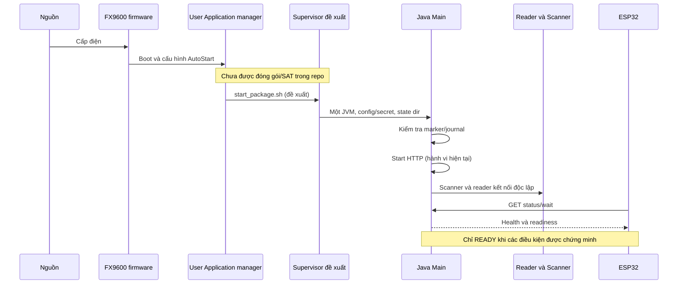

# FX9600 Writing Box — Technical audit, AutoStart và realtime health

Ngày audit: **2026-10-31**, múi giờ Asia/Saigon. Báo cáo điều tra; mọi thiết kế bên dưới là đề xuất, không phải thay đổi đã triển khai.

## 1. Executive summary

**Chưa đủ điều kiện vận hành production không giám sát.** Ưu tiên bảo vệ đúng tag và giữ bằng chứng giao dịch trước khi bật tự phục hồi. Mã có các bảo vệ hữu ích: khóa một lượt ghi, barcode hết hạn, inventory mới, chặn resizing, xác minh read-back, đánh dấu thao tác chưa hoàn tất. Các bảo vệ này chưa giải quyết được duplicate EPC, phục hồi sau partial write hoặc health bị cũ khi SDK treo. Bằng chứng chi tiết: mục 4–5, [RfidGateway.java:60](../src/main/java/org/fus/device/rfid/RfidGateway.java#L60), [StationWorkflow.java:79](../src/main/java/org/fus/domain/StationWorkflow.java#L79), [Main.java:79](../src/main/java/org/fus/Main.java#L79).

Các việc cần xử lý trước:

1. **P0 — đúng tag:** một EPC quan sát được không chứng minh một tag vật lý. Chọn/verify lại bằng EPC có thể nhận nhầm tag; cần box được xác nhận cách ly RF và khảo sát TID đầy đủ, ổn định xuyên suốt giao dịch. Chưa có bằng chứng ghi nhầm thực tế; đây là lỗ hổng nhận diện đã xác nhận từ code, hậu quả phụ thuộc phần cứng.
2. **P0 — recovery và audit:** lỗi sau khi có thể ghi tag vẫn có thể bị xóa marker; scan mới xóa cảnh báo, không có journal hay acknowledgement bền vững. Cần khóa ghi khi còn giao dịch bất định, đối soát tag rồi mới mở lại. Đã tái hiện bằng fake Gateway, không ghi tag thật.
3. **P1 — PnP/restart:** `run.sh` chỉ chạy Java; staging chưa tạo package User Application, chưa có stop script/supervisor. AutoStart chính thức có cơ sở tài liệu Zebra, nhưng không phải bằng chứng restart sau crash hoặc an toàn tiếp tục ghi. Cần SAT firmware 3.32.37.
4. **P1 — watchdog/health:** deadline chỉ bảo vệ lượt thao tác; GPI/connect/dispose có thể chặn luồng. Callback timeout còn phụ thuộc khóa status/log trước `halt`. API có thể vẫn trả READY cũ dù vòng SDK không tiến triển.
5. **P1 — scanner/UI/network:** mở CDC chưa chứng minh scanner responsive; reconnect mặc định 3 s, offline ESP32 5 s, HTTP đồng bộ. Chưa đáp ứng trọn bộ yêu cầu độ trễ. API không auth/TLS, phơi barcode/EPC cho mọi bên truy cập được cổng.

**Hướng triển khai:** Zebra User Application + AutoStart → supervisor được xác minh trên firmware → Java có readiness/health tách biệt và journal → ESP32 hiển thị độ mới dữ liệu và lỗi rõ ràng. Sau commissioning một lần, operator chỉ cấp điện; không cần SSH mỗi lần chạy. Giữ chặn resizing đến khi xác minh đúng SDK/MR6P. Không tự replay giao dịch ghi bất định.

Đã chạy **4 standalone checks**, biên dịch toàn bộ Java bằng **`--release 8`**, kiểm tra public API JAR bằng reflection và **5 probe cục bộ**; đều đạt kiểm tra đã mô tả ở mục 12. Không có kết quả hardware SAT, benchmark end-to-end hay chứng nhận production.

## 2. Scope, versions, evidence rules

### 2.1 Baseline và phạm vi

| Thành phần | Baseline/bằng chứng |
|---|---|
| Branch bắt buộc, kiểm tra trước khi đọc/ghi | `audit/fx9600-writing-box` |
| Commit source | `ba92fb5c57bea58053854068c03ca8e6d0a6630b` |
| Working tree đầu audit | Sạch. Sau đó người dùng bổ sung hai Markdown đầu vào chưa tracked; giữ nguyên cả hai. |
| Yêu cầu chính thức | [CODEX_TASK_FX9600_AUDIT.md](../CODEX_TASK_FX9600_AUDIT.md), đã đọc toàn bộ sau khi người dùng bổ sung |
| Nhận định cần kiểm chứng | [FX9600_WRITING_BOX_PRELIMINARY_FINDINGS.md](../FX9600_WRITING_BOX_PRELIMINARY_FINDINGS.md), đã đọc toàn bộ; không dùng số dòng GitHub/main làm baseline |
| Thiết bị đích theo tài liệu repo | FX9600 FW **3.32.37**, OpenJDK **1.8.0_102**, DS5502 CDC, GPI1 active-low, tag MR6P: [project-context.md:3–7](project-context.md#L3). Chưa đọc trực tiếp thiết bị trong audit. |
| Build | Java 8 source/target, Maven system dependency phiên bản khai báo `1.0.1`: [pom.xml:11–24](../pom.xml#L11). Đây không phải bằng chứng phiên bản Zebra SDK thực. |
| JAR tại máy | `library/Symbol.RFID.API3.jar`, **608931 bytes**, SHA-256 `B1929F3686357E3A61ECF8A817446C10C89906994DD7648BBE11FA4EB7623FE4` |
| Manifest JAR | `Manifest-Version: 1.0`; `Ant-Version: Apache Ant 1.9.6`; `Created-By: 1.8.0_242-8u242-b08-0ubuntu3~16.04-b08 (Private Build)`. Không có Implementation-Version để xác định release SDK. |
| Môi trường kiểm tra | Windows PowerShell; JetBrains JBR OpenJDK **21.0.8+1-1038.73-jcef**, dùng tool đã có trong IntelliJ. Không cài thêm runtime. |
| ESP32 | `espressif32@6.10.0`, TFT_eSPI `2.5.43`, ArduinoJson `6.21.5`, S3 devkit profile/4 MB: [platformio.ini:1–21](../screen_writing_box/platformio.ini#L1). Không build/upload firmware trong audit. |

Chỉ tạo báo cáo Markdown này trong phần source được bàn giao. Compiler/probe tạo file tạm trong `target/` đã được `.gitignore` bỏ qua; không sửa production/test source, script, cấu hình, branch, worktree; không commit/push/deploy và không kết nối reader thật. Không đọc cấu hình chứa password/Wi-Fi thực.

### 2.2 Quy tắc bằng chứng

- **C — Verified from code:** hành vi truy nguyên được từ local source hoặc public API JAR; không đồng nghĩa phần cứng đã chạy.
- **L — Local verified:** kiểm tra thực thi trên máy phát triển, ghi rõ giả lập và điều kiện. `PASS` của test không phải `PASS` ghi tag thực.
- **I — Inference:** kịch bản có thể xảy ra từ code/kiến trúc; chưa quan sát trên thiết bị.
- **H — Hardware-dependent:** cần FX9600/DS5502/MR6P/ESP32 và firmware tương ứng. Mọi SAT phần cứng ở đây là **NOT RUN**.
- **D — Vendor documentation:** tuyên bố của nhà sản xuất, có URL/mục/phiên bản khi đọc được. Không chuyển tự động thành khả năng đã xác minh trên FW 3.32.37.

**P0:** có thể ghi sai tag hoặc mất khả năng kiểm soát giao dịch bất định; chặn production. **P1:** thiếu yêu cầu vận hành, khả dụng, bảo mật hoặc health đáng tin cậy; phải xử lý trước vận hành không giám sát. **P2:** hoàn thiện build/tài liệu/chẩn đoán. Mức độ là đánh giá kỹ thuật, không phải thống kê sự cố.

Đã đọc tất cả Java production/test, cấu hình mẫu, script, các Markdown hiện có, ESP32 `main.cpp`, PlatformIO, header cấu hình và công cụ/font headers (nhận diện asset sinh tự động; không chứng nhận nội dung từng glyph/font nhị phân). Chỉ liệt kê/đọc metadata và public signature JAR; không decompile vendor implementation. Repo không kèm EULA/release JavaDoc đủ để xác minh quyền phân phối SDK/native; cần kiểm tra trước đóng gói.

## 3. Architecture and sequence diagrams

### 3.1 Kiến trúc hiện tại và cold boot đề xuất

Hiện tại tài liệu hướng dẫn SSH chạy `./run.sh`: [deployment-and-recovery.md:56–72](deployment-and-recovery.md#L56). Java dựng HTTP trước scanner/reader; scanner có luồng đọc và monitor riêng, RFID main loop poll GPI, một executor làm workflow, Timer bảo vệ operation. HTTP dùng pool riêng. ESP32 chạy Wi-Fi/HTTP/render chung trong `loop()`.



Mã hiện tại: [Main.main:24–60](../src/main/java/org/fus/Main.java#L24), [Main.main:63–114](../src/main/java/org/fus/Main.java#L63). Nếu config/API bind lỗi trước khi start, JVM thoát; nếu reader connect lỗi sau start, scanner/API có thể vẫn hoạt động.

### 3.2 Device → Java → HTTP → ESP32 hiện tại

```mermaid
sequenceDiagram
    participant D as SDK callback hoặc CDC monitor
    participant M as Main loop hoặc scanner listener
    participant W as StationWorkflow
    participant S as StatusServer
    participant E as ESP32 loop
    E->>S: status/wait?since=instance-revision
    S->>S: Chờ tối đa 2 s nếu revision không đổi
    D->>M: Reader: set cờ; Scanner: listener.state(false)
    Note over D,M: Cờ reader còn chờ Main thoát lời gọi GPI
    M->>W: connections(scannerReady, readerReady)
    W->>S: status(CONNECTION,...)
    S->>S: revision++, notifyAll()
    S-->>E: JSON snapshot mới nhất
    E->>E: Parse, updateBadge/updateLine
    E->>S: Gửi long poll tiếp ngay khi thành công
```

Vị trí: [RfidGateway.eventStatusNotify:47–58](../src/main/java/org/fus/device/rfid/RfidGateway.java#L47), [Main:47,52–59,69–104](../src/main/java/org/fus/Main.java#L47), [StationWorkflow.connections:36–40](../src/main/java/org/fus/domain/StationWorkflow.java#L36), [StatusServer:39–56,87–107](../src/main/java/org/fus/api/StatusServer.java#L39), [ESP32:193–229](../screen_writing_box/src/main.cpp#L193).

### 3.3 Ghi và restart giữa chừng

```mermaid
sequenceDiagram
    participant O as Operator/GPI
    participant W as Workflow/worker
    participant G as OperationGuard
    participant R as SDK/tag
    participant P as Process manager đề xuất
    O->>W: Scan rồi nhấn nút hợp lệ
    W->>G: Marker + fsync + deadline
    W->>R: Inventory 1 s, tập EPC
    W->>R: Kiểm tra cùng độ dài; writeWait EPC cũ
    alt Hoàn thành bình thường
        W->>R: readWait bằng EPC mới
        R-->>W: EPC read-back
        W->>W: So sánh bytes và decode; PASS hoặc FAIL
        W->>G: completed() kể cả FAIL được catch
    else Timeout hoặc cúp nguồn
        G->>W: status FAIL rồi halt(2) nếu timeout chạy tới
        Note over G,R: Có thể đã ghi một phần; không có journal định danh tag
        P->>W: Restart JVM (chưa có trong repo)
        W->>W: Thấy marker: cảnh báo, vẫn cho scan mới
        Note over O,W: Đề xuất: chặn ghi, đối soát tag và acknowledgement bền vững
    end
```

`beginTrigger()` phát WRITING trước marker; Main chỉ submit worker sau khi `guard.start()` thành công. `StationWorkflow.perform()` catch lỗi thông thường nên `work.run()` có thể trả về sau FAIL; Main sau đó vẫn gọi `completed()`. Xem [Main:75–97](../src/main/java/org/fus/Main.java#L75), [StationWorkflow:98–125](../src/main/java/org/fus/domain/StationWorkflow.java#L98).

## 4. Issue register

Owner là vai trò đề xuất, chưa phải phân công đã được chấp nhận. Ưu tiên chi tiết và effort ở mục 10.

| ID | Mức | Bằng chứng/điểm vào | Phát hiện, tác động và hướng xử lý | Owner |
|---|---|---|---|---|
| A | P1 | C/H: [RfidGateway:129–166](../src/main/java/org/fus/device/rfid/RfidGateway.java#L129) | Output 80 bit; resizing bị chặn đúng chủ đích. Chưa xác nhận đơn vị access/PC trên đúng SDK; mọi EPC hiện tại dài 96/128 bit đều bị từ chối. Giữ chặn, thử riêng PC/TID trước thay đổi. | RFID/QA |
| B | **P0** | C/I/H: [RfidGateway:76,110–119,148–161](../src/main/java/org/fus/device/rfid/RfidGateway.java#L110) | Set EPC không đếm tag vật lý, access bằng EPC trước/sau. Nguy cơ wrong-tag write/false attribution. Xác minh box + full serialized TID + selection xuyên suốt. | RFID/cơ khí/QA |
| C1 | P1 | C/L/I: [Main:79–92,102–113](../src/main/java/org/fus/Main.java#L79), [OperationGuard:20–43](../src/main/java/org/fus/device/rfid/OperationGuard.java#L20) | Không external restart; watchdog không bao phủ mọi SDK call và có thể bị khóa status/log chặn. Thiết kế deadline độc lập, supervisor được xác minh, không chồng session. | Java/platform |
| C2 | **P0** | C/L: [Main:32–35,85–88](../src/main/java/org/fus/Main.java#L32), [StatusServer:48](../src/main/java/org/fus/api/StatusServer.java#L48) | Marker không phải unresolved transaction; scan mới xóa warning, FAIL có thể xóa marker. Khóa ghi và acknowledgement/journal bền vững. | Java/operations |
| D | P1 | C/I/H: [ScannerSource:20–42](../src/main/java/org/fus/device/scanner/ScannerSource.java#L20), [BarcodeFramer:20–33](../src/main/java/org/fus/device/scanner/BarcodeFramer.java#L20) | Port-open bị báo READY; read/close có thể chặn, path thay đổi, raw không thiết lập khi reconnect. Tách presence/liveness, stable identity, bounded I/O phù hợp firmware. | Scanner/platform |
| E | **P0** | C/L: [StatusServer:24–67](../src/main/java/org/fus/api/StatusServer.java#L24), [StationWorkflow:114–125](../src/main/java/org/fus/domain/StationWorkflow.java#L114) | Không transaction journal/trace ID/full old identity; state lỗi mất khi thay đổi/reboot. Lưu intent/result/recovery, đối soát chính xác barcode/GRN. | Java/operations |
| F | P1 | C/L/I: [StationConfig:17–18](../src/main/java/org/fus/config/StationConfig.java#L17), [StatusServer:18–19,80–108](../src/main/java/org/fus/api/StatusServer.java#L18) | Unauth HTTP, dữ liệu LAN, hữu hạn waiter nhưng chưa chống cạn tài nguyên/slow client. VLAN/ACL, least-data, health riêng, auth/TLS tùy threat model. | Network/Java |
| PnP-01 | P1 | C/D/H: [run.sh:1–6](../deploy/run.sh#L1), [stage-release:9–20](../scripts/stage-release.ps1#L9) | Chưa package/start-stop/supervisor; bản working tree script CRLF. Dùng manager AutoStart sau commissioning và SAT. | Platform/release |
| HEALTH-02 | P1 | C/L/I/H: [Main:52–100](../src/main/java/org/fus/Main.java#L52), [ESP32:104–148,193–229](../screen_writing_box/src/main.cpp#L104) | Hai trạng thái backend, không freshness theo device; offline UI giống chờ mã, stale timeout dài. Contract 5 trạng thái, UI có lý do, deadline ngoài HTTP blocking. | Java/ESP32/QA |
| BUILD-01 | P2 | C/L: [verify:5–11](../scripts/verify.ps1#L5), [config.example.h:6](../screen_writing_box/include/config.example.h#L6) | Source/target 8 không tự giới hạn API JDK; comment nói API chưa có đã cũ. Bổ sung build Java8/release8, pin toolchain, kiểm tra LF và tài liệu. | Build/docs |

## 5. Deep dive A–F

### A. EPC 80-bit, PC và resizing

**Trace C:** [EpcCodec.encode/decode:9–34](../src/main/java/org/fus/domain/EpcCodec.java#L9) chấp nhận chính xác `[A-Z0-9]{2}[0-9]{16}`. Hai byte ASCII + 16 nibble BCD = 10 byte = 5 word = 80 bit. Ví dụ `9K1135600660004039` → `394B1135600660004039`. Không padding; không phải scheme GS1 (cũng được ghi ở [epc-encoding.md:3](epc-encoding.md#L3)). `WorkflowCheck:20–23` kiểm tra encode/decode và nibble BCD sai.

`inventory()` chỉ nhận EPC dài 4–124 HEX, chia hết 4; `writeChecked()` so độ dài EPC cũ/mới và ném `EPC_RESIZE_UNVERIFIED` trước `writeStep()` nếu khác. Với codec hiện tại, chỉ EPC cũ **20 HEX** qua được; EPC 96 bit/24 HEX và 128 bit/32 HEX bị chặn. Đây là safeguard, **không phải lỗi tự ý cắt EPC**. [RfidGateway.java:93–96,129–138](../src/main/java/org/fus/device/rfid/RfidGateway.java#L129).

Layout Gen2: EPC bank có CRC 2 byte, PC 2 byte, EPC bắt đầu ở byte 4/word 2. Tài liệu [Zebra RFID Demo, article 000018116](https://support.zebra.com/article/000018116) mô tả layout và PC length 5 word tương ứng `0x2800` khi các bit khác bằng 0. Bài này áp dụng MC319Z/MC919Z, chỉ hỗ trợ đối chiếu layout, không chứng minh behavior Embedded FX9600. Với giả định length field tiêu chuẩn, phép thay length phải là **`(oldPc & 0x07FF) | (5 << 11)`**, bảo toàn các bit khác; đây là phép tính thiết kế, **không phải chỉ dẫn ghi PC trên thiết bị**.

Code gọi `setByteOffset(4)`, `setWriteData(byte[10])`, `setWriteDataLength(10)`, `writeWait(oldEpc, params, null)`; sau khi return mới đổi `tag.current`, rồi `readWait(newEpc)` với `setByteCount(10)`. Không có đọc/ghi PC hoặc TID. [RfidGateway.writeMemory/readMemory:148–166](../src/main/java/org/fus/device/rfid/RfidGateway.java#L148).

**Đơn vị SDK: phần đã và chưa xác nhận.** Public surface JAR có các setter byte nói trên, nhưng signature `(int)` không mang thông tin đơn vị của native implementation. Không kèm JavaDoc đúng release để xác nhận `setWriteDataLength` là byte hay word; **chưa đủ bằng chứng kết luận code truyền sai đơn vị**. [Android WriteAccessParams](https://techdocs.zebra.com/dcs/rfid/android/2-0-5-292/apis/com/zebra/rfid/api3/tagaccess.writeaccessparams) mô tả write length theo word; package là `com.zebra...`, khác `com.mot...` local. Không được đổi `10` thành `5` chỉ dựa tài liệu Android. Phải lấy JavaDoc/sample đúng JAR + SHA và thử trên tag dùng riêng. Đối chiếu tương tự [Android ReadAccessParams](https://techdocs.zebra.com/dcs/rfid/android/2-0-5-275/apis/com/zebra/rfid/api3/tagaccess.readaccessparams), không suy rộng sang native FX.

**MR6P D/H:** [Impinj Monza R6-P](https://www.impinj.com/products/endpoint-ics/impinj-monza-r6-series) công bố EPC 96/128 bit, user 32/64 bit và serialized Tag ID. Dung lượng chip khác độ dài EPC được PC công bố; thông tin này chưa chứng minh quy trình đổi sang EPC 80 bit trên tag cụ thể. Cần memory map/lock state/chip revision của lô tag.

**WRITE_PC quá khứ:** [station-status-and-tags.md:9](station-status-and-tags.md#L9) ghi nhận đã từng thất bại. Code hiện tại không có stage WRITE_PC; audit không có PC trước/sau, SDK result/status, TID, antenna/power và log lịch sử. Vì vậy nguyên nhân gốc **chưa xác định**. Các giả thuyết riêng: mất selector sau đổi EPC; nhầm byte/word; lock/password; RF yếu; dùng sai PC/memory layout. Không giả thuyết nào được coi là sự cố đã xác nhận.

**Đề xuất tối thiểu, effort cao nếu mở resizing:** giữ block và có lỗi hướng dẫn chuẩn bị tag 80 bit; trước tiên hoàn thành B/C/E. Nếu mở chức năng sau này, ghi intent chứa full TID/old EPC/old PC, chọn tag bằng identity ổn định, lập state machine cho mọi điểm mất nguồn, đọc lại PC và EPC bằng cùng identity rồi inventory lại. Thứ tự PC/EPC phải được Zebra/Impinj và SAT xác nhận; không áp dụng máy móc trình tự của RFID Demo. Không ghi/đổi độ dài tự động khi restart.

**Test/acceptance:** local negative precheck 80/96/128 và exception trước/sau write (chưa có test gateway thực trong suite); SAT A80/A96/A128 tại mục 9. EPC sai độ dài phải không phát access-write; mọi PASS phải có exact bytes, decode đúng barcode, đúng identity và PC length đã kiểm chứng. Không gọi resizing thành công khi mới build/mock pass.

### B. Duplicate EPC, TID và nguy cơ ghi nhầm tag

**Root cause C:** `collect()` lấy duy nhất `tag.getTagID()` rồi thêm vào `LinkedHashSet<String>`; cùng EPC dù nhiều reports/antenna vẫn thành một phần tử. `getTagSeenCount`, RSSI, antenna hay số lần report không phải định danh vật lý. Inventory một giây có thể bỏ sót tag yếu; việc `purgeTags`, buffer warning và stop event là bảo vệ chống dữ liệu cũ/không tin cậy, không phải chứng minh đủ tag. [RfidGateway:65–119](../src/main/java/org/fus/device/rfid/RfidGateway.java#L65).

**Counterexample I/H:** tag A/B cùng EPC E → tập `{E}` → `Tag(E)`. Lệnh access bằng E không biểu đạt yêu cầu đúng A. Nếu một tag được ghi thành N, read-back bằng N có thể chứng minh dữ liệu N tồn tại nhưng chưa chứng minh tag operator định ghi. Một tag khác ngoài box đã có N cũng có thể trả lời verify. Không khẳng định SDK chắc chắn ghi cả hai: singulation và RF thực quyết định tag đáp ứng. Rủi ro còn có hoán đổi tag sau inventory và partial write khiến EPC mới không còn selector hợp lệ. [RfidGateway:23–30,132–137,152–161](../src/main/java/org/fus/device/rfid/RfidGateway.java#L23).

**SDK surface L:** local JAR có `MEMORY_BANK_TID`; `TagData.getMemoryBankData()`, `getMemoryBankDataOffset()`, `getPC()`; `PreFilters.PreFilter.setMemoryBank`, `setBitOffset`, `setTagPattern(byte[])`, `setTagPatternBitCount`; `AccessFilter` và `TagPatternBase` cũng có memory-bank/bit-pattern APIs. Điều này mở hướng thử đọc/filter TID, không chứng minh unique selection trong `writeWait` hiện dùng.

Chỉ có public overload `writeWait(String, WriteAccessParams, AntennaInfo)` và `readWait(String, ReadAccessParams, AntennaInfo)`. **Không có overload `bTIDPrefilter`** như [SDK Android TagAccess](https://techdocs.zebra.com/dcs/rfid/android/2-0-5-292/apis/com/zebra/rfid/api3/tagaccess). Public field/method filter tồn tại chưa chứng minh một prefilter TID sẽ được synchronous access tôn trọng, không bị EPC selector/session mặc định ghi đè. Xem log SDK mục 12; cần JavaDoc đúng version và SAT.

Public surface còn có **`readEvent(ReadAccessParams, AccessFilter, AntennaInfo)`** và **`writeEvent(WriteAccessParams, AccessFilter, AntennaInfo)`**, với `AccessFilter.TagPatternA/TagPatternB`. Đây là hướng khảo sát cụ thể cho access bất đồng bộ lọc TID bằng memory bank/bit pattern, thay vì chờ overload synchronous không tồn tại. Chưa chứng minh firmware áp dụng filter đủ duy nhất/đủ serial, callback/result completion hay cancellation; migration phải xử lý event correlation, `ACCESS_OPERATION_STATUS`, timeout và kết thúc operation trước reconnect. Không có method nào trong số này được gọi trong audit. `Inventory.perform(PostFilter, TriggerInfo, AntennaInfo)` không nhận trực tiếp `AccessFilter`; không trộn hai loại filter.

**Uniqueness H:** full serialized TID khác phần manufacturer/model chung. Đọc TID một lần qua EPC E vẫn có thể chỉ đọc A và bỏ B. Phải chứng minh inventory/access reporting phân biệt đủ serialized TID của A/B khi EPC trùng; kiểm tra storage/report aggregation và bit mask. TID không đọc được/thiếu serial/multiple/unreliable → từ chối ghi. TID cũng không phải cơ chế xác thực chống clone.

**Đề xuất, effort cao:** khóa cơ cấu box trong inventory→verify; xác nhận shielding, antenna được chọn, RF power và tag ngoài box; code hiện truyền `null` antenna ở inventory/access và dựa cấu hình reader có sẵn, [RfidGateway:81,152,161](../src/main/java/org/fus/device/rfid/RfidGateway.java#L81). Không coi chỉ giảm công suất là bảo đảm cách ly. Chỉ cho ghi khi đầy đủ điều kiện đơn tag và identity ổn định; giữ cùng TID cho precheck/write/PC/read-back, dọn filter khi kết thúc/session reconnect. Nếu SDK không đáp ứng, dừng ở phương án cách ly đã SAT hoặc thay SDK/kiến trúc trong nhiệm vụ riêng; không tuyên bố tính năng TID đã có.

**Test/acceptance:** giả lập 2 reports cùng EPC nhưng TID khác phải bị từ chối ở thiết kế mới; hiện suite chỉ fake `unique=false`, không kiểm tra `collect()` thực. SAT dùng hai tag disposable cùng EPC, hai EPC khác, tag ngoài box và hoán đổi trong thao tác. Không tag ngoài mục tiêu thay đổi; mọi uncertainty phải fail closed. Bản hiện tại chưa đạt tiêu chí này.

### C. Watchdog, marker, restart và concurrent SDK

**Đường chạy và safeguard C:** Main reserve lượt → `guard.start()` tạo/truncate marker, `FileDescriptor.sync()` → đặt active và hẹn Timer → submit worker. Worker duy nhất; `writing` cấm scan/trigger đồng thời. Trong reader `finally`, Main chờ `operation.get()` trước thay gateway/disconnect/Dispose. Điều này tránh thay session giữa access đang chạy. Generation của guard ngăn timer cũ timeout lượt mới. [Main:50,75–111](../src/main/java/org/fus/Main.java#L50), [OperationGuard:20–41](../src/main/java/org/fus/device/rfid/OperationGuard.java#L20).

**Các giới hạn C/I:**

- Timer chỉ bắt đầu **sau** mở/ghi/fsync marker. Treo filesystem ở đây chưa được deadline bảo vệ. Timeout mặc định 30 s; minimum config 10 s, không phải health timeout. [OperationGuard:22–36](../src/main/java/org/fus/device/rfid/OperationGuard.java#L22), [StationConfig:20](../src/main/java/org/fus/config/StationConfig.java#L20).
- Callback timeout gọi `status.status()` rồi `System.err.println()` **trước** `Runtime.halt(2)`. `status()` synchronized và in stdout ngay trong khóa. Nếu khóa/output bị chặn, halt có thể không được gọi. Probe giữ khóa status đã xác nhận callback chưa hoàn tất cho đến khi nhả khóa; không mô phỏng native SDK hoặc power failure. [Main:79–82](../src/main/java/org/fus/Main.java#L79), [StatusServer:39–56](../src/main/java/org/fus/api/StatusServer.java#L39).
- Connect, kiểm tra GPI, `getPortState`, disconnect, Dispose, sleep/reconnect và filesystem không có watchdog riêng. `getPortState` treo khi idle → Timer operation không active → API có thể trả READY mãi. Tham số `reader.timeout.ms=5000` được truyền constructor, chưa chứng minh chặn được mọi native call. [Main:64–74,110–113](../src/main/java/org/fus/Main.java#L64).
- Main đọc GPI trong lúc worker inventory/access. Cùng session có concurrent SDK calls; chưa có bằng chứng thread-safety/cancellation của SDK bundled. Không giải quyết bằng nhiều health threads tự gọi SDK; cần thiết kế một owner, event callback và deadline được xác minh. [Main:71–100](../src/main/java/org/fus/Main.java#L71).
- Nếu Main chờ `operation.get()` mà worker treo, guard chỉ cứu được nếu callback tiếp tục chạy. `halt` bỏ shutdown hooks và không chứng minh reader đã dừng RF/access server-side. Restart phải kiểm tra session/operation cũ và quarantine trước mở ghi.
- Hook chỉ dừng scanner/worker/guard/status, không join/đợi access/disconnect reader trực tiếp. `shutdownNow` không bảo đảm cắt native access; hook gọi scanner.close cũng có thể chặn. Mất nguồn/SIGKILL không chạy hook. [Main:60](../src/main/java/org/fus/Main.java#L60).

**Marker/persistence C/L/I:** `hasUnfinishedOperation()` chỉ gọi `Files.exists`, không kiểm tra nội dung hoặc khả năng đọc marker; trường hợp không xác định được sự tồn tại cũng chưa có nhánh fail-closed riêng. Marker chỉ có `RFID_OPERATION_IN_PROGRESS`, không có txId/TID/barcode/stage. `completed()` đặt active=false rồi xóa; xóa lỗi để marker cũ nhưng không còn active, chỉ log cleanup failure. File content được fsync, nhưng không fsync directory cho create/delete, không atomic journal, không chứng minh durable qua brownout. Nếu `guard.start()` tạo/ghi/fsync marker ném exception thì Main không submit access; log chung `RECOVERY_MARKER_FAILED` chưa đủ chẩn đoán nguyên nhân. [OperationGuard:18–41](../src/main/java/org/fus/device/rfid/OperationGuard.java#L18), [Main:85–97](../src/main/java/org/fus/Main.java#L85).

**Ba khái niệm riêng:** AutoStart gọi ứng dụng lúc boot; supervisor khởi động lại JVM đã chết/treo; recovery giao dịch giải quyết tag có thể đã đổi. Repository mới có retry kết nối bên trong JVM và một operation timeout, chưa cung cấp hai lớp quản lý tiến trình/đối soát bền vững. Không có auto replay hiện tại, nhưng scan mới vẫn cho thao tác mới ngay sau warning.

**Đề xuất tối thiểu:** callback hết deadline phải có đường chấm dứt không phụ thuộc log/status lock; external supervisor theo dõi progress riêng, nhận biết intentional stop và rate-limit restart. Một instance bằng lock có lifetime gắn process, không chỉ PID file hoặc cổng API; config port khác vẫn có thể cho hai JVM tranh thiết bị. Giữ unresolved journal khi FAIL có thể đã đổi tag; startup chỉ cho status/recovery, không cho ghi cho tới reconciliation. Effort trung bình cho guard/process lifecycle, cao cho SDK/recovery SAT.

**Test/acceptance:** kiểm tra timer generation hiện đã pass; thêm filesystem fail, cleanup fail, blocked logger/status, pending operation + reconnect, start/stop trùng, startup fail loop. SAT chặn GPI/native có kiểm soát, crash/power-cut trên tag disposable sau phê duyệt operator; không hai session ghi đồng thời, không replay, không false PASS. Reset/reboot reader không phải hành động recovery mặc định trong đề xuất.

### D. Scanner CDC, health và reconnect

**Trace C:** Main start `scanner-cdc` daemon rồi monitor daemon mỗi `sleep(250)`. `ScannerSource.run()` mở `FileInputStream(device)` → lập tức `listener.state(true)` → tạo framer → blocking `read()` từng byte; EOF/exception → finally state(false), sleep reconnect mặc định **3000 ms** rồi thử lại. `checkPresence()` phát false trước khi close stream nếu path không tồn tại. [Main:46–59](../src/main/java/org/fus/Main.java#L46), [ScannerSource:20–42](../src/main/java/org/fus/device/scanner/ScannerSource.java#L20).

**Không có `read timeout` scanner.** Hai giây của `BarcodeFramer` là inter-byte timeout được xét khi **byte tiếp theo đến**, không timer chủ động, không heartbeat và không total-frame deadline. Khung chưa LF có thể giữ đến byte tiếp theo, nhưng tối đa 1024 byte nên không tăng vô hạn. Overflow bị bỏ tới LF hoặc tới khi byte tiếp theo làm inter-byte timeout reset khung; stale frame reset trước byte mới. Bytes ngoài ASCII chuyển thành replacement khi decode rồi codec từ chối. CR không bị bỏ: CRLF tạo barcode có CR và bị INVALID_BARCODE, CR-only không hoàn tất khung. [BarcodeFramer:20–33](../src/main/java/org/fus/device/scanner/BarcodeFramer.java#L20), [ScannerSource:24–28](../src/main/java/org/fus/device/scanner/ScannerSource.java#L24). Chọn LF chính xác là hợp đồng hiện tại, không khẳng định CRLF đã được hỗ trợ.

**Linux H:** JDK8 [FileInputStream](https://docs.oracle.com/javase/8/docs/api/java/io/FileInputStream.html) có blocking read và close tài nguyên; API không cung cấp cam kết deadline để interrupt một tty read bằng close từ luồng khác. Unplug có thể phát EOF/I/O error/node biến mất tùy driver/JVM; cần đo trên kernel CDC và 1.8.0_102 thực. Không kết luận close chắc chắn treo hoặc chắc chắn đánh thức read. Nếu close chặn monitor, vòng checkPresence cũng ngừng; callback false đã được gọi trước close nếu không bị lock khác chặn.

**Các counterexample I/H:** path còn nhưng decode engine chết vẫn READY; node `/dev/ttyACM0` tái sử dụng cho scanner khác; reconnect ra ACM1 thì code vẫn mở ACM0; path mất rồi có lại giữa hai lần check thì monitor có thể không thấy; read thread kẹt trên fd cũ thì không quay lại open. Thay quyền hoặc USB identity không được theo dõi. Config typo trỏ regular file cũng có thể mở thành công; không có kiểm tra character-device/VID/PID/serial. Đây là giới hạn code, chưa quan sát các tình huống trên DS5502 thật.

**Raw/permissions C:** production code và run.sh không cấu hình termios/stty, delimiter hay exclusive port lock. [scanner-cdc-test.md:23–49](scanner-cdc-test.md#L23) chỉ là quy trình khảo sát raw và khôi phục, không provisioning boot/hotplug. Phải kiểm tra lại raw/echo/CR conversion/baud hoặc control line cần thiết sau mỗi reopen; không hardcode thông số hoặc `chmod 777`. Mở cổng cùng một `od`/app khác có thể chia dữ liệu; cần exclusive ownership thực sự.

Khung stale/overflow bị framer bỏ bằng `null`, không có counter hoặc error event riêng, nên mất dữ liệu loại này không được health/API phân biệt với không có lượt quét. Invalid barcode hoàn chỉnh đi tới workflow thì có FAIL; lỗi transport chỉ log tên exception. Bổ sung counters/reason có giới hạn, không log raw payload tùy ý, để chẩn đoán được scanner failure và dữ liệu lỗi. [BarcodeFramer:22–30](../src/main/java/org/fus/device/scanner/BarcodeFramer.java#L22), [ScannerSource:26–31](../src/main/java/org/fus/device/scanner/ScannerSource.java#L26).

**Protocol D/H:** DS5502 PRG MN-004952-01EN Rev A, 2024-07-17, USB Device Type tr.92–94 liệt kê CDC/SSI over CDC/SNAPI, SNAPI status handshaking. [Tài liệu Zebra, bản mirror](https://www.ptsmobile.com/barcode-scanners/hardware/zebra/ds5502/ds5502-prg-en.pdf). Không tìm thấy ping/status dùng được trong plain CDC từ phần đã đối chiếu; **không chứng minh CDC không thể có mọi lệnh vendor**, mà chưa có contract được xác minh. Không gửi lệnh thử vào scanner đang vận hành.

**Đề xuất, effort trung bình/cao:** tách USB presence, opened, last response/decode; port-open chỉ CONNECTED. Nếu không có active status được vendor xác nhận, readiness scanner phải UNKNOWN hoặc ghi rõ bằng chứng test scan đã cũ; không timeout vì operator không quét. Khảo sát SSI management request read-only có correlation/timeout, hoặc SNAPI với ARM Linux support; đây là migration parser/driver, không chỉ thêm ping. Lifecycle một owner, discovery theo identity, backoff và raw mỗi open; tránh để close không giới hạn khóa cả health pipeline.

**Test/acceptance:** mở thiếu node/quyền sai/regular-file sai loại; LF/CRLF/CR/overflow/stale/no-activity; partial frame + disconnect; same path khác identity; ACM renumber; cắm lại trong khi read. ≥30 USB cycles với hardware ở mục 9. Không báo DISCONNECTED chỉ vì idle; không báo responsive READY chỉ vì open thành công.

### E. Transaction logging, GRN và operator-safe recovery

**Root cause C/L:** state/revision/barcode/EPC/error nằm trong RAM. `StatusServer.status()` chỉ in stdout; không journal/store/transaction ID/time/ack; giới hạn API barcode 64, EPC 124, detail 240 ký tự nhưng stdout in **trước** limit. Marker không có giao dịch. [StatusServer:24–67](../src/main/java/org/fus/api/StatusServer.java#L24), [OperationGuard:22–24](../src/main/java/org/fus/device/rfid/OperationGuard.java#L22).

**Mất thông tin khi lỗi:** workflow catch `StationFailure` rồi return; Main gọi completed xóa marker kể cả `tagMayHaveChanged=true` (probe fake write đã xác nhận). FAIL hiển thị 5 s rồi `tick()` IDLE xóa error, nếu vòng main còn chạy. Disconnect status xóa state/barcode/EPC/error; WAIT_TRIGGER xóa recovery warning. Lúc reboot, không có persistent outcome để tái tạo lỗi đã được catch/xóa marker. [StationWorkflow:42–49,120–125](../src/main/java/org/fus/domain/StationWorkflow.java#L42), [Main:85–88](../src/main/java/org/fus/Main.java#L85), [StatusServer:44–52](../src/main/java/org/fus/api/StatusServer.java#L44).

**Duplicate scan/trigger C:** chỉ scan mới nhất trước trigger được giữ; scan trong writing bị bỏ; barcode bị consume khi reserve, kể cả FAIL. Trigger tiếp không có barcode không ghi lại; debounce active-low phải từng nhả HIGH ổn định mới arm. Tuy nhiên scan lại cùng barcode sau lượt trước vẫn có thể tạo lượt ghi mới; không có business-level dedupe/GRN uniqueness xuyên restart. Điều này có thể là nghiệp vụ hợp lệ, cần quy tắc explicit, không tự cấm mọi barcode lặp. [StationWorkflow:52–96](../src/main/java/org/fus/domain/StationWorkflow.java#L52), [GpiButton:15–30](../src/main/java/org/fus/device/gpi/GpiButton.java#L15).

**Exact GRN:** mã hiện xác minh chính xác barcode 18 ký tự được chọn và EPC read-back, không có field GRN riêng, nguồn đơn hàng hay mapping barcode→GRN. Không thể tuyên bố đã xác minh đúng chứng từ nghiệp vụ nếu chưa chốt GRN chính là chuỗi nào. Cần fixture đầu vào có expected GRN/barcode/EPC độc lập, giữ zero đầu và so sánh exact, không trim/parse numeric. [EpcCodec:9–34](../src/main/java/org/fus/domain/EpcCodec.java#L9), [StationWorkflow:99–117](../src/main/java/org/fus/domain/StationWorkflow.java#L99).

**Privacy/log integrity C/I:** raw invalid barcode có thể chứa CR/control byte và SDK detail có text vendor; stdout chưa escape, truncate hay rotate. Không thấy code log access password; không suy diễn đã lộ secret. Dữ liệu barcode/EPC có thể nhạy cảm, cần retention/ACL. Ghi log đồng bộ dưới workflow/status lock có thể làm stall cả health/timeout. [StationFailure.describe:13–15](../src/main/java/org/fus/domain/StationFailure.java#L13), [StatusServer:39–52](../src/main/java/org/fus/api/StatusServer.java#L39).

**Thiết kế đề xuất, effort cao:** durable intent trước RF write; txId + process bootId + device identity + full TID + old EPC/PC + requested EPC + barcode/GRN tham chiếu + stage/outcome/SDK code + `tagMayHaveChanged` + timestamp/monotonic duration + acknowledgement. Success chỉ durable sau same-target read-back; crash giữa verify và journal commit vẫn unresolved, không tự replay. Lưu terminal failure bất định cho tới reconciliation có operator/time/reason, độc lập với lỗi tạm hiển thị. Chỉ xóa recovery gate sau đối soát, không xóa khi quét.

Chọn append journal có record boundary/checksum, recovery từ truncated tail, fsync có chủ đích và kiểm tra directory semantics trên filesystem reader; hoặc embedded DB được xác minh. Không fsync mỗi heartbeat. Rotation theo dung lượng/retention, ngân sách flash, quyền thư mục, behavior disk-full: không ghi tag nếu không lưu được intent. Audit đầy đủ và redaction ở API/log vận hành là hai phạm vi quyền khác nhau; không dùng hash mất khả năng đối soát exact mà không giữ nguồn được bảo vệ.

**Test/acceptance:** injected fail sau write/readback, process death sau mỗi durable boundary, full disk/read-only/corrupt tail/cleanup fail; unresolved không mất sau scan/IDLE/reboot; acknowledgement không thành công nếu chưa có kết quả kiểm tra tag. SAT ≥300 cycles với ground truth GRN độc lập, journal đầy đủ và zero observed wrong-tag writes; 300 lần không chứng minh xác suất lỗi bằng không.

### F. API security, resource isolation và stale health

**Bề mặt C/L:** mặc định `0.0.0.0:8081`; GET `/status` và `/status/wait` đọc barcode/EPC/error, không auth/TLS/token/origin allowlist. Probe loopback không credentials nhận được EPC. Path/method ngoài allowlist trả 404, JSON có escaping và `no-store`; không có HTTP write/control route. Vì vậy không có bằng chứng remote tag-write qua API này. [StationConfig:17–18](../src/main/java/org/fus/config/StationConfig.java#L17), [StatusServer:70–108](../src/main/java/org/fus/api/StatusServer.java#L70).

**Giới hạn hiện có C:** 8 workers, queue 16, backlog 8, semaphore 4 cho long-poll, mỗi wait tối đa 2 s. Wait dùng `timedWait` nhả monitor, nên một long poll bình thường không giữ status lock 2 s; `StatusServerCheck:45–56` đã kiểm tra regular GET vẫn trả trong trường hợp một waiter. UUID instance + revision nhận biết JVM restart, không cần ETag; unknown `since` trả ngay. Đây là latest snapshot, không event log, có thể bỏ qua trạng thái trung gian.

**DoS/priority inversion I:** semaphore được lấy sau request dispatch; không giới hạn mọi TCP connection/body/header/slow reader, và slot được release trước response write. Khi queue đầy, CallerRunsPolicy có thể chạy handler trên thread dispatcher/submitter, kể cả chờ long-poll hoặc I/O, giảm tiến độ nhận request khác. Chưa có load test để định lượng cạn tài nguyên hoặc mức cô lập với RFID. Không coi 4 slots là bảo đảm chống DoS hay bảo đảm còn 4 workers cho health. [StatusServer:18–20,87–108](../src/main/java/org/fus/api/StatusServer.java#L18).

503 khiến ESP32 retry sau 500 ms cố định, không jitter/Retry-After; nhiều client có thể cùng retry. Backend snapshot không chứa age từng device hay loop progress. Nếu SDK/GPI treo nhưng HTTP pool còn sống, API trả cùng revision 200 sau 2 s, ESP32 cập nhật `lastSuccess` và giữ READY vô hạn. Đây là counterexample code rõ ràng, chưa tái hiện trên reader. [ESP32:193–227](../screen_writing_box/src/main.cpp#L193), [Main:71–74](../src/main/java/org/fus/Main.java#L71).

**Đề xuất, effort trung bình:** mặc định commissioning vào VLAN riêng, ACL chỉ ESP32 và máy quản trị, bind interface dự định, chặn truy cập cổng từ mạng khác; loopback-only không phục vụ được ESP32. Tách minimal `/health`/readiness với pool/admission budget riêng và không lộ barcode; private status có quyền phù hợp. LAN isolation không chống máy đã nằm trong VLAN giả mạo HTTP. Nếu threat model có sniff/spoof/LAN không tin cậy, cần TLS với server authentication + cơ chế client auth/token rotation và time/certificate provisioning đã SAT trên ESP32; token qua plain HTTP không chống nghe lén. Không suy luận đã có firewall chỉ vì tài liệu nói trusted LAN.

Health endpoint không gọi SDK trực tiếp; trả snapshot có tuổi/progress/gate, không block theo client log. Đặt giới hạn query/header/connection/read-write duration phù hợp HttpServer JDK8 thực; không hứa mọi hạn mức đều có setter sẵn. Rate-limit admission trước long wait, trả nhanh khi quá tải, ưu tiên health; load test slow client trên localhost riêng. Nghiên cứu SSE/WebSocket chỉ sau khi polling/freshness đã đúng; đổi transport không sửa tín hiệu READY sai.

**Test/acceptance:** GET không quyền sau hardening không trả dữ liệu nhạy cảm; malformed/oversized query/POST/path lạ không đổi workflow; 4+ waiter/503, burst và slow-client không làm nghẽn health/guard; UUID restart cập nhật được; SDK giả treo phải chuyển UNKNOWN/RECOVERING dù HTTP 200. Hardware/hostile load chưa chạy trong audit.

## 6. Plug-and-play assessment

### 6.1 Cơ chế Zebra đã đối chiếu và giới hạn tài liệu

Zebra Integration Guide **MN000026A06 Rev A, November 2017**, Applications tr.84–85, mô tả AutoStart, script `start_<package>.sh`/`stop_<package>.sh`, và user `rfidadm`. Đã đối chiếu [bản tài liệu Zebra được mirror](https://manualmachine.com/zebra/fx9600/22042505-integration-manual/); PDF [PTSMobile được task dẫn](https://www.ptsmobile.com/zebra/fx9600/zebra-fx9600-integrator-guide.pdf) fetch timeout, search index đọc được trang Applications. Không gán revision mới cho tài liệu cũ này.

[Embedded Java SDK User Guide Windows](https://prod-www.zebra.com/content/dam/support-dam/en/documentation/unrestricted/guide/software/Zebra-FXSeries-Embedded-Java-SDK-UserGuide_Windows.pdf), §8.8 tr.75 và §9.1–9.2 tr.76–78, có mẫu Java start/stop/package. Đọc được đoạn §8.8 và mục lục từ search index; tải toàn PDF gặp 502/406 nên chưa xác nhận revision và mọi chi tiết builder. Tài liệu khuyến nghị Unix line endings. [Zebra article 000026882](https://support.zebra.com/tr/article/000026882) cũng có AutoStart nhưng là **Modbus**, không dùng format ZIP/license của app đó làm yêu cầu của Java này.

**Kết luận D/H:** User Application AutoStart là cơ chế có tài liệu chính thức, cần commissioning một lần. Chưa có bằng chứng manager sẽ restart app crash, giám sát hang, giữ checkbox qua upgrade hoặc đảm bảo SDK/RF sẵn ngay lúc boot trên **3.32.37**. Không xác nhận systemd, cron, rc.local, root access hay init tùy chỉnh được hỗ trợ.

### 6.2 So sánh phương án

| Phương án | Boot tự chạy | Crash/hang | Tương thích/chi phí | Khuyến nghị |
|---|---|---|---|---|
| SSH + `run.sh` hiện tại | Không được repository thiết lập | Không supervisor | Dùng được cho dev nếu dependency/quyền hợp lệ | Không đạt PnP |
| User Application + AutoStart | Có cơ sở D, cần SAT | Chưa biết policy manager | Khớp quản lý app Zebra, phải package đúng FW | Nền tảng ưu tiên |
| AutoStart + supervisor native được vendor/firmware hỗ trợ | Cần xác minh | Restart process; hang cần progress deadline riêng | Chỉ chọn nếu runtime/privilege/tài nguyên được xác minh | Ưu tiên nếu có hỗ trợ |
| AutoStart + wrapper POSIX giám sát child | Cần SAT | Theo dõi exit và có thể bounded restart; không tự nhận biết mọi hang | Tự làm lock, signals, stop flag, child/PID, backoff; stop lifecycle cần manager hiểu wrapper | Phương án dự phòng có điều kiện |
| systemd/cron/rc.local tự thêm | Chưa có bằng chứng | Tùy nền tảng | Có thể không tồn tại/không được phép, tăng gánh bảo trì | Chưa đề xuất triển khai |
| Watchdog firmware reboot toàn reader | Chưa chứng minh | Ảnh hưởng RF/dữ liệu và dịch vụ khác | Có thể tạo power/reboot loop | Không chọn làm recovery mặc định |

### 6.3 Gaps đóng gói chính xác trong repo

- [stage-release.ps1:9–20](../scripts/stage-release.ps1#L9) chạy verify, build JAR, copy SDK/example/run.sh; tự ghi “not a .deb package”. Không package metadata, maintainer lifecycle, named start/stop, supervisor, install verifier, rollback, checksum inventory hay state migration.
- Chỉ copy `station.properties.example`, chưa có `station.properties` cần cho `Main(args[0])`; commissioning phải tạo và validate config thực, không ghi đè config đang dùng. [run.sh:6](../deploy/run.sh#L6), [StationConfig:12–14](../src/main/java/org/fus/config/StationConfig.java#L12).
- `run.sh` có working directory ổn định và `exec` đúng cho chạy foreground. Chưa có log destination/rotation, lock, secret loader, permission checks, raw/re-enumeration setup. Cần giữ `exec` làm child của supervisor; không đổi thành `nohup` rời quản lý.
- `git ls-files --eol deploy/run.sh`: **`i/lf w/crlf`**, sáu CR trong file làm việc. Staging `Copy-Item` giữ bytes; Linux có nguy cơ `bad interpreter` hoặc `set -eu\r`. Đây là rủi ro artifact Windows đã xác nhận, chưa chạy shell Linux để chứng minh lỗi cụ thể. Không sửa script trong audit.
- Maven chưa cấu hình tên JAR theo `fx9600-writing-box.jar` hay manifest Main-Class; staging tạo tên đó bằng `jar cf` và chạy `-cp ... org.fus.Main`, hợp lệ không cần executable manifest. Không dùng `java -jar` theo sample mà bỏ dependency/classpath/argument hiện tại. [pom.xml](../pom.xml), [stage-release:15](../scripts/stage-release.ps1#L15).
- Chưa xác minh native dependency/classloader với JAR local; JAR không chứa `.so` trong listing đã xem. Build Windows không chứng minh thư viện ARM Linux có sẵn trên reader. SDK EULA/redistribution cần chủ dự án kiểm tra.

### 6.4 Artifact tree đề xuất — không tạo/cài trong audit

Tên package và layout dưới đây là **proposal**, phải đối chiếu builder/sample SDK đúng firmware; không giả định có quyền tạo `/var/lib` hoặc `/var/log`.

```text
fx9600-writing-box_<version>_<verified-arch>.deb (hoặc container format manager yêu cầu)
  DEBIAN/control + lifecycle metadata tương ứng builder
  apps/
    start_fx9600-writing-box.sh       LF, executable, idempotent launcher
    stop_fx9600-writing-box.sh        LF, stop supervisor + đúng child
    fx9600-writing-box/
      releases/<version>/
        fx9600-writing-box.jar
        Symbol.RFID.API3.jar          chỉ phân phối nếu license cho phép
        run.sh                       child foreground
        supervisor                   nếu được xác minh hỗ trợ
        checksums.txt
      config/station.properties      persistent, giữ qua upgrade
      secrets/service.env            persistent, chỉ service đọc; không in ra log
      state/                         persistent tx journal + recovery gate
      logs/                          bounded rotation, quyền phù hợp
      current                        cơ chế chọn release đã SAT
```

Bắt buộc probe đường dẫn persistent/quyền của `rfidadm` và native loader; không đặt journal/marker chỉ trong `/tmp`. Config và secret không gói chung artifact chia sẻ. Nếu firmware không hỗ trợ symlink/atomic switch theo layout này, dùng versioned directories và cơ chế chọn release được vendor chấp nhận.

### 6.5 Startup fault/lifecycle matrix

| Trigger | Hành vi hiện tại C/I | Hành vi cần có / nghiệm thu đề xuất |
|---|---|---|
| SDK server chưa sẵn | `reader.connect()` lỗi → retry sau reconnect, API/scanner đã start | STARTING/RECOVERING, bounded call, tự retry, không ghi |
| Scanner chưa cắm khi boot | Open lỗi, state false, retry 3 s | API vẫn lên; SCANNER OFFLINE; cắm sau tự connect đúng identity |
| GPI1 disabled | Throw → disconnect/dispose/retry toàn reader | Báo config fault rõ; không giả READY hoặc crash loop, không tự bật GPI ngoài commissioning |
| API bind port bận/config thiếu/sai | Exception trước loop → JVM thoát | Supervisor phân biệt permanent config error, log tối thiểu và rate-limit; không đổi port ngầm |
| Marker/journal còn unresolved | Cảnh báo; vẫn nhận scan mới | API RECOVERING + `safeToTrigger=false`; chỉ reconciliation mở gate |
| USB ACM đổi số/quyền/raw reset | Retry cố định path; không cấu hình lại | Discovery theo identity + đúng quyền/raw mỗi reopen; sai identity không READY |
| LAN/AP offline, ESP32 boot trước | Java có thể hoạt động độc lập; ESP32 retry Wi-Fi | WAITING FOR STARTUP/STATION UNREACHABLE; network trở lại tự hồi phục; không auto-trigger |
| Java exit/worker Throwable | Halt(2), không có restart được repo cung cấp | Một supervisor restart có giới hạn; preserve journal; gate ghi |
| SDK/GPI hang idle | Không operation timer; HTTP có thể READY cũ | Progress lease hết hạn → UNKNOWN/RECOVERING, fail closed; supervisor xử lý hang theo policy đã SAT |
| Power cut/brownout giữa write | Marker có thể còn; tag có thể đổi; chưa biết durability | Boot vào recovery, không replay; xác minh storage và tag trước thao tác tiếp |
| Start gọi 2 lần hoặc Stop lúc đang restart | Chưa có lock/stop package | Idempotent start/stop, một child; stop ngăn mọi respawn, wait bounded; không `pkill java` chung |
| Upgrade/rollback/uninstall | Chưa có lifecycle | Stop/drain an toàn, giữ config/secrets/state/log; không xóa unresolved, không hai release cùng điều khiển |

**Policy đề xuất:** backoff process lỗi thoáng qua 1→2→4→8→15 s + jitter, rate cap ví dụ 5 lần/10 phút; ngưỡng là cấu hình thiết kế cần SAT, không khả năng hiện có. Hết cap giữ trạng thái lỗi và cảnh báo, không reboot liên tục. Device retry tách process restart; permission/config lỗi không chữa bằng restart nhanh. Startup Java/API phải không chờ scanner/cổng mạng bên ngoài vô hạn. Không để health timeout khởi động JVM mới trong khi JVM cũ còn sở hữu SDK.

Stop: chặn trigger mới → nếu access đang chạy chờ deadline hữu hạn → kết thúc/giữ unresolved nếu không chứng minh hoàn tất → dừng child/supervisor đúng PID + generation → release lock sau khi child chết. Upgrade/rollback phải tương thích journal schema; nếu không đọc được state cũ thì chỉ recovery/read-only, không xóa state để chạy tiếp.

### 6.6 Discovery và network provisioning

Hiện ESP32 biên dịch URL IP `http://192.168.1.50:8081/status`; code chỉ chấp nhận string kết thúc chính xác `/status`. Không có discovery hay URL fallback. [config.example.h:7](../screen_writing_box/include/config.example.h#L7), [main.cpp:197–201](../screen_writing_box/src/main.cpp#L197).

| Lựa chọn | Đánh giá | Quyết định đề xuất |
|---|---|---|
| Static IP cùng subnet có quản lý | Phù hợp URL IP hiện tại; cần chống trùng IP và biết gateway/mask | Tạm chọn cho SAT LAN được provision; chưa chứng minh kết nối thực |
| DHCP reservation gắn MAC | Giữ URL IP ổn định, không sửa client discovery; phụ thuộc DHCP | Ưu tiên vận hành nếu hạ tầng có reservation, phải SAT mất/khôi phục DHCP |
| DNS hostname | Cần DNS record/resolver và hostname lifecycle trên hai thiết bị | Chỉ chọn sau SAT; tài liệu reader hỗ trợ hostname không tự chứng minh ESP32 resolve được |
| mDNS/`.local` | Không thấy khởi tạo mDNS/discovery ở firmware màn hình; phụ thuộc multicast/VLAN | Không khuyến nghị là giải pháp đã hoạt động |

Chưa có phương án network nào được **demonstrated end-to-end trong audit**; IP cố định là lựa chọn ít thay đổi code nhất cho SAT, không lời hứa PnP ngoài mạng đã provision. Commissioning không đồng nghĩa operator phải đăng nhập mỗi lần cấp điện.

### 6.7 Lệnh quan sát cần operator thực hiện sau — DO NOT EXECUTE trong audit

Các lệnh sau chỉ đề xuất đọc thông tin, không reboot/reset/write-tag/install. Chạy từng lệnh nếu firmware có công cụ/quyền tương ứng; redaction serial/MAC khi chia sẻ, không gửi secret/env/config thật.

```sh
uname -a
cat /etc/os-release
id
java -version
readlink /proc/1/exe
cat /proc/1/comm
command -v systemctl
command -v start-stop-daemon
command -v flock
command -v dpkg
command -v stty
ps
ls -ld /apps
ls -l /dev/ttyACM* /dev/ttyUSB*
ls -l /dev/serial/by-id
ls -l /sys/class/tty/ttyACM0/device
stty -F /dev/ttyACM0 -a
mount
df -h
netstat -tln
dpkg --version
```

`stty -a` chỉ đọc, không dùng `raw` trong audit; thiếu command/path là bằng chứng cần ghi lại. Xem reader version trong Web Console **không đổi cấu hình**, lấy release notes chính thức 3.32.37, installed package list/start-stop script sample từ SDK licensed. Không chạy `printenv`, `ps e` hay dump properties chứa thông tin nhạy cảm. Quan sát tồn tại systemctl không đủ chứng minh service install được vendor hỗ trợ; hỏi Zebra về init/service contract và manager restart policy.

SAT cold boot ≥20 lần, brownout/crash matrix và upgrade/rollback ở mục 9; audit chưa chạy thao tác này.

## 7. Fast and trustworthy health display

### 7.1 Luồng reader/scanner và độ tin cậy hiện tại

Reader READY được đặt sau `connect`, GPI1 enabled và dựng gateway, **trước khi poll state lần đầu**. Callback disconnect/exception chỉ đổi volatile flags; `Main` phải quay lại vòng `isSessionUsable()` hoặc catch GPI exception mới phát connections(false). Sleep 25 ms chỉ là khoảng nghỉ sau một lần SDK call, không giới hạn thời gian call. Một lỗi access được `translate()` thành FAIL cũng chưa luôn đánh dấu session unusable nếu không có callback tương ứng. [Main:64–104](../src/main/java/org/fus/Main.java#L64), [RfidGateway:47–58,168–176](../src/main/java/org/fus/device/rfid/RfidGateway.java#L47).

Scanner open→READY và checkPresence 250 ms đã phân tích ở D. `StationWorkflow.connections()` chỉ phát khi boolean đổi, mất một thiết bị thì xóa barcode/increment generation; guard trước write và sau verify phát FAIL khi generation khác. Có race sau precheck trước SDK call: mất scanner ngay sau kiểm tra vẫn có thể bắt đầu write; postcheck không thể rollback RF. [StationWorkflow:36–40,104–117](../src/main/java/org/fus/domain/StationWorkflow.java#L104). Cần interlock/quy tắc transaction rõ thay vì coi health event hủy được access tức thời.

HTTP pool độc lập giúp API còn hoạt động khi SDK block, nhưng không chứng minh health mới. Status lock/stdio block vẫn có thể giữ cả snapshot. Revision tăng theo event chứ không theo heartbeat; response cùng revision là hợp lệ khi không đổi, nhưng không chứng minh từng device còn được kiểm tra. [StatusServer:39–67,92–103](../src/main/java/org/fus/api/StatusServer.java#L39).

### 7.2 Contract đề xuất cho năm trạng thái

Đây là contract mới cần triển khai cả Java/ESP32, **không phải JSON hiện có**. Tách `connection`, `readiness`, `healthState`, `reason`, `evidence`, `observedAgeMs`, `lastProgressAgeMs`, `lastDecodeAgeMs`, bootId/revision/schemaVersion, `recoveryRequired`, `safeToTrigger`. API chỉ cần tuổi/duration dựa monotonic clock; wall time phục vụ audit có nhãn chất lượng đồng hồ.

| Health state | Reader — bằng chứng đủ để hiển thị | Scanner — bằng chứng đủ để hiển thị | Quy tắc ghi |
|---|---|---|---|
| CONNECTED | SDK transport/session có kết nối; readiness chưa đủ | Đúng USB identity + cổng mở; chưa chứng minh responsive | Chưa cho phép chỉ từ trạng thái này |
| READY | Config/GPI hợp lệ, progress còn mới, không lỗi/gate; RF chỉ được xác nhận theo probe/SAT giới hạn | Protocol response hợp lệ và cấu hình đúng nếu được hỗ trợ; decode thực là bằng chứng riêng | Cần thêm barcode, single-target/interlock và recovery gate |
| DISCONNECTED | Disconnect event/transport fail đáng tin cậy | Node/identity mất, EOF/I/O disconnect xác nhận | Chặn lượt mới, unresolved nếu write có thể đã bắt đầu |
| UNKNOWN | Không đủ dữ liệu/lease hết hạn/không phân biệt hang | Port còn nhưng không có liveness contract; API mất không quy lỗi vật lý | Fail closed theo yêu cầu readiness; không tự coi thiết bị hỏng |
| RECOVERING | Đang tái lập session/đối soát lỗi cũ | Đang reopen/re-enumerate/validate protocol | Không auto write hoặc reuse barcode cũ |

Nếu plain CDC không xác minh được liveness định kỳ thì không thể đồng thời cam kết “READY nghĩa là decode engine khỏe” và giữ xanh vô hạn khi idle. Cần chọn rõ: CONNECTED kèm `liveness=UNKNOWN`, test-scan có độ tuổi, hoặc đổi sang protocol được chứng minh. Không suy luận lỗi từ không có barcode. Reader probe đọc config/GPI chỉ chứng minh control-plane; RF/antenna/write-path vẫn cần SAT hoặc diagnostics được vendor xác nhận. Không inventory liên tục chỉ để tạo health heartbeat mà ảnh hưởng operation.

### 7.3 Khả thi scanner management/RTA

DS5502 hỗ trợ nhiều host modes theo PRG ở D. SSI/SNAPI là hướng integration hai chiều cần kiểm tra đúng firmware, ARM Linux ABI, parser/ACK/timeout và khả năng query an toàn; plain CDC hiện chỉ có byte reader, không có transmitter hay command dispatcher. Không lấy SDK Windows/x86 làm chứng nhận chạy native trên FX9600.

[Zebra RTA dev guide](https://techdocs.zebra.com/dcs/scanners/rta/dev-guide/) yêu cầu host interface và đăng ký alert; bảng supported products hiện **không có DS5502**. [Sample apps/firmware table](https://techdocs.zebra.com/dcs/scanners/rta/sample-apps/) cũng không chứng minh hỗ trợ DS5502. Vì vậy nhận định sơ bộ “có thể dùng RTA cho scanner này” phải hạ xuống **chưa được vendor xác nhận**; không kết luận model chắc chắn không hỗ trợ mọi release. RTA idle alert không phải ping subsecond hay chứng minh decode engine luôn hoạt động. Tạm không chọn RTA làm dependency health.

### 7.4 ESP32: current UX và lỗi freshness

- `deviceColor()` gom READY và CONNECTED cùng xanh, UNKNOWN vàng, mọi trạng thái khác đỏ; RECOVERING chưa có biểu diễn riêng. Badges chỉ label Reader/Scanner và màu, không state text. Backend cũng ép mọi detail không `=READY` thành DISCONNECTED (probe đã xác nhận). [ESP32:46–77,104–107,133–148](../screen_writing_box/src/main.cpp#L104), [StatusServer:41–43](../src/main/java/org/fus/api/StatusServer.java#L41).
- `showOffline(reason)` lưu reason nhưng không vẽ reason; Reader/Scanner vàng, giữa màn hình vẫn “Đang chờ mã”. `IDLE` lại dịch thành “Sẵn sàng” kể cả các badge đỏ. Đây là UX gây hiểu nhầm đã xác nhận từ source, chưa render trên TFT trong audit. [main.cpp:110–148](../screen_writing_box/src/main.cpp#L110).
- Wi-Fi loss được kiểm tra đầu loop; nếu đang HTTP GET/getString đồng bộ, chưa chạy đoạn offline cho tới call return. `setConnectTimeout(1000)` và `setTimeout(3500)` là tham số client, **không phải tổng deadline 3,5 s được chứng minh**; connect/read/multiple-stage timeout và scheduling phải đo. [main.cpp:172–229](../screen_writing_box/src/main.cpp#L172).
- Offline age được kiểm tra **sau HTTP call**; ngưỡng 5 s có thể bị vượt thêm bởi call blocking/retry. Hết ngưỡng trong khi call đang treo vẫn giữ badge cũ. Response JSON cùng revision thành công lại reset lastSuccess, dù device progress đã chết. Payload yêu cầu Content-Length 0..1024 và các field string, không validate toàn bộ enum/schema/freshness.
- Hết HTTP lỗi retry nghỉ 500 ms; success repoll ngay bằng `lastPoll = millis()-retryMs` rồi loop delay 5 ms. Wi-Fi retry cấu hình 10 s, thư viện có thể tự reconnect sớm hơn nhưng chưa đo; không gọi 10 s là thời gian hồi phục chắc chắn.

**UI đề xuất:** ưu tiên 1) persistent transaction bất định “CẦN KIỂM TRA TAG”, 2) STATION UNREACHABLE/UNKNOWN với tuổi dữ liệu, 3) RECOVERING/WAITING FOR STARTUP, 4) READER OFFLINE/SCANNER OFFLINE với cả hai badge có chữ, 5) WRITING, 6) PASS/FAIL lượt xác minh, 7) READY/chờ quét khi đủ điều kiện. Khi offline giữa write, không giữ PASS cũ hoặc “Sẵn sàng”; hiện rõ kết quả chưa xác định. PASS gắn txId + exact verified result, không gắn Wi-Fi/API 200. Cập nhật stale/watchdog bằng timer/task không bị HTTP blocking; một owner render TFT để tránh race.

### 7.5 Latency budget — tất cả là phân tích/target, chưa benchmark

Định nghĩa `Ltotal = Ldetect + Lpublish + LHTTP + Lparse/render`. Nếu bắt đầu đo ở **Java event đã đổi**, bỏ `Ldetect` khỏi KPI đó; không trộn với đo từ rút cáp vật lý. Không cộng các p95 từng đoạn để tuyên bố p95 tổng; phải đo toàn pipeline.

| Đoạn/kịch bản | Hiện tại từ code, không phải đo | Mục tiêu/SLO đề xuất và khả thi |
|---|---|---|
| USB path biến mất → monitor | Sleep 250 ms + thời gian lần check trước/lock/scheduler; event I/O có thể nhanh hơn | Detection nominal ≤250 ms nếu path biến mất và monitor không block; không hard bound |
| SDK callback → Java connections | Cờ volatile rồi chờ Main; GPI SDK call có thể chặn | Event publish trực tiếp/dispatcher không gọi SDK; call progress có lease, cần SAT |
| Java connections → status revision | Đồng bộ, có log dưới lock | Budget thiết kế 20 ms; loại I/O logging khỏi critical path |
| Revision → HTTP response | notifyAll trả sớm; 2 s chỉ khi không đổi | Budget ổn định LAN 100 ms, phải đo admission/RTT |
| ESP32 receive → visible redraw | Parse + partial redraw/sprite, delay 5 ms; TFT SPI 20 MHz cấu hình | Budget thiết kế 100 ms; đo paint/glyph/string thực, không suy ra từ MHz |
| Event đã xác nhận → redraw | Long-poll đang chờ có thể nhanh; gap mở request/network chưa có bound | **p95 ≤500 ms**, khả thi về cấu trúc khi tín hiệu đúng và LAN khỏe, chưa được chứng minh |
| Rút cáp vật lý → badge đúng | OS notification + monitor/SDK delay + trên; silent failure có thể vô hạn | **p95 ≤1 s** chỉ với tín hiệu hardware/OS quan sát được; <500 ms mọi loại lỗi không khả thi theo code/protocol hiện tại |
| API/network loss → UNKNOWN | offlineMs 5000, check sau blocking GET; có thể >5 s | **≤3 s** đề xuất cần end-to-end request deadline + independent stale timer, không chỉ đổi constant |
| Scanner reconnect | Sleep 3000 + open/driver/probe | Tự reconnect; mục tiêu kết nối sau node ổn định cần chốt/SAT; không đạt sub500 mặc định |
| Wi-Fi recovery | Retry config 10000 ms + association/DHCP/HTTP | Không hứa <500 ms; báo UNKNOWN ngay khi biết link loss, recovery đo riêng |
| EPC transaction | Inventory configured 1000 ms + access/readback | Không áp SLO redraw 500 ms cho toàn giao dịch ghi |

Ngân sách minh họa cho observable device event: detect 250 + publish 20 + HTTP 100 + render 100 = **470 ms** chưa kể tail jitter; đây là phép phân bổ thiết kế, không số đo hay cam kết đạt p95. Cho Java-event-only còn khoảng dự phòng lớn hơn; với SDK block/CDC không liveness thì detection không có bound, đổi long-poll sang push cũng không khắc phục.

### 7.6 Instrumentation và cách tính nghiệm thu

Đo Java monotonic `t_event`, `t_revision`, `t_response`; ESP32 unsigned monotonic `t_receive`, `t_render_done` và revision/bootId để correlation. Không trừ `System.nanoTime` của Java cho `millis()` ESP32. Cần external reference: thiết bị ghi timestamp cạnh rút cáp/GPIO test và GPIO ESP32 sau redraw, hoặc camera/high-speed recording với độ phân giải công bố. Cross-device đo bằng NTP/PTP chỉ sau xác định sai số đồng hồ, bao gồm sai số trong báo cáo. Wall time journal phải có timezone/sync quality; bootId xử lý reboot, unsigned delta xử lý millis wrap.

Cho mỗi kịch bản ≥30 lần; normal state-change nên ≥300 mẫu gồm WAIT_TRIGGER/WRITING/FAIL và health event. Lưu raw samples, define nearest-rank p95 `sorted[ceil(0.95*N)]` theo chỉ số 1-based; báo N/p50/p95/max, timeouts và missed events riêng, không bỏ outlier/failed samples. Health flip bị coalesced bởi snapshot phải tính missed nếu tiêu chí yêu cầu hiển thị từng transition; outcome giao dịch lấy journal để không mất. Đo tải bình thường và 4+ client/503, Wi-Fi yếu, reader reconnect và redraw chuỗi dài. Chưa thu mẫu nào trên hardware trong audit.

## 8. Proposed design decisions

| Quyết định | Phương án ưu tiên và trade-off | Trạng thái/dependency |
|---|---|---|
| AutoStart | Manager Zebra thay operator SSH; không tùy chỉnh init ngoài contract | **Provisional H**, SDK package sample/FW SAT |
| Restart | Một supervisor được hỗ trợ; fallback wrapper có stop/lock/rate-limit đầy đủ | **Provisional H**, không khẳng định có systemd |
| Giao dịch | Durable journal + persistent recovery gate; thêm flash I/O có giới hạn | Đề xuất P0, C/E; không auto retry write |
| Identity | Full serialized TID + validated RF enclosure; không chỉ EPC string | **Provisional H**, API lọc synchronous/duplicate discovery phải chứng minh |
| EPC width | Giữ 80-bit-only precheck; provisioning tag riêng | Giữ safeguard hiện tại; resize là feature/SAT riêng |
| Scanner | Presence/port-open riêng readiness; thử SSI/SNAPI read-only status phù hợp model | **Provisional H**, RTA DS5502 chưa chứng minh |
| Reader health | Một SDK owner, progress lease; bounded calls/process boundary khi cần | Đề xuất P1; API/SDK thread-safety cần vendor trả lời |
| HTTP | Tiếp tục long poll cho một màn hình; sửa freshness/admission trước đổi transport | Ít thay đổi, latest snapshot không audit log |
| UI | Năm trạng thái có chữ + reason + age; stale task độc lập HTTP | Cần contract version và Java/ESP32 đồng bộ |
| Network | IP cố định/reservation trên LAN provision, ACL/VLAN; TLS/auth nếu cần chống spoof | **Provisional H**, không coi DNS/mDNS đã hoạt động |
| Data/security | Minimal health riêng, hạn chế status/journal, không lộ secret | Hardening riêng, đo lại overhead trên Java8/ESP32 |
| Build | Java8 thực hoặc `--release 8`, verify standalone, package LF/checksums | Local `--release 8` đã pass; hardware runtime chưa chạy |

Các bước tối thiểu nên có test injection trước refactor phần cứng: giữ lỗi unresolved qua scan/reboot; timeout độc lập khóa status; state enum không bị collapse; stale deadline độc lập HTTP; package byte/permission validation. Không bỏ các guard đang có để đạt tốc độ.

## 9. Test plan

### 9.1 Local đã chạy và test bổ sung

| ID | Action / negative case | Expected / bằng chứng cần có | Budget | Result |
|---|---|---|---|---|
| L1 | `scripts/verify.ps1`: BarcodeFramerCheck | Chia khung, stale/overflow discard | Chức năng | **PASS**, executed Windows/JDK21 |
| L2 | WorkflowCheck | Codec, expiry, multiple fake tags, verify mismatch, mất kết nối, debounce | Chức năng | **PASS**, fake Gateway |
| L3 | StatusServerCheck | Warning/clear, JSON escape, long-poll wake + normal GET, heartbeat | Test deadline của suite | **PASS**, localhost |
| L4 | OperationGuardCheck | Generation, marker, timeout, child JVM halt exit 23 | Test deadline của suite | **PASS**, temp file/child JVM |
| L5 | Compile toàn production `--release 8` | Không gọi API Java mới ngoài Java8 exposed API | Build | **PASS**, không runtime FX9600 |
| L6 | Reflection public API JAR | Signatures và memory/filter/PC surface; không gọi SDK operations | Read-only | **PASS** inspection |
| L7 | AuditProbe state/unauth/warning/lock/failure | Tái hiện 5 hành vi ở mục 12 | Timeout injection local | **CONFIRMED**, không hardware |
| L8 | Gateway access argument/precheck 80/96/128, duplicate EPC/TID reports | Không write khi precheck fail; verify identity | Chức năng | **NOT RUN**, chưa có SDK fake seam |
| L9 | CRLF/CR/non-ASCII/no-activity/missing-permission/renumber | Contract framing, truthful health, no stale frame | Chức năng | **NOT RUN**, ngoài case suite hiện có |
| L10 | Disk-full/read-only/corrupt journal/partial tail; ack persistence | Fail closed, không mất unresolved | Chức năng | **NOT RUN**, journal đề xuất chưa tồn tại |
| L11 | 4+ waiters, saturation/slow-client/invalid query và stale SDK fake | 503 hữu hạn; health/progress không bị starvation | Theo SLO mục 7 | **NOT RUN** load/fault tests |
| L12 | PlatformIO compile/render UI, unknown enums/schema/length/revision/reboot | Không stale READY, explicit offline, đúng badge | Theo SLO mục 7 | **NOT RUN**, không có toolchain/config triển khai trong PATH |

### 9.2 Hardware SAT — toàn bộ NOT RUN

Chỉ lập kế hoạch; các bước crash/power-cut/write/upgrade sau đây cần operator được ủy quyền, tag thử disposable, môi trường cô lập và kế hoạch recovery. Không thực hiện trong audit này. Không erase/kill/lock tag để tạo test chung.

| ID | Action và số lần | Expected status/acceptance | Time budget / evidence | Result |
|---|---|---|---|---|
| P01 | **≥20 cold power cycles** sau commissioning | AutoStart tự lên, một JVM, không SSH, không write tự phát; API báo STARTING→đúng health | Ghi boot-to-API/ready p50/p95/max; ngưỡng boot chốt theo baseline FW, chưa đặt số giả | **NOT RUN** |
| P02 | Boot không scanner, boot không LAN/AP; ESP32 lên trước | API local không chờ ngoại vi; UI WAITING FOR STARTUP/UNREACHABLE; cắm sau tự hồi | Mốc physical power/API/UI, log bootId/PID | **NOT RUN** |
| P03 | Brownout/power cut tại idle và mỗi phase transaction | Preserve journal; unresolved gate khi không chắc; không replay | Nguồn thử có kiểm soát, raw filesystem/journal và EPC/TID/PC trước/sau | **NOT RUN** |
| P04 | Java exit/crash idle, startup error và restart liên tiếp | Restart đúng rate cap; permanent config fault không loop; Stop không respawn | PID/start counter, supervisor/manager log | **NOT RUN** |
| P05 | Authorized crash giữa inventory/write/PC/verify/journal commit nếu phase có trong bản thử | Không false PASS, không retry tự động; tag quarantine và đối soát | Disposable tag, xác minh độc lập identity/EPC/PC, log stage | **NOT RUN** |
| P06 | Start/Stop lặp, gọi Start hai lần, Stop trong backoff/access | Một instance; intentional stop dừng được; access không overlap | Process tree/lock/session evidence, bounded shutdown policy | **NOT RUN** |
| P07 | Upgrade/rollback/uninstall trên test reader sau backup | Giữ config/secret/state; old/new schema không xóa unresolved; AutoStart persistence được kiểm tra | Hash/artifact/version/state diff, không dump secret | **NOT RUN** |
| H01 | **≥30 USB unplug/replug cycles**, gồm giữa frame và khi idle | DISCONNECTED theo tín hiệu, RECOVERING→CONNECTED/READY có bằng chứng; barcode cũ vô hiệu | Unplug→UI **p95≤1 s** nếu tín hiệu quan sát được; p50/p95/max, missed events | **NOT RUN** |
| H02 | ACM renumber, cùng path khác scanner, quyền sai, raw reset sau hotplug | Không nhận sai identity; cấu hình/quyền lỗi rõ; không READY giả | sysfs identity/termios trước-sau đã redaction, node→ready duration | **NOT RUN** |
| H03 | Scanner vẫn enumerated nhưng decode disabled/failure theo phương pháp vendor cho phép | Không suy liveness từ idle; CONNECTED/UNKNOWN khi thiếu bằng chứng | Vendor read-only status, decoded fixture và UI; không hứa subsecond khi không có signal | **NOT RUN** |
| H04 | Reader disconnect/SDK exception/control-plane freeze, GPI disabled | UNKNOWN/RECOVERING/FAULT reason; API vẫn có freshness; không trigger mới | Java event/progress+HTTP+UI stamps; observe event→UI **p95≤500 ms** | **NOT RUN** |
| H05 | **≥30** Wi-Fi/Ethernet/API outages và recoveries, kể cả giữa long poll | STATION UNREACHABLE, hai thiết bị UNKNOWN khi không biết; tự hồi; không PASS cũ | Loss→UNKNOWN **≤3 s** target; association/API recovery đo riêng | **NOT RUN** |
| H06 | ≥300 normal Java status events + overlap faults + 4+ clients/503 | Hiển thị truthful, recovery/uncertain ưu tiên; không starvation guard | Event→redraw **p95≤500 ms**, raw N/p50/p95/max và failures | **NOT RUN** |
| A80 | Tag EPC80, khóa/sai password/mất tag/RF yếu/verify mismatch | Chỉ PASS exact bytes/decode/same identity; mọi lỗi write có uncertain đúng | Old/new PC/EPC/TID, SDK code/status, antenna/power | **NOT RUN** |
| A96/A128 | EPC96/EPC128 với bản hiện tại | `EPC_RESIZE_UNVERIFIED`, không EPC/PC write | RF/access trace phù hợp và memory trước-sau | **NOT RUN** |
| AR | Resizing trên bản feature tương lai, mọi điểm lỗi giữa EPC/PC | Đúng offset/unit/length, preserve PC bits, same TID; recovery an toàn | Sau khi vendor/API xác nhận; disposable tag; không phải tiêu chí bản hiện tại | **NOT RUN** |
| B01 | 0/1/2 tag khác EPC; 2 tag cùng EPC/TID khác; tag ngoài box/hoán đổi | Từ chối nếu không đủ bằng chứng một target; không tag ngoài mục tiêu đổi | Ground truth số tag và readout độc lập trước-sau | **NOT RUN** |
| E300 | **≥300 end-to-end write cycles** sau sửa P0, gồm fixture GRN/zero đầu/barcode lặp và lỗi có kiểm soát | Mỗi PASS khớp exact GRN/barcode/EPC/TID; journal đầy đủ; zero observed wrong-tag writes | Danh sách từng cycle, tỷ lệ PASS/FAIL có lý do, unresolved reconciliation | **NOT RUN** |
| F01 | Truy cập từ VLAN không quyền, capture giả mạo trong lab nếu được phép | Không đọc/giả status ngoài policy; TLS/auth provisioning đúng nếu bật | ACL logs và test client, không scan mạng reader production | **NOT RUN** |

Đạt E300 không bù cho B01/A80/P03 thất bại. Không chuyển “NOT RUN” thành PASS từ lời khẳng định trong tài liệu hoặc từ test Java mô phỏng.

## 10. Prioritized backlog

Thứ tự roadmap dựa dependency; effort thấp/trung bình/cao là ước lượng kỹ thuật tương đối, không lịch cam kết.

| Thứ tự/ID | Priority/owner | Công việc cụ thể | Dependency / effort | Acceptance gate |
|---|---|---|---|---|
| 1 — B-SAFE | P0 RFID/cơ khí/QA | Xác nhận enclosure/antenna, serialized TID reporting và unique access xuyên EPC change | Đúng SDK JavaDoc, lô MR6P; **cao** | B01/A80, không ghi nếu uniqueness không chứng minh |
| 2 — E-JOURNAL/C-GATE | P0 Java/operations | Intent/result durable, txId, unresolved gate/ack và GRN contract | Disk persistence/permissions, identity; **cao** | L10/P03/P05/E300; scan/reboot không xóa unresolved |
| 3 — C-DEADLINE | P1 Java/platform | Deadline không phụ thuộc status/log lock; cover SDK progress; single owner/session và controlled stop | Thread-safety SDK; **trung bình–cao** | L7 expanded/H04/P05, không hai access owners |
| 4 — PNP-PACKAGE | P1 release/platform | Package start/stop AutoStart, LF/checksum, config/secret provisioning, one-instance lock | SDK package sample/license/FW capabilities; **trung bình** | P01/P02/P06, chạy không SSH |
| 5 — PNP-RESTART | P1 platform | Supervisor support, rate cap/backoff, intentional stop, rollback giữ state | 2/3/4, manager lifecycle; **trung bình–cao** | P04/P06/P07; restart không replay |
| 6 — D-CDC | P1 scanner/platform | Identity discovery/raw each open/bounded read-close; truthful liveness | DS5502 firmware/protocol và kernel; **trung bình–cao** | H01/H02/H03, không READY giả |
| 7 — H-CONTRACT/UI | P1 Java/ESP32 | Năm state, age/progress, safeToTrigger, explicit offline, independent stale timer | 2/3/6; **trung bình** | H04–H06 và L12, SLO mục 7 đạt theo phép đo |
| 8 — F-ISOLATION | P1 network/Java | VLAN/ACL, least-data, health pool/admission, threat-model auth/TLS | Site network và ESP32 memory/time provisioning; **trung bình** | L11/F01, không ảnh hưởng guard/operation |
| 9 — A-RESIZE-RESEARCH | P1 RFID/QA | Xác minh units/PC/selector, tái hiện WRITE_PC; feature resize riêng nếu cần | 1/2, exact SDK docs; **cao** | A96/A128 vẫn block hiện tại; AR chỉ sau SAT riêng |
| 10 — BUILD/DOCS | P2 build/docs | Java8 CI/API boundary, reproducible JAR/package, stale config comment, LF/permission checker | Toolchain/license inventory; **thấp–trung bình** | Standalone checks + release8 + artifact checks; không secrets |

**Roadmap:** Giai đoạn 1 chốt bằng chứng phần cứng/SDK và contract an toàn (1–2); giai đoạn 2 sửa guard/lifecycle rồi làm package + crash supervisor (3–5); giai đoạn 3 health/scanner/security đồng bộ (6–8); giai đoạn 4 SAT cold boot/replug/crash/E300 và ký nghiệm thu. Resizing có thể tiếp tục bị chặn sau rollout nếu nghiệp vụ chỉ cần tag đã provision 80 bit. Mỗi giai đoạn là nhiệm vụ implementation riêng, không được thực hiện bởi báo cáo này.

## 11. Open hardware questions

1. **FX9600/FW:** cung cấp Web Console version 3.32.37, release notes chính thức và SDK support matrix; Java/native library version thực. Repo ghi nhận khảo sát nhưng audit chưa kết nối lại. Không cần gửi password hoặc config đầy đủ.
2. **SDK/licensing:** cần JavaDoc/sample đúng SHA JAR, release identifier/EULA, unit của `setByteOffset`, `setByteCount`, `setWriteDataLength`, behavior `writeWait`/PC update, timeout và thread-safety. Native libraries nào bắt buộc, được phân phối/cài theo cách nào?
3. **TID selection:** full serialized TID của lô MR6P nằm ở bit nào/bao nhiêu bit; reader inventory có tách EPC trùng không? Access synchronous ba tham số có tôn trọng TID prefilter không, chọn lại sau EPC/PC change thế nào, filter/session reset ra sao? Cần câu trả lời/sample vendor + B01 SAT.
4. **WRITE_PC:** xin log lỗi cũ đã redaction, PC/EPC/TID trước-sau, SDK result/status, access password policy (không giá trị), lock state, RF/antenna và trình tự lệnh. Không thể tìm nguyên nhân gốc chỉ từ tên lỗi.
5. **AutoStart:** package format/naming/layout/builder exact của 3.32.37, user/working dir/env, return semantics start script, run-status detection có nhận supervisor hay chỉ JVM, AutoStart persistence qua cold boot/upgrade, manager có restart/rate limit không?
6. **Supervisor/storage:** init PID1 và command availability theo mục 6.7; vendor có cho supervisor tùy biến không; đường dẫn persistent nào service được ghi, fsync/directory semantics/flash endurance và rotation quota?
7. **DS5502:** model/SKU/firmware/USB VID-PID-serial/cáp, CDC raw/LF thực; SSI/SNAPI command read-only nào chứng minh responsiveness, RTA có hỗ trợ chính xác model/FW không? SDK Linux có ARM/ABI tương thích FX9600 không? Không dùng tên “Linux” để suy ra tương thích.
8. **Linux CDC:** node/identity trước-sau unplug, blocking read/close timeline, re-enumeration/permissions/raw và scanner lỗi nhưng USB vẫn còn. Ai chịu trách nhiệm provisioning mỗi reconnect?
9. **RF/box:** antenna nào bật, power/region đã commission, shielding/door interlock, tag stock/lock/capacity, khả năng tag ngoài box và phương pháp ground truth chứng minh không wrong-tag writes?
10. **ESP32/network:** board/display đúng wiring, redraw duration, HTTP timeout behavior của phiên bản core pinned, Wi-Fi loss/recovery, VLAN/DHCP reservation/DNS thực, certificate/time provisioning nếu TLS. Cần raw samples theo mục 7.6.
11. **Nghiệp vụ/GRN:** exact barcode có phải GRN không, mapping nguồn nào là ground truth, có cho phép ghi lại cùng barcode không, ai được acknowledge uncertain tag và retention journal/log bao lâu? Không mặc định HTTP FAIL là tag chưa thay đổi.

Các câu hỏi là đầu vào cho implementation/SAT tiếp theo; không chặn việc hoàn thành audit tài liệu này và không tự cho phép truy cập/đổi thiết bị.

## 12. Sources and test execution log

### 12.1 Source map local

Số dòng tính trên working tree/commit ở mục 2. Mọi link source dẫn local path, không dùng branch main trên GitHub.

| File/class/method | Dòng trọng tâm / nội dung |
|---|---|
| [Main.java](../src/main/java/org/fus/Main.java) `main` | `src/main/java/org/fus/Main.java:24–60` init/API/scanner; `:64–74` connect/GPI; `:75–97` guard/worker; `:102–113` reconnect/dispose |
| [StationWorkflow.java](../src/main/java/org/fus/domain/StationWorkflow.java) | `:36–65` connections/tick/scan; `:79–96` reserve; `:98–125` perform/write/read/exception |
| [EpcCodec.java](../src/main/java/org/fus/domain/EpcCodec.java) | `:9–34` encode/decode; [StationFailure.java:9–15](../src/main/java/org/fus/domain/StationFailure.java#L9) error contract |
| [RfidGateway.java](../src/main/java/org/fus/device/rfid/RfidGateway.java) | `:33–58` events; `:65–107` inventory; `:110–119` EPC set; `:129–166` write/read; `:168–176` translate |
| [OperationGuard.java](../src/main/java/org/fus/device/rfid/OperationGuard.java) | `:18–43` existence/fsync/timer/completed/close |
| [ScannerSource.java](../src/main/java/org/fus/device/scanner/ScannerSource.java) | `:20–42` run/presence/close; [BarcodeFramer.java:20–33](../src/main/java/org/fus/device/scanner/BarcodeFramer.java#L20); [GpiButton.java:15–30](../src/main/java/org/fus/device/gpi/GpiButton.java#L15) |
| [StatusServer.java](../src/main/java/org/fus/api/StatusServer.java) | `:18–26` resources/RAM; `:39–67` log/snapshot; `:80–108` route/wait/response |
| [StationConfig.java](../src/main/java/org/fus/config/StationConfig.java) | `:15–30` defaults/bounds/secret; [station.properties.example:1–11](../station.properties.example#L1) |
| [ESP32 main.cpp](../screen_writing_box/src/main.cpp) | `:26–28` constants; `:46–107` badge/render/colors; `:110–150` state/offline; `:172–229` Wi-Fi/HTTP/freshness |
| [ESP32 config](../screen_writing_box/include/config.example.h), [TFT setup](../screen_writing_box/include/tft_setup.h) | URL example/comment; TFT SPI/GPIO; font headers là generated assets |
| [deploy/run.sh](../deploy/run.sh), [stage-release.ps1](../scripts/stage-release.ps1), [verify.ps1](../scripts/verify.ps1), [pom.xml](../pom.xml) | startup :1–6; staging :9–20; verify :5–12; Java/dependency :11–24 |
| [WorkflowCheck](../src/test/java/org/fus/WorkflowCheck.java), [BarcodeFramerCheck](../src/test/java/org/fus/BarcodeFramerCheck.java), [StatusServerCheck](../src/test/java/org/fus/StatusServerCheck.java), [OperationGuardCheck](../src/test/java/org/fus/OperationGuardCheck.java) | Đã đọc toàn bộ; fake Gateway, localhost HTTP, temp marker/child JVM; không exercise native SDK |
| [project-context](project-context.md), [operations](operations.md), [deployment-and-recovery](deployment-and-recovery.md), [station-status-and-tags](station-status-and-tags.md), [scanner-cdc-test](scanner-cdc-test.md), [epc-encoding](epc-encoding.md) | Bối cảnh khảo sát/quy trình; phân biệt ghi nhận trước đây với test audit này |
| [overview](overview.md), [project-structure](project-structure.md), [implementation-design](implementation-design.md), [ESP32 README](../screen_writing_box/README.md) | Đã đọc; implementation-design ghi rõ thiết kế ban đầu, không override source hiện tại |

### 12.2 Nguồn bên ngoài và chất lượng truy cập

Truy cập nghiên cứu ngày 2026-10-31. Chỉ dùng nội dung do Zebra/Impinj/Oracle xuất bản; một số bản gốc được lưu ở mirror. Ngày “crawled/published” của search engine không được dùng như revision tài liệu.

| Ref | Nguồn | Nội dung dùng và giới hạn |
|---|---|---|
| Z1 | [Zebra FX Series Integration Guide, mirror](https://manualmachine.com/zebra/fx9600/22042505-integration-manual/) | MN000026A06 Rev A November 2017, Applications tr.84–85; xem nguồn tác giả Zebra, không coi mirror là chứng nhận firmware hiện tại. [PDF task](https://www.ptsmobile.com/zebra/fx9600/zebra-fx9600-integrator-guide.pdf) timeout. |
| Z2 | [Zebra Embedded Java SDK Windows User Guide](https://prod-www.zebra.com/content/dam/support-dam/en/documentation/unrestricted/guide/software/Zebra-FXSeries-Embedded-Java-SDK-UserGuide_Windows.pdf) | §8.8 tr.75, §9.1–9.2; search-index excerpt/TOC, full PDF 502/406; revision chưa xác nhận. |
| Z3 | [DS5502 Product Reference Guide, Zebra-authored mirror](https://www.ptsmobile.com/barcode-scanners/hardware/zebra/ds5502/ds5502-prg-en.pdf) | MN-004952-01EN Rev A, 2024-07-17, USB Device Type tr.92–94; full PDF đọc được. [Publisher URL đã thử](https://www.zebra.com/content/dam/support-dam/en/documentation/unrestricted/guide/product/ds5502-prg-en.pdf) trả 406. |
| Z4 | [RTA dev guide](https://techdocs.zebra.com/dcs/scanners/rta/dev-guide/), [sample/firmware list](https://techdocs.zebra.com/dcs/scanners/rta/sample-apps/) | Supported products/interfaces và registration; không tìm DS5502 trong bảng đã đọc. Không có revision date được xác nhận. |
| Z5 | [RFID Demo article 000018116](https://support.zebra.com/article/000018116) | Layout EPC/PC và ví dụ PC length; applicable mobile readers, không phải FX9600 Embedded contract. |
| Z6 | [Android WriteAccessParams](https://techdocs.zebra.com/dcs/rfid/android/2-0-5-292/apis/com/zebra/rfid/api3/tagaccess.writeaccessparams), [ReadAccessParams](https://techdocs.zebra.com/dcs/rfid/android/2-0-5-275/apis/com/zebra/rfid/api3/tagaccess.readaccessparams), [TagAccess](https://techdocs.zebra.com/dcs/rfid/android/2-0-5-292/apis/com/zebra/rfid/api3/tagaccess) | Chỉ so sánh version/package/API; không dùng để xác nhận unit/overload của local `com.mot` JAR. |
| Z7 | [Zebra Modbus installation article](https://support.zebra.com/tr/article/000026882) | AutoStart của ứng dụng Modbus; không áp dụng format/license app đó cho Java custom. |
| I1 | [Impinj MR6-P product](https://www.impinj.com/products/endpoint-ics/impinj-monza-r6-series), [spec table](https://www.impinj.com/getmedia/81c5e38b-2c64-47a7-8e14-4191ab2ee302/Impinj-Monza-R6-Series-SpecTable-041425.pdf) | Capacity/serialized Tag ID; không chứng minh lựa chọn unique tag trong SDK bundled hay PC80 trên lô tag. |
| J1 | [Oracle Java8 FileInputStream](https://docs.oracle.com/javase/8/docs/api/java/io/FileInputStream.html) | Read/close API; không có deadline cam kết cho Linux tty driver/JVM đích. |

Không lấy được release notes chính thức FW 3.32.37 hoặc SDK JavaDoc đúng release trong audit; đây là khoảng trống bằng chứng đã giữ rõ, không thay bằng tài liệu Android hay nhận định từ diễn đàn.

### 12.3 Lệnh cục bộ và kết quả thực

Các lệnh chạy tại repository; `target/audit-evidence/` là scratch ignored, không phải source bàn giao. Đường dẫn tool chỉ phục vụ tái hiện môi trường audit.

```powershell
git branch --show-current
git status --short
git rev-parse HEAD
```

Kết quả: đúng branch, ban đầu sạch, commit mục 2; không checkout/merge/commit/push. Hai Markdown input do người dùng bổ sung được giữ nguyên.

Lần đầu `powershell -NoProfile -File scripts/verify.ps1` **exit 1** do execution policy; `java/javac` trong PATH cũng chưa có. Tìm được tool IntelliJ đã cài; dùng bypass **chỉ cho tiến trình kiểm tra**, không đổi policy hệ thống:

```powershell
$env:PATH='D:\Tool\ideaIU-2025.2.4.win\jbr\bin;' + $env:PATH
java -version
powershell -NoProfile -ExecutionPolicy Bypass -File scripts/verify.ps1
```

**Exit 0**. Output: `Barcode framing checks passed`, `Workflow checks passed`, `Status server checks passed`, `Operation watchdog checks passed`. Compiler cảnh báo source/target 8 obsolete và bootstrap class path chưa đặt; StatusServerCheck dùng deprecated API. Không bỏ qua lỗi check. Không chạy `org.fus.Main`.

Kiểm tra API Java8 bổ sung:

```powershell
$sources=@(Get-ChildItem src/main/java -Filter '*.java' -Recurse | ForEach-Object FullName)
javac --release 8 -encoding UTF-8 -cp library/Symbol.RFID.API3.jar -d target/audit-java8 $sources
```

**Exit 0**, toàn production compile; chỉ cảnh báo source/target obsolete. Không phải test runtime Java8/native ARM. `mvn package` **NOT RUN**: không cần lặp build để suy ra hardware compatibility; standalone checks và release8 là bằng chứng dùng ở đây. `mvn test` không chạy main-based checks theo AGENTS/verify.

**SDK inspection:** đọc JAR bằng `System.IO.Compression.ZipFile` để lấy manifest/listing/SHA; `javap` không có trong JBR, thử module `jdk.jdeps/com.sun.tools.javap.Main` **exit 1**, module không tồn tại. Thay bằng `SdkSurface.java` tạm, chỉ `Class.forName(name,false,loader)` + `getDeclaredMethods/getDeclaredFields` public, không khởi tạo reader hay gọi SDK operation. Lần tạo probe đầu có UTF-8 BOM gây compile exit 1; chuyển scratch file sang UTF-8 không BOM rồi compile/run **exit 0**.

```powershell
javac --release 8 -encoding UTF-8 -d target/audit-evidence target/audit-evidence/SdkSurface.java
java -cp 'target/audit-evidence;library/Symbol.RFID.API3.jar' SdkSurface
Get-FileHash library/Symbol.RFID.API3.jar -Algorithm SHA256
git ls-files --eol deploy/run.sh
```

Signature chọn lọc (bằng chứng public API, không suy diễn native semantics):

```text
TagAccess.writeWait(String, TagAccess.WriteAccessParams, AntennaInfo) -> void
TagAccess.readWait(String, TagAccess.ReadAccessParams, AntennaInfo) -> TagData
TagAccess.readEvent(TagAccess.ReadAccessParams, AccessFilter, AntennaInfo) -> void
TagAccess.writeEvent(TagAccess.WriteAccessParams, AccessFilter, AntennaInfo) -> void
AccessFilter.TagPatternA, AccessFilter.TagPatternB -> TagPatternBase
Inventory.perform(PostFilter, TriggerInfo, AntennaInfo) -> void
WriteAccessParams.setByteOffset(int), setWriteData(byte[]), setWriteDataLength(int)
ReadAccessParams.setByteOffset(int), setByteCount(int)
PreFilters.PreFilter.setMemoryBank(MEMORY_BANK), setBitOffset(int)
PreFilters.PreFilter.setTagPattern(byte[]), setTagPatternBitCount(int)
TagPatternBase.setMemoryBank(MEMORY_BANK), setBitOffset(int), setTagMask(byte[])
TagData.getMemoryBankData(), getMemoryBankDataOffset(), getPC()
MEMORY_BANK.MEMORY_BANK_TID
```

**AuditProbe.java tạm — localhost/temp files/fake Gateway**, compile/run **exit 0**:

```powershell
javac --release 8 -encoding UTF-8 -cp target/classes -d target/audit-evidence target/audit-evidence/AuditProbe.java
java -cp 'target/classes;target/audit-evidence' AuditProbe
```

| Probe | Thiết lập kiểm chứng đủ để tái hiện | Kết quả thực và giới hạn |
|---|---|---|
| `PROBE_STATE_COLLAPSE` | `StatusServer("127.0.0.1",0)`, status CONNECTION detail `scanner=CONNECTED reader=RECOVERING`, GET `/status` | Hai field thành DISCONNECTED; xác nhận backend chưa hỗ trợ enum mới |
| `PROBE_UNAUTH_DATA` | Status WAIT_TRIGGER với barcode/EPC mẫu rồi HTTP GET không credentials | HTTP 200 chứa EPC mẫu; chỉ localhost, không scan LAN |
| `PROBE_WARNING_CLEARS` | setRecoveryWarning rồi WAIT_TRIGGER, GET | Không còn PREVIOUS_OPERATION_INCOMPLETE; không có acknowledgement |
| `PROBE_WATCHDOG_STATUS_LOCK` | Giữ `synchronized(server)`; guard timeout 50 ms, callback signal entered rồi gọi status; đợi entered ≤2 s, kiểm tra callback chưa done trong cửa sổ 200 ms; nhả lock rồi done | Callback bị lock chặn và hoàn tất sau nhả; không gọi halt, không đo SDK/FX latency |
| `PROBE_FAILED_WRITE_MARKER_DELETED` | Fake Gateway select target; write ném StationFailure stage WRITE_EPC/changed=true; reserve→guard.start→work.run→guard.completed | Workflow báo FAIL/changed=true, marker không còn. Không SDK write, không tag thật |

Các marker tạm của probe được xóa trong `finally` ở thư mục temp do probe tạo, không đụng marker vận hành. Scratch source/output còn ở `target/audit-evidence`, có thể dùng kiểm tra cục bộ; báo cáo chứa recipe và kết quả để không phụ thuộc scratch khi chia sẻ.

### 12.4 Hiệu chỉnh nhận định sơ bộ và review

- Xác nhận phần lớn nhận định preliminary, nhưng dùng số dòng local hiện tại. Backend chỉ boolean READY/DISCONNECTED; năm trạng thái chưa được triển khai.
- Hai giây long-poll không phải polling cứng hai giây. `notifyAll` trả sớm và success repoll ngay đã có; không thể từ đó khẳng định p95<500 ms.
- `http.setTimeout(3500)` chưa được chứng minh là overall request deadline; stale check còn bị HTTP đồng bộ trì hoãn. Offline 5 s là ngưỡng code, không bound đo thực.
- SDK filter/TID public surface có thật, overload TID Android **không có** trong JAR này. Unit native/unique selection cần đúng JavaDoc và SAT, không sửa từ suy đoán.
- MR6P có serialized Tag ID theo vendor, nhưng đọc TID qua EPC một lần không chứng minh mọi tag duplicate đã được đếm. RTA public support list chưa có DS5502; preliminary chưa đủ để chọn RTA.
- Watchdog local tests pass không chứng minh timeout luôn tới halt hoặc restart/safe recovery. Probe bổ sung xác nhận dependency khóa status; marker cleanup sau caught FAIL không đồng nghĩa an toàn.
- Báo cáo không coi AutoStart là crash supervision, không coi latest status là journal và không coi API 200 là RF/scanner READY. Tất cả hardware tests giữ NOT RUN; thời gian budget/SLO đều gắn nhãn target/phân tích.

**Review hoàn tất:** đã tự rà soát và có một reviewer độc lập chỉ đọc đối chiếu task/source/probe/báo cáo. Reviewer không phát hiện overclaim nghiêm trọng hay đề xuất recovery nguy hiểm; đã sửa ba điểm về tính xác định của precheck EPC96/128, overflow/inter-byte reset và phạm vi bảo vệ của `guard.start()` so với `Files.exists`. Review không xác nhận hardware/native SDK/FW 3.32.37.

Kiểm tra cấu trúc tự động: **12/12 headings bắt buộc**, **0 local link thiếu**; mọi hardware SAT vẫn NOT RUN. Hai input Markdown giữ nguyên SHA-256 từ lúc đọc. Kiểm tra Git cuối: đúng branch audit, commit source giữ nguyên, không tracked source/script/config thay đổi; chỉ báo cáo mới và hai input do người dùng bổ sung là untracked. Không commit/push/deploy, không chuyển branch hoặc tạo worktree.
